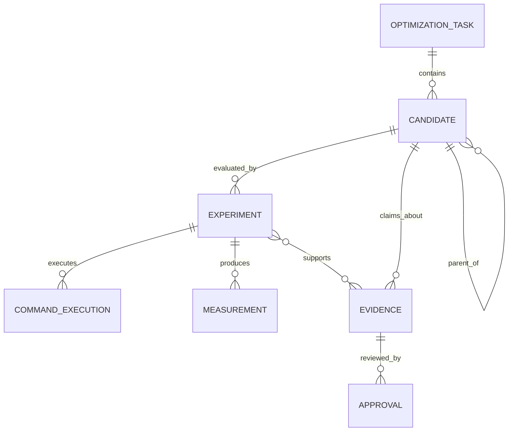
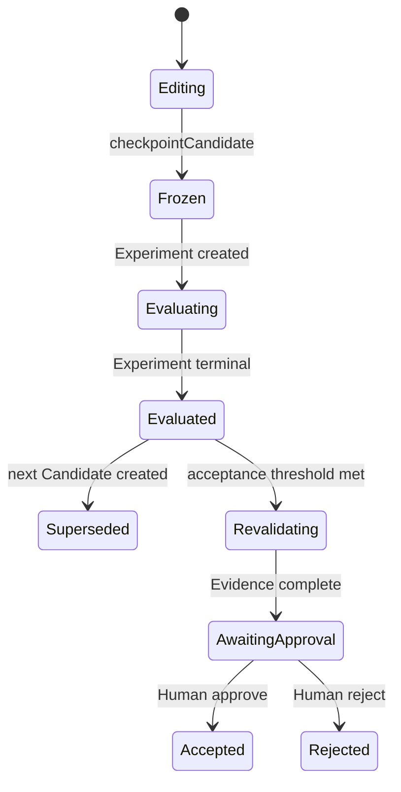
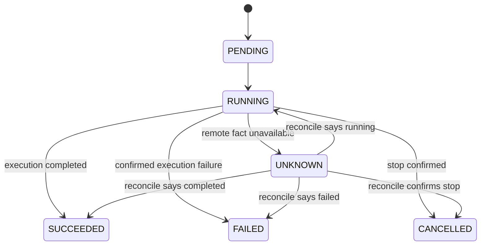

# PhyOpt Architecture

本文是 PhyOpt 的主要架构文档。产品范围和优先级以 `docs/PRD.md` 为准；本文描述如何把当前 `phyopt-agent` 逐步演进为该产品，而不是在现有项目旁边建设第二套系统。

基线 commit：`09d4d9e7b2080b77037837145c9333e34f059f1a`。

## 1. System Context

PhyOpt 是面向飞腾 CPU 的自动性能工程系统。性能工程师在 Control Plane 定义目标、启动优化、观察实验并审批；Optimization Agent 只负责分析和产生 Candidate；运行在飞腾 ARM Linux 上的 `phyopt-runner` 机械地执行受控实验；Formal Evaluator 和真实硬件提供最终事实。

```mermaid
flowchart LR
    H[Performance Engineer] --> CLI[Existing CLI / Interactive UI]
    CLI --> CP[Control Plane<br/>Optimization Runtime]
    CP --> A[Existing Model Adapter<br/>Pi Agent Loop]
    A --> C[Existing Git Candidate<br/>Worktrees]
    CP -->|HTTP/JSON RPC| R[phyopt-runner<br/>Execution Plane]
    CP -. bootstrap / update / diagnostics .->|SSH| R
    R --> E[Formal Evaluator]
    R --> M[Phytium CPU / S5000C]
    R -->|status / raw facts / artifacts| CP
    CP --> DB[(Existing SQLite<br/>evolved schema)]
    CP --> AP[Human Approval]
```

不可变边界：Agent 可以提出答案，但不能决定答案是否正确或更快；`SUCCEEDED` 只表示 Experiment 的执行流程完成，不等于 correctness pass、performance improvement 或 approval。

## 2. Control Plane

Control Plane 继续运行在开发机或管理节点，并由现有进程逐步演进：

- `src/entry.ts`、`src/cli.ts` 和 `src/cli-interactive/**` 继续作为产品入口。
- `src/http/server.ts` 继续承载本机控制 API；它逐步从 workflow summary API 转向 Task/Candidate/Experiment/Evidence API。
- `src/model/**` 与 `src/agent/pi-agent-loop.ts` 继续提供可替换的 Intelligence Provider。
- `src/workflow/optimization-workflow-service.ts` 是当前真实 public optimize 入口，将逐步收敛为统一 Optimization Runtime 的外观，而不是被复制。
- `src/workspace/candidate-workspace.ts` 继续管理 Git baseline、editing/validation worktree、checkpoint 和 source identity。
- `src/storage/sqlite-task-store.ts` 继续作为 V1 durable store；新增领域事实与旧记录共存，直到旧 workflow JSON 不再承担核心语义。
- `src/core/task-host.ts` 中 lease、retry、resume、cancel、reconcile 和 UNKNOWN 处理思想被复用到真实 runtime；其 MockRunner 产品路径不成为新正式入口。

Control Plane 不在目标机内调用模型，不用模型输出替代正式实验，也不把一次 HTTP 请求的生命周期当作 Experiment 生命周期。

## 3. Execution Plane

Execution Plane 运行在飞腾 ARM Linux 目标机。第一版只需服务一台受控 S5000C，但边界不允许把 SGEMV 字段写入通用运行时。

Execution Plane 负责：

- 提供稳定、版本化的 HTTP/JSON RPC；
- 维护独立于 RPC/SSH 连接的 Experiment/Job 状态；
- 探测 machine、CPU、topology、NUMA、OS、kernel 和 toolchain；
- staging 固定 Candidate，并核验 identity；
- 应用 CPU affinity、NUMA 和 thread policy；
- 执行 Build、Formal Correctness、Formal Performance；
- 保存 command records、raw measurements 和 artifacts；
- 响应 status、cancel、measurement/artifact 获取和 reconcile。

Execution Plane 不负责读取产品目标、生成优化假设、调用大模型、选择下一轮 Candidate 或作出 Human Approval。

## 4. phyopt-runner

`phyopt-runner` 是现有 runner/validation 能力的演进方向，不是一个平行产品。

第一阶段复用：

- `src/workspace/validation-runner.ts` 的受限命令执行、timeout、cancel 和 output capture；
- `src/runner/runner.ts` 的 availability/run/cancel/reconcile 语义；
- `src/testpack/remote-transport.ts` 的 SSH 能力仅用于部署、诊断和过渡；
- TaskHost 已验证的 UNKNOWN、cancel confirmation 和 reconcile 规则。

第一阶段 runner 保持薄：单机进程、有限并发、HTTP/JSON、明确 experiment ID。复杂 scheduler、分布式数据库、模型推理、搜索和知识检索不进入 runner。

Runner 内部的执行顺序由 Experiment Plan 声明；runner 只报告事实。正式状态至少为 `PENDING`、`RUNNING`、`SUCCEEDED`、`FAILED`、`CANCELLED`、`UNKNOWN`。Evaluation Result 与 lifecycle status 分离。

## 5. RPC

V1 使用 HTTP/JSON，但业务边界是 RPC Contract，而不是特定 Web 框架。

| RPC | 语义 |
| --- | --- |
| `GET /health` | runner identity、version、capabilities 和时间 |
| `GET /machine` | observed machine context |
| `POST /experiments` | 持久接受一个已有 identity 的 Experiment Plan，立即返回 experiment ID |
| `GET /experiments/:id` | 查询 durable lifecycle 和 current step |
| `POST /experiments/:id/cancel` | 请求取消；只有确认停止后才为 `CANCELLED` |
| `GET /experiments/:id/measurements` | 获取逐 case/sample raw measurements |
| `GET /experiments/:id/artifacts` | 获取带 digest 的 artifact index |
| `POST /experiments/:id/reconcile` | 网络或控制面恢复后核对远端事实 |

RPC request timeout 不会把 Experiment 标为失败。Control Plane 无法获取远端事实时记录 `UNKNOWN` 并 reconcile。RPC 必须认证，协议版本不兼容时拒绝执行，不产生模糊结果。

## 6. SSH Bootstrap

SSH 保留并复用当前 target configuration、profile、identity file 和 transport 代码，用于：

- 安装、启动和更新 `phyopt-runner`；
- 初次写入 runner 配置和认证材料；
- 健康诊断、日志排障与受控 fallback；
- runner 尚未部署时的迁移期兼容。

目标状态下，SSH 子进程退出不代表 Experiment 退出。正式 Experiment 不再由 Control Plane 长时间持有 SSH 子进程完成。当前 `stageRemoteCandidate()` 和 remote command 仍可作为迁移适配器，但不再扩展成最终远端 runtime。

## 7. Optimization Runtime

Optimization Runtime 是唯一正式编排语义。它从现有 `OptimizationWorkflowService` 原位演进：

1. intake 创建 `OptimizationTask`，旧 `workflow_id` 暂时作为兼容关联；
2. Agent 每轮完成修改后，现有 `checkpointCandidate()` 形成稳定 Git identity，并登记独立 `Candidate`；
3. 每次正式 validation 在执行前创建 `Experiment`；
4. Build、Correctness、Performance 是该 Experiment 的 steps，完整 command facts 与 raw Measurement 追加保存；
5. Runtime 把结构化结果反馈给现有 Pi Agent loop；
6. 未达标产生后继 Candidate 和新 Experiment，不覆盖历史；
7. 达标后用冻结 Candidate 创建独立 Revalidation Experiment；
8. 完整 Evidence 才能进入 Human Approval。

迁移期允许 workflow summary 继续服务旧 CLI，但它只是兼容投影；Task/Candidate/Experiment/Measurement/Evidence 的 SQLite 记录成为事实来源。`TaskHost` 不再发展第二套真实优化语义，其可靠性机制逐步下沉到统一 runtime。

## 8. Domain Model



- **OptimizationTask**：目标、范围、baseline、Evaluator、资源、预算和接受条件的责任单元。
- **Candidate**：某一轮冻结源码状态；记录 parent、Git commit/tree、source archive hash、changed files、hypothesis 和 Agent identity。
- **Experiment**：固定 Candidate/Baseline/Evaluator/Context 下的一次执行；重试和 revalidation 都产生新 Experiment。
- **CommandExecution**：Experiment step 的原始进程事实，包括 command、args、cwd、时间、duration、exit、stdout/stderr、timeout 和 cancelled。
- **Measurement**：Evaluator 直接产生的逐 case/sample 原始观察；通用 Core 只认识 identity、kind、role、value、unit 和 domain payload。
- **Evidence**：对有限 claim 的受检 Measurement、identity、context 与 evaluation summary 的引用，不等于单个 Measurement。
- **Approval**：具名工程师对 Candidate 和有限 claim 的 durable 决定。

这些对象有独立 identity 和生命周期。旧 `OptimizationWorkflowRecord` 不再同时代表全部对象。

## 9. Agent Boundary

现有 `WorkspaceToolset` 和 Pi Agent loop 保留。Agent 可以：

- 阅读整个 Candidate source tree；
- 修改 Candidate worktree 内允许的源码；
- 使用项目测试、快速 benchmark、profiling 和临时脚本获取 Development Feedback；
- 接收上一轮 Experiment 的结构化 build/correctness/performance 反馈。

Agent 不得写 Formal Evaluator、baseline artifact、formal workload、measurement policy 或 acceptance policy。当前 `WorkspaceToolset` 只保护 `.git`、`.phyopt`、`node_modules`，尚不足以构成该边界；迁移过程中 Formal Evaluator 必须位于 Candidate worktree 之外并由 runner 核验 identity。

原始 stdout/stderr 保存在 Experiment 中，但反馈给模型的是有界结构：build failure 摘要、failed correctness cases、per-workload median/speedup/regression。这样既保留审计事实，也避免用海量日志污染 Agent context。

## 10. Evaluator Boundary

Formal Evaluator 是独立信任域，至少包含：

- correctness oracle、case inventory、input/reference/tolerance policy；
- formal benchmark、workload 和 sampling policy；
- baseline artifact 与 identity；
- acceptance/regression policy；
- owner、version 和 digest。

Development Feedback 即使复用相同 case 或 benchmark source，也不自动成为 Formal Evidence。Formal execution 由 runner 从 Candidate 不可写位置装载 evaluator，并在执行前后核验 identity。parser failure、case 缺失或 evaluator drift 属于 Evaluator Failure/Invalid Experiment，不判 Candidate 成败。

## 11. Candidate Lifecycle



每次 checkpoint 都产生新 Candidate identity，即使上一轮失败也保留。Parent 指向上一轮 Candidate；第一轮 parent 为空并关联 Task 的 Source Baseline。Candidate 进入 Formal Experiment 后冻结，继续修改必须生成后继 Candidate。Git commit/tree/source archive hash 继续由现有 CandidateWorkspace 提供。

## 12. Experiment Lifecycle



Experiment 在执行前持久化 plan 和 identity。Build Failure 使 Correctness/Performance 为 `NOT_EXECUTED`；Correctness Failure 阻止正式 performance acceptance；Performance Regression 与 Target Not Met 是 evaluation 结果，不应伪装成进程启动失败。基础设施、资源、Evaluator 和 Candidate failure 分别记录。

首次 formal evaluation 和 Revalidation 是不同 Experiment。`SUCCEEDED` 只表示计划执行完成，Evaluation Result 再说明 correctness、performance、regression 和 evidence completeness。

## 13. Measurement / Evidence

正式 performance 至少保存：

- workload identity 与 domain parameters；
- baseline/candidate role 与 sample order；
- warmup/loop policy；
- 每个 raw sample、单位、时间和 validity；
- baseline median、candidate median、per-workload speedup；
- critical regression 结果；
- Candidate/Baseline binary、Evaluator 与 observed context 引用。

V1 使用简单可解释的 repeated samples + median。复杂 bootstrap 是可选 policy，不进入通用 Core。Outlier 不被删除；无效 sample 连同预声明原因保留。

Evidence 引用 Measurement，而不是复制一个孤立 ratio。缺 Candidate、Baseline、Evaluator、observed context、required correctness 或 raw performance 任一关键事实时，Evidence 为 `INCOMPLETE`，不能批准。

## 14. Persistence

V1 继续使用同一个 SQLite 文件和 `SqliteTaskStore`，以新增 append-oriented 表演进：

- Optimization Task 当前状态可更新，但定义和 identity 可追踪；
- Candidate 只追加，不用 `latest_candidate` 覆盖历史；
- Experiment 每次 formal attempt/revalidation 独立追加；
- Command execution 和 Measurement 逐条追加；
- Evidence 与 Approval 有独立记录；
- 旧 `tasks/jobs/events/optimization_workflows` 在兼容期保留。

数据库存储事实，artifact store 保存较大 binary/log/package；V1 可以先把有界 stdout/stderr 保存在 command record 中。API key、SSH 私钥和 bearer token 不进入领域记录。

## 15. Failure / Recovery

统一 runtime 复用 TaskHost 已有的 lease、idempotent command、cancel confirmation 和 reconcile 原则：

- Control Plane 重启后从 SQLite 列出 Task/Candidate/Experiment；
- `PENDING` 可安全调度，`RUNNING`/`UNKNOWN` 必须查询 runner，不自动重跑；
- RPC/SSH 中断只产生 `UNKNOWN`，不会推导 success/fail；
- retry 创建新 Experiment attempt，不覆盖旧 Experiment；
- cancel request 与 confirmed `CANCELLED` 分离；
- 已完成 command/measurement 在进程退出后仍保留；
- runner 与 Control DB 不一致时标记 Evidence incomplete 并要求 reconcile。

第一阶段 public workflow 仍有进程内 Promise/AbortController；接入领域记录只是迁移第一步，不把该限制隐藏为已解决。

## 16. Hardware Context

Experiment 同时记录 Declared Context 和 Observed Context：

- machine/runner identity；
- CPU model/architecture、core/socket/topology、NUMA；
- OS、kernel、compiler/toolchain；
- CPU set、NUMA policy、thread count；
- resource reservation/conflict state；
- baseline/candidate/evaluator/benchmark binary identity；
- 影响首个 workload 的必要 machine state。

Runner 的 `/machine` 提供可观察事实，formal step 再记录实际 binding。V1 只实现 S5000C 所需 probe 和 control，不建设通用硬件数据库。

## 17. SGEMV Domain

首个 domain 是 S5000C 上的 float32、column-major、NoTrans `cblas_sgemv`。主要源码入口为 `kernel/arm64/gemv_n.S`，必要时包含 `driver/level2/gemv_thread.c` 和相关调用链。

SGEMV domain package 拥有：

- `m/n/lda/incx/incy/alpha/beta/threads` 等 case/workload parameters；
- correctness inventory、reference、tolerance 和 guards；
- benchmark source、workload matrix、warmup/sampling/regression policy；
- S5000C evaluator/baseline identity。

通用 Domain Model 只保存这些参数的 opaque domain payload，不为 BLAS 增加核心字段。现有 `testpacks/sgemv-n.yaml`、`testpacks/sgemv-n/versions/1.0.1`、`benchmark-assets/sgemv-n/1.0.2`、`testplans/sgemv-n/1.0.4` 和 `build-inputs/sgemv-s5000c/1.0.1` 是迁移输入；它们的 case/script/CSV-JSON 不一致必须在成为 Formal Evaluator 前消除。

## 18. Current Code → Target Architecture Mapping

| 当前代码 | 当前真实作用 | 演进位置 | 本轮策略 |
| --- | --- | --- | --- |
| `src/entry.ts`, `src/cli.ts` | CLI 与后台入口 | Control Plane CLI | 保留；逐步显示 Task/Experiment/Evidence |
| `src/cli-interactive/**` | Interactive UI | Control Plane UI | 保留，不重写 |
| `src/model/**` | Model discovery/transport/Pi provider | Intelligence Adapter | 保留，后续补 Agent identity/cost |
| `src/agent/pi-agent-loop.ts` | Tool-call loop | Optimization Agent | 保留；接收结构化实验反馈 |
| `src/agent/workspace-tools.ts` | Candidate 文件/开发工具 | Candidate Domain tools | 保留；formal evaluator 移出其写域 |
| `src/workspace/candidate-workspace.ts` | Git worktree/checkpoint/source identity | Candidate Manager | 保留并登记每轮 Candidate |
| `src/workflow/public-agent-workflow.ts` | 真实单 lineage 优化循环 | Optimization Runtime loop | 原位接入 Candidate/Experiment records |
| `src/workflow/optimization-workflow-service.ts` | public optimize backend | Runtime service facade | 原位演进；workflow JSON 降为兼容投影 |
| `src/workspace/validation-runner.ts` | 本地/SSH command launcher | Experiment step adapter | 增加完整 command facts、case/sample results；随后由 RPC client 替换远端路径 |
| `src/storage/sqlite-task-store.ts` | mock task 与 latest workflow JSON | Domain Store | 同库新增 Task/Candidate/Experiment/Measurement/Evidence |
| `src/core/task-host.ts` | durable mock scheduling/recovery | Runtime lifecycle mechanisms | 复用 lease/retry/resume/reconcile 思想，不保留第二正式 runtime |
| `src/runner/runner.ts` | TaskHost runner protocol | Execution abstraction | 演进/适配为 experiment RPC 语义 |
| `src/runner/mock-runner.ts` | 模拟执行 | Tests only | 保留测试，不进入正式 UX |
| `src/testpack/remote-transport.ts` | SSH/scp | Bootstrap/transition adapter | 保留，正式实验逐步切到 RPC |
| `src/http/server.ts` | Control API | Control Plane API | 保留并逐步增加真实领域查询 |
| testpacks/benchmark-assets/testplans | SGEMV 历史实验资产 | SGEMV Formal Evaluator package | 统一 contract 后复用，不原样宣称可信 |

## 19. Deprecated / Legacy Paths

以下路径不会在第一轮大规模删除，但不再获得新的产品能力：

- VS Code extension：暂停，不进入 V1 主链；
- 旧 Knowledge runtime/packaging：历史资料保留 reference，不阻塞 clean build；
- Mock task product UX：TaskHost/MockRunner 只用于测试可靠性机制；
- 旧 remote helper/dead paths：不再扩展；
- latest-only workflow JSON：兼容读取/展示，逐步由领域记录替代；
- SSH 长连接 experiment runtime：迁移期 fallback，目标是 runner RPC。

Deprecated 表示不再作为目标架构扩展点，不表示本轮立即删除文件或破坏兼容接口。

## 20. Evolution Path

演进必须保持每一步可运行：

1. **Domain facts in existing main path**：在当前 SQLite 和 public optimize 中登记 Task、每轮 Candidate、每次 Experiment、完整 command 与 raw performance samples；旧 workflow API 保持可用。
2. **Thin runner skeleton**：在 `src/runner` 内建立可运行 HTTP/JSON 服务、machine probe 和异步 experiment identity；暂不替换当前 SSH validation。
3. **RPC transition adapter**：给现有 OptimizationWorkflowService 注入 runner client，让 formal validation 从 SSH adapter 切换为 RPC，CLI/Agent/Candidate 不变。
4. **Formal evaluator isolation**：把 SGEMV evaluator 放入 Candidate 不可写域，修通参数化 correctness 和 benchmark contract。
5. **Resource/context enforcement**：runner 实际施加并观测 CPU/NUMA/thread，持久化 binary/toolchain/machine identity。
6. **Unified recovery**：将 TaskHost 的 lease/reconcile 能力接入真实 Optimization Runtime，workflow summary 只做兼容视图。
7. **Evidence/revalidation/approval gate**：独立复验产生新 Experiment/Evidence，现有 merge 前置到完整 Human Approval。
8. **Legacy retirement**：主链稳定、数据迁移和 clean checkout 验证完成后，再移除 mock UX、旧 workflow store 和 SSH runtime。

当前实现检查点（2026-09-28）：第 1～3 步已形成可运行迁移链路；第 4 步已加入受信 Evaluator bundle 契约和 RPC 执行域隔离。RPC formal/revalidation 现在要求 evaluator 的 `id/version/owner/root/sha256`，Control Plane 在启动前核验本地 bundle，Runner 将 Candidate/Evaluator 目录分开，并在每个 evaluator step 前后重新核验完整目录 digest。命令事实、失败分类和观察到的 evaluator identity 均持久化。

这仍不等于 SGEMV Formal Evaluator 已获得资格：当前 `testpacks/sgemv-n.yaml` 仍是 legacy/development 参考，尚未绑定 owner 批准的独立 bundle；同一 OS 用户下的目录分离与 digest 漂移检测也不等价于强对抗性的 UID/container sandbox。因而 RPC 模式会在模型或 Runner 调用前拒绝缺少 evaluator identity 的 testpack，直到 SGEMV evaluator 资产、权限模型和目标机 qualification 完成。

Multi-candidate Search、Knowledge/Experience、RL、自动 Model Router、GPU/NPU、多 CPU vendor 和复杂 UI 不属于上述 V1 落地路径。
