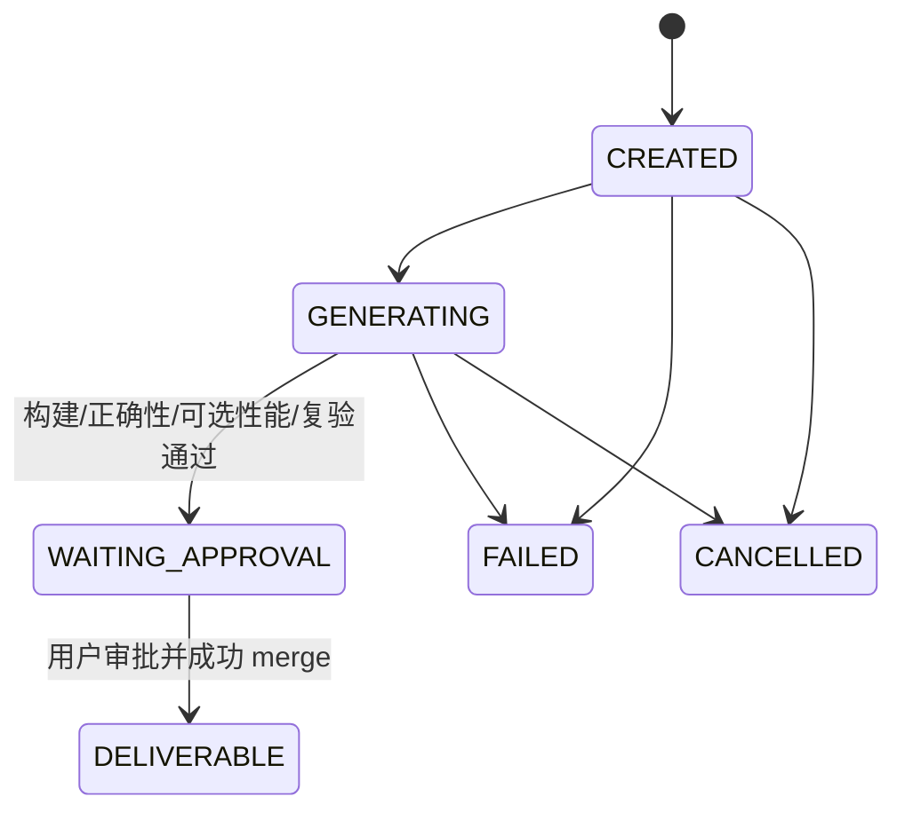

# PhyOpt Current State

## 1. Audit Scope

本文件是对当前仓库的 As-Is Audit，只陈述源码、测试和实际调用关系中已经存在的事实，不把 README、历史设计文档、注释中的目标状态视为已实现能力，也不包含未来架构或改造方案。

### 1.1 审计基线

| 项目 | 值 |
| --- | --- |
| 分支 | `main` |
| HEAD commit | `09d4d9e7b2080b77037837145c9333e34f059f1a` |
| HEAD 标题 | `移除测试与开发日志跟踪` |
| 审计日期 | 2026-09-23（Asia/Shanghai） |
| 审计方法 | 静态阅读源码、配置、测试与文档；追踪实际调用链；未执行构建、测试、模型请求或远端命令 |

最近 10 个提交为：

```text
09d4d9e 移除测试与开发日志跟踪
b1d6a4a 新增小米MIMO模型
ebb01f1 GLM、Kimi、Doubao、GPT 和自定义模型使用同一套持久化逻辑, GET /models 成功后立即保存 API Key,网络失败、tool call失败不删key
7fbfd39 fix：首页build交互
c5dd8a3 放宽 Node.js 最低运行版本要求
47e852f 重构 public optimize 工作流并移除旧 D13 链路
164ac9d feat(cli): 统一命令规范并完善 YAML 配置
6941d14 feat(config): 完善可复现 YAML 配置与中文注释
050f8ee fix(workflow): bind candidate patches and evidence
5f9da7e feat(workflow): connect multi-candidate optimize entry
```

审计开始时工作树并非纯 HEAD 快照，已有一项用户未提交修改：

```text
 M src/cli-interactive/commands.ts
```

该差异删除了 `/build` 和 `/target` 菜单中的显式“返回”选项，并改为依赖 Esc 返回。本文审计的是“上述确定 commit + 该项既有工作树差异”的实际源码状态；审计过程没有改动该文件。

### 1.2 覆盖范围

本次实际检查了以下仓库区域：

- CLI、Ink 交互 UI、命令注册与命令实现：`src/entry.ts`、`src/cli.ts`、`src/cli-command-spec.ts`、`src/cli-interactive/**`。
- 配置、模型凭据、代理、目标机与构建配置：`src/config/**`、根目录 YAML 和 `examples/**`。
- 模型发现、Pi 适配、tool-call 验证和 Agent 循环：`src/model/**`、`src/agent/**`。
- public optimize 工作流、候选工作树、构建、正确性、性能和复验：`src/workflow/**`、`src/workspace/**`、`src/testpack/**`。
- HTTP、后台生命周期、SQLite、通用 TaskHost 状态机和 Runner：`src/http/**`、`src/backend/**`、`src/storage/**`、`src/core/**`、`src/runner/**`。
- SGEMV testpack、benchmark、build-input、testplan、source archive manifest 和知识资料：`testpacks/**`、`benchmark-assets/**`、`build-inputs/**`、`testplans/**`、`source-archives/**`、`docs/knowledge/**`。
- VS Code 扩展、打包脚本、远端辅助脚本、示例与 fixture：`extensions/vscode/**`、`scripts/**`、`fixtures/**`。
- 本地存在但已被 Git 忽略的 `tests/**`，以及当前提交是否包含这些测试。

### 1.3 状态词定义

本文能力矩阵只使用以下状态：

- `IMPLEMENTED`：真实代码位于可达主调用链，能够执行其声明的职责，并有源码或测试证据。
- `PARTIAL`：存在真实实现，但有明显缺口、未执行的契约字段、运行环境限制或可靠性边界。
- `MOCK`：主要执行依赖 mock、fake、stub 或固定模拟场景。
- `HARDCODED`：功能存在，但绑定具体算法、库、机器、路径、benchmark、baseline 或厂商目录。
- `NOT_IMPLEMENTED`：只有接口、文档、历史资产或残留调用方，没有当前可用的真实实现。

## 2. What PhyOpt Is Today

1. 当前 PhyOpt 是一个 Node.js CLI 和本地 HTTP 后台组合，公开主入口是 `phyopt optimize --config ... --function ...`，无参数时进入 Ink 交互工作台。
2. public optimize 主链会真实调用 OpenAI-compatible 模型，经 Pi 执行多轮 tool-call Agent，Agent 直接修改独立 Git editing worktree 中的真实文件，而不是返回 patch。
3. 系统会从一个确定的 Git baseline commit 创建 editing 和 validation 两个 worktree，按轮提交候选 checkpoint，再在干净 validation worktree 或 SSH 目标机执行用户配置的命令。
4. 构建命令、正确性命令和可选性能命令是真实进程调用；是否“正确”主要由命令退出码决定，性能门槛只接受特定 JSON 输出格式。
5. 通过复验后，工作流停在 `WAITING_APPROVAL`；用户审批时才把候选 commit 合并到当前基准分支并删除两个本地 worktree。
6. 当前只有一个随轮次持续演进的候选，没有多个独立候选、候选排名、搜索种群或候选选择器。
7. SQLite 会保存 public workflow 的摘要状态和部分来源身份，但运行中的 Promise、取消控制器、模型对话、原始命令输出和逐样本性能数据不持久化。
8. 仓库还保留一套通用 `/v1/tasks`、TaskHost、状态机、lease、retry/resume/reconcile 体系，但当前默认且实际装配的是 `MockRunner`；它不是 public optimize 的执行或恢复引擎。
9. 仓库中的唯一运行时 testpack 是高度绑定 SGEMV/OpenBLAS/PhyBLAS/固定机器路径的样例，而且当前 YAML 没有给脚本传入必需参数，其性能输出格式也不符合运行时解析器，因此不能视为已跑通的开箱即用优化链路。
10. 现状更准确地说是“已有真实模型、Git、命令执行和审批合并骨架的优化编排实现”，而不是已经具备独立、抗篡改、可恢复、可复现且经真实 ARM 硬件证明的通用自动优化产品。

## 3. Current Architecture

### 3.1 当前运行时架构

```mermaid
flowchart TD
    U[用户]
    CLI[src/entry.ts\nsrc/cli.ts]
    UI[Ink 工作台\nsrc/cli-interactive]
    BM[BackendManager\n本地后台复用/拉起]
    HTTP[src/http/server.ts]

    U --> CLI
    CLI -->|无参数| UI
    UI -->|/optimize /workflow| BM
    CLI -->|optimize/workflow| BM
    BM --> HTTP

    subgraph P[真实 public optimize 平面]
      WSVC[OptimizationWorkflowService]
      PREF[配置与 testpack 预检]
      PI[Pi 模型 + tool-call 验证]
      LOOP[Pi Agent loop]
      TOOLS[WorkspaceToolset]
      EDIT[editing worktree]
      CHECKPOINT[Git candidate checkpoint]
      VALID[validation worktree]
      LOCAL[本地命令进程]
      SSH[SSH/scp + 远端候选目录]
      GATE[正确性/可选性能门槛/复验]
      APPROVE[审批、merge commit、清理本地 worktree]

      WSVC --> PREF --> PI --> LOOP
      LOOP <--> TOOLS
      TOOLS <--> EDIT
      EDIT --> CHECKPOINT --> VALID
      VALID --> LOCAL
      VALID --> SSH
      LOCAL --> GATE
      SSH --> GATE
      GATE -->|失败且未超轮次| LOOP
      GATE -->|通过| APPROVE
    end

    subgraph T[通用 TaskHost 平面]
      TASKAPI[/v1/tasks]
      HOST[TaskHost + 状态机 + lease]
      MOCK[MockRunner]
      TASKAPI --> HOST --> MOCK
    end

    HTTP --> WSVC
    HTTP --> TASKAPI
    DB[(SQLite\ntasks/jobs/events/commands/optimization_workflows)]
    WSVC --> DB
    HOST --> DB

    ASSETS[历史/专项资产\nbenchmark-assets build-inputs testplans knowledge]
    EXT[VS Code 扩展旧实现]
    ASSETS -. 当前主链未装载 .-> P
    EXT -. 导入多个已删除模块 .-> HTTP
```

### 3.2 两个执行平面的边界

| 平面 | 真实入口 | Runner/执行器 | 持久化与恢复事实 |
| --- | --- | --- | --- |
| public optimize | `POST /v1/workflows` → `OptimizationWorkflowService.submitPublic()` | `runPublicAgentWorkflow()`、本地 `spawn()`、`SshTransport` | 保存 workflow JSON；不由 TaskHost 调度；进程重启不续跑 |
| 通用 task | `POST /v1/tasks` → `TaskHost.createTask()` | `TaskHost` 默认 `new MockRunner(job.scenario)` | 状态机、lease、retry/resume/reconcile 较完整，但执行结果是模拟结果 |

`src/cli.ts::serve()` 同时装配这两个平面。`--transport ssh` 决定的是 public workflow 的 validation transport；它没有把真实 SSH Runner 注入 TaskHost。

### 3.3 模块职责现状

| 区域 | 当前职责 | 关键证据 |
| --- | --- | --- |
| CLI/UI | 参数解析、交互配置、提交/查询/审批命令、后台自动启动 | `src/cli.ts::runCli()`；`src/cli-interactive/commands.ts::runCommandArgs()` |
| Configuration | 严格解析 public YAML、拒绝未知字段、解析路径与密钥来源 | `src/config/optimization-config.ts::parseOptimizationConfig()` |
| Model | `/models` 动态发现、Pi 动态 provider、代理、tool-call 探针 | `discoverOpenAIModels()`、`createPiModels()`、`verifyToolCalling()` |
| Intelligence | 多轮模型/工具循环；仓库搜索、读写与验证工具 | `runPiAgentLoop()`、`WorkspaceToolset` |
| Workflow | public workflow 生命周期、轮次反馈和审批状态 | `OptimizationWorkflowService`、`runPublicAgentWorkflow()` |
| Candidate | 双 worktree、checkpoint commit/tree/file SHA、合并 | `candidate-workspace.ts`、`candidate-approval.ts` |
| Validation | 用户命令执行、可选远端 staging、性能门槛、复验 | `validation-runner.ts` |
| Target/SSH | 目标配置、连接探测、同步 ssh/scp | `target-config.ts`、`remote-transport.ts` |
| Persistence | SQLite task 表和 workflow JSON | `SqliteTaskStore`、`SqliteOptimizationWorkflowStore` |
| Generic Task | 状态机、任务 lease、重试/恢复模型 | `TaskHost`，但其默认执行器为 `MockRunner` |
| Assets/knowledge | 大量 SGEMV 历史资产和文档 | 当前 `src/**` 没有装载这些目录的运行时调用 |
| VS Code | 旧 experiment/patch/candidate UI 源码 | 导入多个当前不存在的模块，不能构建为当前产品能力 |

## 4. Current End-to-End Flow

### 4.1 用户启动与配置

```text
phyopt（无参数）
  → src/entry.ts
  → src/cli.ts::runCli()
  → src/cli-interactive/start.ts::startInteractive()
  → WorkbenchContext
  → 若 phyopt.yaml 存在：ensureBackend()，并从 /v1/tasks 读取首页“最近活动”
  → 若 phyopt.yaml 不存在：不启动后台，显示“请编辑您的优化配置文件”
```

配置命令的当前事实：

- `/model`：选择内置厂商或自定义 OpenAI-compatible endpoint；要求非空 API Key；调用 `GET <endpoint>/models`；选择模型；执行一次真实最小 tool call；把模型配置写入 YAML，把 Key 按 endpoint 明文保存在用户目录 `~/.phyopt/credentials.json`。
- GPT 来源额外支持直连或用户提供的 HTTP/HTTPS/SOCKS5 代理，并把代理保存在 `~/.phyopt/settings.json`。其他内置来源的交互流程不显示代理选择，但手写 YAML 的 `model.proxy` 仍由运行时通用解析。
- `/target`：选择已有用户级 profile，或配置 host/username/port/私钥路径，或填写 SSH Alias；随后真实执行 `uname -m`、`id -un` 和工作目录创建/删除探测；profile 写到 `~/.phyopt/targets.json`。
- `/build`：把一条无 shell 运算符的 executable/args 命令、相对源码根目录的 cwd、环境变量和超时写入 YAML。复杂 shell 流程只能由用户放入脚本后把脚本作为 executable/args 调用。
- `/config`：原样显示 YAML 文件内容；若 YAML 中直接写了 API Key，它也会被原样显示。

### 4.2 public optimize 实际调用链

```text
phyopt optimize --config <yaml> --function <name> [--file <entry>] [--performance]
  → parseOptimizeCliInput()
  → 从当前调用目录解析算法库 Git root
  → loadOptimizationConfig() + resolveOptimizationApiKey()
  → BackendManager.ensure()
  → ApiClient.submitOptimizationWorkflow()
  → POST /v1/workflows
  → OptimizationWorkflowService.submitPublic()
  → loadPublicOptimizationPreflight()
  → SQLite 写入 CREATED
  → executePublic()
       → createModelTransport()
       → createPiModels()
       → verifyToolCalling()
       → ensureCandidateRepository()
       → freezeValidationTestpack()
       → runPublicAgentWorkflow()
            → createCandidateWorkspace()：editing + validation
            → 可选优先读取 --file，但不限制全仓库读写
            → runPiAgentLoop() + WorkspaceToolset
            → checkpointCandidate()
            → 可选 stageRemoteCandidate()：tar + scp + SSH 解压
            → runValidationCycle()：build → correctness → optional performance
            → evaluatePerformanceGate()（仅 --performance）
            → runRevalidationCycle()：formal → independent
            → 失败反馈给同一 Agent 候选继续下一轮，最多 8 轮
       → SQLite 写入 WAITING_APPROVAL 或 FAILED/CANCELLED
  → 用户 phyopt workflow approve ...
  → approveAndCleanup()
  → 校验 baseline HEAD 与工作区洁净度
  → merge --no-ff --no-commit + 用户提交说明
  → 删除本地 editing/validation worktree
  → SQLite 写入 DELIVERABLE
```

### 4.3 逐步输入、输出与数据去向

| 步骤 | 入口与主要函数 | 输入 | 输出/调用 | 是否真实执行 | 数据去向 |
| --- | --- | --- | --- | --- | --- |
| 1. CLI 解析 | `src/config/optimize-cli-input.ts::parseOptimizeCliInput()` | config、函数、可选入口文件、性能开关、可选 API Key | 绝对 config 路径、调用目录 Git root | 是 | 仅内存 |
| 2. 配置预检 | `loadPublicOptimizationPreflight()` | YAML 和 validation testpack | 严格类型对象、config SHA、testpack digest、已解析密钥 | 是 | 初始摘要写 SQLite；完整 config 未快照 |
| 3. 后台 | `BackendManager.ensure()` | URL、DB 路径、SSH 参数 | 复用兼容后台或拉起 detached 子进程 | 是 | `.phyopt/backend.json`、`.phyopt/backend/*.log` |
| 4. HTTP intake | `http/server.ts::handle()` | JSON body，API Key 可在自定义 header | `workflow_id` | 是 | Key 只传入内存；workflow record 写 SQLite |
| 5. 模型验证 | `verifyToolCalling()` | endpoint、model id、Key、代理、思考强度 | 必须收到 `phyopt_probe` tool call | 是 | 结果仅控制流程，不单独持久化 |
| 6. 基准准备 | `ensureCandidateRepository()` | 算法库目录 | Git root 与 HEAD commit；无 Git 时执行 init/add/commit | 是，且无 Git 时会修改用户目录 | baseline commit 写 SQLite |
| 7. 双工作树 | `createCandidateWorkspace()` | baseline commit、run id | detached editing/validation worktree | 是 | 本机临时目录 `os.tmpdir()/phyopt-worktrees/...` |
| 8. Agent | `runPiAgentLoop()`、`WorkspaceToolset` | 函数名、入口预览、全仓库工具、验证反馈 | 直接文件修改与最终文本 | 是 | 文件落 editing tree；对话与最终文本不持久化 |
| 9. Agent 内验证工具 | `run_build/run_correctness/run_performance` | 配置命令 | 本机 editing tree 中执行命令 | 是 | 输出只返回模型上下文；构建产物留在 editing tree |
| 10. 候选 checkpoint | `checkpointCandidate()` | editing tree | commit、tree、变更文件前后 SHA、源码内容哈希 | 是 | Git 对象与 workflow 摘要 |
| 11. 远端 staging | `stageRemoteCandidate()` | 候选 commit 的 Git archive | 临时 tar、scp、远端清目录并解压 | SSH 模式真实执行 | 本地 tar 随即删除；远端目录不会在审批后清理 |
| 12. 验证 | `runValidationCycle()` | build/testpack commands | 退出码、stdout/stderr、时长 | 是 | 只把摘要写 SQLite，原始输出只在内存 |
| 13. 性能门槛 | `parsePerformanceMeasurements()`、`evaluatePerformanceGate()` | 性能命令 stdout 中的 JSON measurements | 加权几何平均、overall/key lower bound | 是，但只识别固定 JSON 字段 | 汇总值写 SQLite；原始样本不写入 |
| 14. 复验 | `runRevalidationCycle()` | candidate commit、formal/independent command | 每项重新建干净 validation tree 并重跑 build/check | 是 | 只保存命令摘要 |
| 15. 审批交付 | `approveCandidate()` | workflow id、commit message、baseline identity | merge commit/tree | 是 | 用户算法库 Git 历史；SQLite 状态 |
| 16. 取消 | `OptimizationWorkflowService.cancel()` | workflow id | AbortController abort | 仅同一后台进程内有效 | SQLite 写 CANCELLED；不自动清理工作树或远端目录 |

### 4.4 public workflow 状态



内部 `PERFORMANCE_THRESHOLD_NOT_MET` 最终会被 service 映射为持久化状态 `FAILED`，而不是独立的 workflow 状态。当前没有 public workflow 的 list、retry 或 resume API。

### 4.5 通用 TaskHost 的实际调用链

```text
POST /v1/tasks（必须提供 success/failure/no-resources/... 模拟 scenario）
  → TaskHost.createTask()
  → SQLite tasks/jobs/events/commands
  → scheduler + lease + state machine
  → 默认 runnerFactory：MockRunner
  → 模拟 availability/run/cancel/reconcile
```

该平面有真正的 SQLite 状态机和调度代码，但没有真实 SSH/ARM/优化 Runner。`scripts/phyopt-remote-agent.sh` 实现了一个远端 job 状态协议，却没有任何当前生产源码调用它。

### 4.6 当前数据位置

| 数据 | 位置 | 当前内容 |
| --- | --- | --- |
| public workflow/task 状态 | `<config-dir>/.phyopt/workflow.sqlite`（仅当该项目启动后台时） | workflow JSON、task/job/event/command/lease |
| 后台状态与日志 | `<config-dir>/.phyopt/backend.json`、`.phyopt/backend/` | pid、shutdown token、启动信息、stdout/stderr 日志 |
| validation snapshot | `<output_dir>/<run-id>/validation-testpack.json` | 冻结后的 testpack 对象和 digest |
| 模型 Key | `~/.phyopt/credentials.json` | 按 endpoint 保存的明文 Key |
| 模型代理 | `~/.phyopt/settings.json` | 按 endpoint 保存的代理 URL |
| 目标 profiles | `~/.phyopt/targets.json` | host/user/port/私钥路径/Alias/workspace，不含私钥内容 |
| 编辑与验证源码 | 系统临时目录下 `phyopt-worktrees/<repo-id>/<run-id>/` | 两个 Git worktree |
| 远端候选 | `<target.workspace_root>/<run-id>/validation` | 候选源码、构建产物和命令产生的数据 |
| 原始 stdout/stderr、模型对话、逐样本性能数据 | 无持久化位置 | 仅本次进程内存在 |

## 5. Capability Matrix

| Capability | Status | Implementation | Evidence | Limitations |
| --- | --- | --- | --- | --- |
| CLI 可执行入口 | IMPLEMENTED | ESM entry、help/version、optimize/workflow/backend/serve | `src/entry.ts`；`src/cli.ts::runCli()` | 错误只输出文本和退出码；无 workflow list |
| Ink 交互工作台 | IMPLEMENTED | 首页、slash menu、历史、补全、Prompt、Esc、Shift+Enter、多行和 resize 处理 | `src/cli-interactive/app.tsx`、`start.ts` | 首页“最近活动”读取的是 `/v1/tasks`，不是 optimize workflows |
| 命令系统 | IMPLEMENTED | 单一命令 registry 连接 `/optimize`、`/workflow`、`/task`、`/model`、`/build`、`/target`、`/config` | `src/cli-command-spec.ts`、`registry.ts`、`commands.ts` | `/task` 与 `/workflow` 属于不同执行平面 |
| public YAML 配置 | IMPLEMENTED | 严格字段校验、未知字段拒绝、相对路径解析、SHA-256 | `parseOptimizationConfig()`、`loadOptimizationConfig()` | 不保存完整配置快照；根目录 tracked YAML 本身含机器特定信息 |
| 交互式模型配置 | PARTIAL | 内置来源、自定义 endpoint、动态模型列表、Key/代理持久化 | `configureModel()` | 所有来源都要求 API Key；无 Ollama 专用或无鉴权本地模型流程；首次建配置固定 SGEMV testpack |
| OpenAI-compatible 模型发现 | IMPLEMENTED | 带 Bearer Key 调用 `GET /models`，解析 `data` 或 `models` | `discoverOpenAIModels()` | endpoint 不提供标准 `/models` 时无法交互配置 |
| Pi provider 适配 | IMPLEMENTED | 为用户 endpoint 动态构造 Pi provider/model，不要求 YAML provider/name | `createPiModel()`、`createPiModels()` | context window、max tokens、compat flags 是代码内固定元数据 |
| 模型 tool-call 能力验证 | IMPLEMENTED | 真实最小请求必须返回 `phyopt_probe` tool call | `verifyToolCalling()` | 验证会产生真实供应商调用和费用；只证明一次探针响应 |
| Agent 多轮工具循环 | IMPLEMENTED | toolCall/toolResult 回灌；默认 32 turns、128 tool calls | `runPiAgentLoop()` | 对话、token usage、最终说明不持久化；无跨进程续跑 |
| 全仓库源码调查 | IMPLEMENTED | list/search/find/read 覆盖 editing tree，入口文件只是首读 | `WorkspaceToolset`；`runPublicAgentWorkflow()` | 搜索为同步全树文本扫描；除三个目录外没有敏感文件读取边界 |
| 直接修改真实文件 | IMPLEMENTED | write/create/replace/delete/move/revert | `WorkspaceToolset.execute()` | 只保护 `.git`、`.phyopt`、`node_modules`，测试、benchmark、构建脚本和 evaluator 都可改 |
| 非 Git 目录初始化 | IMPLEMENTED | 自动 `git init --initial-branch=main`、add、baseline commit | `ensureCandidateRepository()` | 会改变用户源码目录；已有仓库的未提交内容不进入 baseline worktree |
| 双 Git worktree 隔离 | IMPLEMENTED | baseline 派生 editing 与 validation；checkpoint 后刷新 validation | `createCandidateWorkspace()`、`refreshValidationWorkspace()` | 失败/取消不自动清理；远端目录不在审批清理范围 |
| Candidate 身份与追踪 | IMPLEMENTED | commit、tree、每个变更文件 before/after SHA、源码内容 hash | `checkpointCandidate()`；`OptimizationWorkflowRecord` | workflow 只保存最新 checkpoint；不记录最终二进制身份 |
| Build 执行 | IMPLEMENTED | `spawn()` 本地真实进程或 SSH 真实命令，退出码/超时/输出 | `runValidationCommand()` | Agent 工具阶段始终在本机 editing tree，可能与 ARM 正式环境不同 |
| Correctness validation | PARTIAL | build 成功后执行 testpack correctness command，非零退出失败 | `runValidationCycle()` | 不消费 `cases`、`pass_required`；不解析断言数；evaluator 可被 Agent 修改 |
| Performance measurement | PARTIAL | 可选执行 performance command 并计算三类门槛 | `parsePerformanceMeasurements()`、`evaluatePerformanceGate()` | 只接受 JSON；不执行 sampling/bootstrap/confidence_level；不保留原始样本 |
| 仓库自带 SGEMV testpack | HARDCODED | 固定 cblas_sgemv、18+18 cases、PhyBLAS/OpenBLAS baseline | `testpacks/sgemv-n.yaml` | 命令缺少脚本必需参数，性能脚本输出 CSV 而解析器要求 JSON；按当前定义不能直接通过主链 |
| 单候选迭代 | PARTIAL | 同一 editing branch 最多 8 轮修改、验证、反馈 | `runPublicAgentWorkflow()` | 不是多个独立候选；失败反馈主要只有 stderr |
| 多候选生成、探索与选择 | NOT_IMPLEMENTED | 当前源码没有 candidate population、排名或选择器 | `src/workflow/public-agent-workflow.ts` 只有一个 workspace/checkpoint | 历史文档中的 multi-candidate 不是当前运行时能力 |
| Experiment 管理 | NOT_IMPLEMENTED | 当前 public workflow 没有 experiment 实体或实验矩阵 | 当前 `src/**` 无 experiment 模块 | VS Code 仍导入已删除 experiment 模块，但调用链不可用 |
| Revalidation | PARTIAL | formal/independent 各自刷新干净 worktree、重建并运行命令 | `runRevalidationCycle()` | 只看退出码；不重新计算性能门槛；“独立”完全由同一可修改仓库内命令声明 |
| 用户审批与 Git 合并 | IMPLEMENTED | 检查 HEAD、工作区洁净度，merge commit 后清理本地 worktree | `approveCandidate()`、`approveAndCleanup()` | 提交说明完全由用户提供；无自动优化说明或交付报告 |
| Target 配置与连接检查 | IMPLEMENTED | direct SSH/Alias、Key/Agent、`uname/id/mkdir/rmdir` 检查、profiles | `configureTarget()`、`checkSshTarget()` | 不支持密码；实际验证目标要求 POSIX SSH 环境 |
| SSH 正式验证 | PARTIAL | Git archive、scp、远端 bash/tar、真实命令 | `SshTransport`、`stageRemoteCandidate()` | 同步 `spawnSync` 使超时/取消无法及时生效；无远端 kill/reconcile；只上传候选仓库 |
| CPU/NUMA/thread 控制 | NOT_IMPLEMENTED | testpack 中只解析、冻结并展示这些字段 | `validation-yaml.ts`、`validation-freeze.ts` | runner 不调用 taskset/numactl，也不设置线程；完全依赖命令脚本自行落实 |
| 正式测量资源锁 | NOT_IMPLEMENTED | public workflow 没有目标机/CPU/NUMA 互斥 | `OptimizationWorkflowService` 可并发启动多个 Promise | TaskHost lease 只保护一个 SQLite scheduler，且不承载 public workflow |
| public workflow 持久化 | PARTIAL | workflow JSON upsert 到 SQLite | `SqliteOptimizationWorkflowStore`、`optimization_workflows` 表 | 无 list；无 event journal；原始输出、对话和运行控制器不持久化 |
| public workflow 取消 | PARTIAL | 同进程 AbortController | `OptimizationWorkflowService.cancel()` | 重启后无法取消；同步 SSH 阻塞期间无法可靠中断；远端进程状态未知 |
| public workflow 恢复/续跑 | NOT_IMPLEMENTED | 启动时不扫描和重新调度 `GENERATING` workflows | `OptimizationWorkflowService` 仅在 `submitPublic()` 建内存 Promise | `WAITING_APPROVAL` 仅在 worktree 仍在时可能在重启后继续审批 |
| 通用 TaskHost 状态机 | MOCK | SQLite 状态、lease、retry/resume/reconcile 代码真实 | `TaskHost`、`state-machine.ts` | 默认 Runner 是 `MockRunner`，所有 `/v1/tasks` scenario 都是模拟 |
| 真实远端 Task Runner | NOT_IMPLEMENTED | 无 Runner 调用 SSH 或 `phyopt-remote-agent.sh` | `src/runner/**` 只有 interface 与 mock | 远端 helper 是未接线脚本 |
| Knowledge retrieval | NOT_IMPLEMENTED | Agent 只能普通搜索仓库文件 | 当前 `src/**` 无 knowledge 模块 | `docs/knowledge` 不被加载；生成脚本依赖不存在的 `dist/knowledge` 模块 |
| Report / optimization hypothesis | NOT_IMPLEMENTED | workflow status 仅保存/显示状态、阶段、错误和部分摘要 | service 不保存 `result.agent`；`reportDir` 未使用 | 没有报告生成器；模型最终说明和优化假说丢失 |
| Artifact / delivery package | PARTIAL | 有 Git candidate commit 和 frozen testpack JSON | candidate workspace、`freezeValidationTestpack()` | 临时 source tar 被删除；无二进制、原始结果、manifest 或独立交付包 |
| Secret handling | PARTIAL | Key 不进 workflow body/SQLite；常见 provider error 会脱敏；POSIX 尝试 0600 | `credentials.ts`、`redactOptimizationConfig()`、`sanitizePiError()` | Key 可明文 YAML/CLI argv/用户 JSON；Windows 无等价 ACL 强制；build environment 未脱敏 |
| ChatGPT Login/Codex subscription | NOT_IMPLEMENTED | 仅有待扩展 handoff 文档 | `docs/handoffs/openai-codex-chatgpt-extension.md` | 当前只支持 API Key 路径 |
| VS Code 产品能力 | NOT_IMPLEMENTED | 源码仍是旧 experiment/patch/candidate 工作台 | `extensions/vscode/src/extension.ts` | 导入多个不存在模块，端口和 API 也与当前主链不一致 |
| CLI 打包 | PARTIAL | 有 build/stage/npm-ci/tar 脚本 | `scripts/package-cli.mjs` | clean build 不生成 `dist/knowledge/*`，但打包脚本强制导入它们，依赖陈旧 dist 时才可能继续 |
| 自动化测试资产 | PARTIAL | 本机有 unit/local integration/mock 测试源码 | 本地忽略的 `tests/**` | HEAD 不跟踪这些测试，clean checkout 没有提交级测试证据；没有真实 ARM/SSH E2E |

## 6. Generic Components

下列实现本身没有绑定 SGEMV 算法名称，具备一定复用性；这里仅陈述现状，不代表其所有可靠性边界已经解决。

| 组件 | 已有通用抽象 | 现有边界 |
| --- | --- | --- |
| CLI 输入 | `--function` + 可选 `--file`，源码根由调用目录 Git root 推导 | 工作流仍要求单一函数名；没有多目标任务 |
| YAML loader | model/target/build/validation/output 五块严格 schema | validation schema 的 case 字段偏矩阵运算 |
| Model adapter | endpoint + model_id + API Key，统一走 Pi OpenAI-compatible API | 交互发现强依赖 `/models`，无无鉴权本地模型分支 |
| Model transport | 模型专用 HTTP/HTTPS/SOCKS5 proxy，不改变 SSH/后台网络 | UI 只对 GPT 暴露代理选择 |
| Agent loop | 与具体算法无关的 tool-call/result 循环和预算 | 没有持久化上下文或恢复 |
| Workspace tools | 通用的树遍历、搜索、读写、移动、Git 状态/diff | 文件保护范围很窄；验证脚本也在可写范围 |
| Git candidate lifecycle | 任意 Git 仓库可创建双 worktree、checkpoint、hash、merge | 不保存最终构建二进制身份；失败清理缺失 |
| Validation command | executable/args/cwd/environment/timeout 的通用命令模型 | “case/sampling/resource”不是通用执行引擎，只是部分元数据 |
| Remote transport | `RemoteValidationTransport` 可替换 SSH 或 mock | 真实实现同步阻塞且假设 POSIX bash/tar/scp |
| Backend/API | health probe、兼容性检查、managed spawn/shutdown | 普通 workflow/task API 无认证；后台复用不校验 DB 身份 |
| SQLite TaskHost | task/job/event/command、状态机、lease、幂等 command | 当前只配 MockRunner，不能代表真实优化任务管理 |
| 交互 UI primitives | 多行编辑、secret prompt、选择器、Esc、resize、slash menu | recent activity 数据源不是 optimize workflow |

## 7. Domain-Coupled Components

### 7.1 算法、基础库与 workload 绑定

| 位置（file + symbol/区域） | 绑定内容 | 影响 |
| --- | --- | --- |
| `src/cli-interactive/commands.ts::configureModel()` | 首次创建 YAML 固定 `./testpacks/sgemv-n.yaml` | 任意新项目首次配置都会被默认指向 SGEMV testpack |
| `src/contracts/validation-testpack.ts::ValidationCase` | 固定 `m`、`n`、`threads`、`seed`、`critical`、`weight` | 难以原样表达压缩、网络、存储、图像等非矩阵 workload |
| `testpacks/sgemv-n.yaml` | `cblas_sgemv`、GEMV-N、float32、18 个 correctness 和 18 个 performance case | 唯一运行时 testpack 完全绑定 SGEMV |
| `testpacks/sgemv-n.yaml::performance.baselines` | PhyBLAS 与 OpenBLAS release033、个人绝对路径、固定 SHA | baseline 无法直接迁移到其他机器或库，且这些身份当前不被运行时验证 |
| `testpacks/sgemv-n/**/run_sgemv_v1_correctness.sh` | SGEMV 可执行文件参数、固定 case、`numactl`、CPU 0-15、线程数 | 正确性逻辑由专项脚本决定，不是通用 case runner |
| `testpacks/sgemv-n/**/run_sgemv_three_way.sh` | release033/KML/candidate 三方比较、固定矩阵与线程、CSV | 绑定特定友商/开源基线，且输出不符合当前 JSON parser |
| `benchmark-assets/sgemv-*` | cblas_sgemv、OpenBLAS 头文件、固定库路径和动态链接验证格式 | 是 SGEMV 专项历史资产；当前主链未装载这些 manifest/parser |
| `build-inputs/sgemv-s5000c/**` | SGEMV、OpenBLAS 风格构建、FT2000、S5000C | 只能描述既定硬件/库实验，不是运行时通用 build input |
| `build-inputs/s2500/**` | SGEMV 调用链、S2500 NUMA/CPU 策略 | 机器和函数强耦合，且当前 runtime 不读取该 manifest |
| `testplans/sgemv-n/**` | cblas_sgemv、固定 `/tmp` 路径、OpenBLAS release033、CPU 0-15、numactl/taskset | 大量可复现设计停留在静态资产，未连接当前 validator |
| `source-archives/sgemv-n/**` | 特定 BLAS SGEMV 源码 archive manifest | tar.gz 本身被忽略，runtime 不消费 manifest |
| `docs/knowledge/sgemv-n-methodology.md` | SGEMV 方法学 | 只是文档，当前 Agent 没有结构化检索/注入链路 |
| `fixtures/dot-product/**` | dot-product 小型 C fixture | 仅 fixture，不是当前产品优化或验证入口 |

### 7.2 机器、目录和产品默认值绑定

| 位置 | 绑定内容 | 影响 |
| --- | --- | --- |
| `phyopt.yaml` | DeepSeek 模型、`10.31.31.65`、用户 `chenmn`、本机私钥绝对路径、FT2000/OpenMP/32 线程、Windows testpack 绝对路径 | 根目录默认配置携带个人机器和单一项目环境，不能直接作为通用默认值 |
| `phyopt-s5000c.yaml` | Kimi、`phytium-s5000c`、FT2000、OpenMP、32 线程 | 固定 Phytium/OpenBLAS 风格环境 |
| `examples/sgemv/phyopt.yaml` | Kimi、S5000C、FT2000、SGEMV testpack | 示例只证明一个设想场景，不证明其他算法库通用性 |
| `src/cli-interactive/homepage.ts::SUBTITLE`、`package.json::description` | “面向 ARM 的代码/基础算法库优化” | UI 和包定位明确绑定 ARM 领域 |
| `src/model/model-sources.ts::MODEL_SOURCES` | DeepSeek/Qwen/GLM/Kimi/Doubao/MiMo/OpenAI endpoint 与开发者平台 URL | 模型 ID 动态，但厂商目录和 endpoint 仍需源码维护 |
| `src/cli.ts::serverUrl()`、`BackendManager` | 默认 `127.0.0.1:4317` | 单端口后台被多个项目复用时，实际 DB 可能属于先启动后台的项目 |
| `src/config/target-config.ts::DEFAULT_WORKSPACE_ROOT` | `/tmp/phyopt` | 默认假设 POSIX 远端；正式 staging 也要求 `/` 开头路径 |
| `runPublicAgentWorkflow()`、`runPiAgentLoop()` | 8 个 workflow rounds、32 turns、128 tool calls、64 KiB entry preview | 固定预算可能影响不同规模仓库，但 YAML 无法配置这些值 |
| `validation-runner.ts::MAX_OUTPUT` | 本地命令每路输出上限 2 MiB | 超过后静默截断尾部之后的内容，且仍不持久化原始输出 |

## 8. Reliability Audit

### 8.1 十六项核心检查

| 检查项 | 当前事实 | 证据 | 结论 |
| --- | --- | --- | --- |
| 1. Correctness 是否独立于 Agent | correctness 命令由 workflow 在 validation tree 执行，模型不能直接伪造 `CommandRunResult`；但 Agent 可改命令引用的测试、脚本、Makefile 和 evaluator | `runValidationCycle()`；`WorkspaceToolset.assertWritable()` | 部分独立，不是抗篡改 evaluator |
| 2. Benchmark 是否可能被候选修改 | 可以。写保护只覆盖 `.git`、`.phyopt`、`node_modules` | `workspace-tools.ts::assertWritable()` | 候选可同时改变被测代码和测量代码 |
| 3. Source identity 是否固定 | baseline commit、candidate commit/tree、文件 SHA、validation tree 内容 hash 被记录 | `checkpointCandidate()`；`OptimizationWorkflowRecord` | 本地源码身份较强；未校验远端解压后的内容，已有仓库 dirty 内容不进入基准 |
| 4. Baseline identity 是否固定 | Git baseline HEAD 固定；performance baseline 只有 testpack 中的 id/path/SHA 声明 | `ensureCandidateRepository()`；`ValidationBaseline` | 对比库文件 SHA 没有运行时校验 |
| 5. Binary identity 是否记录 | 没有保存候选库、基线库、benchmark executable 或编译产物 SHA | `OptimizationWorkflowRecord` 无相应字段 | 未记录 |
| 6. CPU/NUMA/thread 是否受控 | 字段会解析、冻结、显示给 Agent；runner 不施加 | `parseValidationTestpack()`；`runValidationCommand()` | 仅脚本自觉执行时才受控 |
| 7. 正式测量是否有资源锁 | public workflow 没有目标机、CPU 或 NUMA 锁，可并发运行 | service 的 `running` Map 按 workflow 保存 Promise，无互斥 | 没有正式测量锁 |
| 8. 测量失败如何处理 | 命令非零、超时或性能门槛失败会把错误反馈给同一 Agent 进入下一轮；最多 8 轮，随后 FAILED | `runPublicAgentWorkflow()` | 有有限重试，但无分类重试策略；原始证据不保留 |
| 9. SSH 中断如何处理 | `SshTransport.runRemote()` 使用同步 `spawnSync`；外层 Promise race 无法在阻塞期间触发 timer/abort；没有远端 kill/status | `remote-transport.ts`；`runRemoteValidationCommand()` | 无法可靠确认或终止远端进程 |
| 10. 进程退出后能否恢复 | public Promise/AbortController 只在内存，后台启动不扫描未完成 workflow | `OptimizationWorkflowService.running/controllers` | 不能恢复 GENERATING；TaskHost 恢复逻辑不适用于 public workflow |
| 11. Candidate 是否可追踪 | 最新候选有 commit/tree/文件 SHA/源码 hash，轮次 commit 在 Git 历史链中 | `checkpointCandidate()` | workflow record 只指向最新轮次；模型理由和运行输出未绑定 |
| 12. Revalidation 是否真正重新执行 | 每个 required 项前刷新 validation worktree、重新 build、重新运行命令；远端也重新上传 | `runRevalidationCycle()` | 是重新执行，但只看退出码，不重算性能 gate，且 evaluator 仍属于候选源码 |
| 13. 原始性能数据是否保留 | 不保留 stdout/stderr 或逐样本 measurements | `summarizeCommand()` 只保存摘要 | 不保留 |
| 14. 最终结果是否可重现 | 有 commit/hash/testpack snapshot，但缺配置快照、toolchain、环境、二进制身份、原始样本和资源执行证明 | workflow record 与 output dir 内容 | 只能部分追溯，不能完整复现 |
| 15. API Key/Secret 是否可能落盘或进日志 | Key 可在 YAML、CLI argv、`~/.phyopt/credentials.json` 明文；错误有脱敏，workflow 不存 Key | config/credentials/model provider | 仍有落盘、shell history/process argv 和终端显示面 |
| 16. Agent 能否修改 test/benchmark/evaluator | 能，也能修改构建脚本后调用 run_build/run_correctness/run_performance，从而间接执行修改后的脚本 | `WorkspaceToolset` + 验证工具 | 当前没有可信验证边界 |

### 8.2 Correctness 细节

- `runValidationCycle()` 对 correctness 的唯一通用判定是进程 `exit_code === 0`；没有解析“通过多少 case”或数值误差。
- `correctness.cases` 和 `correctness.pass_required` 只在 YAML parser 中做结构校验并进入冻结摘要，runner 不遍历这些 case，也不检查 `pass_required`。
- build 失败时，返回结构把同一个 build result 同时放进 `build` 和 `correctness` 字段，持久化摘要无法表示“correctness 根本未运行”这一事实。
- 当前 SGEMV correctness command 没传 `CANDIDATE_EXE OUTPUT_FILE [CPU_LIST]`，脚本会打印 usage 并以 2 退出。

### 8.3 Performance 细节

- `performance.cases` 的 weight 和 key case 会被 gate 使用，但 runner 不根据 cases 生成命令行；命令只执行一次。
- `sampling.warmup`、`samples`、`interleave_seed`、`bootstrap_iterations` 和 `thresholds.confidence_level` 没有执行逻辑。
- parser 只接受 JSON 数组或逐行 JSON，且至少包含 `case_id`、`candidate_time`、`comparison_time`。当前 `run_sgemv_three_way.sh` 产生 CSV/文件输出，无法形成 measurements。
- `ci_lower` 若缺失，gate 直接用单次 ratio 代替，并不计算置信区间。
- testpack 中 current/comparison baseline 的 `path` 和 `sha256` 不会被 validator 打开或校验，也不会自动传给性能命令。
- performance gate 通过后，formal/independent revalidation 不再调用 `evaluatePerformanceGate()`；当前 independent 命令即使跑性能脚本，也只检查退出码。

### 8.4 Source、构建与环境身份

- 已有 Git 仓库以当前 HEAD 为 baseline；用户工作区中的 tracked/untracked dirty 修改不会进入 detached worktree。
- 无 Git 仓库时，PhyOpt 会在用户源码目录执行 `git init`、设置临时 repo identity、`git add -A` 和 baseline commit。
- checkpoint 会排除一组常见 `.o/.obj/.a/.so/.d/.pyc/CMakeFiles/.phyopt` 产物；未覆盖的生成文件仍可能进入候选 commit。
- 远端只收到 `git archive` 的候选 commit，不会上传 testpack 所在目录的任意外部资产。testpack 脚本若不在候选仓库同一路径，远端命令找不到它。
- `stageRemoteCandidate()` 计算 tar SHA 并放入内存 session，但没有让远端重新计算并比对，持久化 record 保存的是 validation tree 内容 hash，而不是远端解压证明。
- Agent 的验证工具始终在本机 editing tree 执行；正式验证才使用 SSH target。因此模型修复阶段和正式 ARM 测量阶段可能是不同 OS、ISA、依赖与工具链。

### 8.5 Persistence 与 Recovery

- SQLite `optimization_workflows` 表只保存一列 workflow JSON 和更新时间，没有逐事件日志或 compare-and-swap 状态转换。
- public workflow 的 `running` Promise 与 `AbortController` 仅在进程内 Map 中；service 构造时不恢复未完成项。
- backend shutdown 调用 `service.stop()` 只发 abort 并立即清空 Map，不等待 public workflow 完成或保存远端最终状态。
- 失败和取消不会调用 `removeCandidateWorkspace()`；只有审批 merge 成功后清理两个本地 worktree。
- 远端 validation 目录没有工作流结束清理逻辑。
- 没有 workflow list API。用户若丢失 workflow id，CLI 无法枚举 SQLite 中的 workflow。
- `WAITING_APPROVAL` 记录在重启后仍可读取；如果本地 worktree 和 Git 对象仍存在，审批路径可能继续工作，但这不是通用恢复机制。
- TaskHost 的 lease/reconcile/retry/resume 是另一条 mock task 链，不能据此声称 public optimize 可恢复。

### 8.6 Security 与 Secret Handling

正面事实：

- SSH 使用 `BatchMode=yes`，不接收密码输入，不设置 `StrictHostKeyChecking=no`，不会自动接受未知 host key。
- YAML direct target 只保存私钥路径，不保存私钥内容；target profile 也不保存密码。
- workflow request 的 API Key 使用 header 传给后台，record 不保存 Key；模型错误包含 Key/Bearer 时会做字符串脱敏。
- writing/search path 会阻止 `..` 越出 worktree，拒绝经过中间 symlink，并保护 `.git/.phyopt/node_modules`。
- credentials/settings/targets/backend state 在 POSIX 上尝试用 `0600` 文件权限。

限制事实：

- 手写 YAML 可直接包含明文 `model.api_key`；`--api-key` 可进入 shell history 和进程参数；`credentials.json` 本身是明文 JSON。
- Windows 上 Node 的 mode 参数不构成等价 ACL 强制。
- `/config` 原样显示 YAML；直接写在 YAML 的 Key 会显示在终端。
- `redactOptimizationConfig()` 不脱敏 `build.environment`，`read_build_context` 会把完整 build environment 返回模型。如果用户把 token 放入构建环境，模型能够看到。
- Agent 可以读取 worktree 中除三个保护目录外的任何 tracked 文件，包括项目自身的 `.env`、凭据文件或测试资产。
- Agent 虽没有任意 shell tool，但可以修改 Makefile/构建脚本/验证脚本，再调用配置好的执行工具，实际命令运行在本机或 SSH 用户权限下，没有额外 sandbox。
- `/v1/workflows`、查询、取消、审批和 `/v1/tasks` 等普通 HTTP 路由没有认证；只有 managed shutdown route 有 token。若服务绑定到非 localhost，接口仍公开。
- 后台复用只校验 API version 和 runner 名，不校验目标 DB/config identity；同端口已有兼容后台时，新项目请求会写入已有后台所打开的 DB。

## 9. Test Reality

### 9.1 提交级事实

- `.gitignore` 明确忽略 `/tests/`。
- commit `09d4d9e7...` 中没有任何 tracked `tests/**` 文件。
- 当前工作目录本地仍有 46 个被忽略文件：43 个 `*.test.ts`、2 个 helper TypeScript 文件、1 个 AArch64 assembly fixture。
- 静态统计这些本地 test 文件共有 173 个 `test(...)` 调用。
- 本次审计遵守只读分析范围，没有运行 `npm test`，所以本文不声称这 173 项当前通过。
- 因为测试未提交，clean checkout 无法复现本机测试集，当前 commit 没有可随版本审计的自动化测试证据。

### 9.2 本地测试覆盖类型

| 类型 | 本地文件示例 | 实际覆盖 | 不能证明什么 |
| --- | --- | --- | --- |
| Unit | `optimization-config.test.ts`、`build-config.test.ts`、`homepage.test.ts`、`state-machine` 相关测试 | parser、格式化、状态转换、UI layout、代理/凭据逻辑 | 不证明真实模型、SSH、ARM 或 benchmark |
| Local integration | `candidate-workspace.test.ts`、`candidate-approval.test.ts`、`http-server.test.ts`、`persistence.test.ts` | 本地 Git worktree/merge、SQLite、localhost HTTP、本地进程 | 不证明跨机器行为或生产环境依赖 |
| Mock-based | `task-host.test.ts`、`resource-wait.test.ts`、`failure.test.ts` | MockRunner 的等待、失败、取消、lease、恢复 | 不证明真实资源管理或远端恢复 |
| Model stub/fake | `model-discovery.test.ts`、`tool-verification.test.ts`、`pi-agent-loop.test.ts`、`pi-wire.test.ts` | 注入 fetch、fake Pi message、本地 HTTP wire | 不调用真实云模型，不证明特定厂商 tool call 稳定性 |
| Public workflow component | `public-agent-workflow.test.ts`、`public-workflow-http.test.ts` | fake Agent、本地 `node -e process.exit(0)`、mock remote intake | 没有把真实模型 + SSH + ARM + SGEMV testpack 串成一条 E2E |
| SSH unit | `remote-transport.test.ts` | ssh/scp argv 构造 | 没有真正建立 SSH 连接或处理中断 |
| CLI rendering | `cli-*.test.ts` | Ink 输入、光标、resize、Esc、菜单、配置向导 | 不证明 optimize 结果正确 |
| VS Code smoke | `extensions/vscode/test/**` | 旧任务/report UI 设想 | 不在根 `npm test` 中，且扩展当前缺依赖、旧端口和旧 API |

### 9.3 缺失的真实验证证据

当前仓库和本地测试没有以下自动化证明：

- 真实 DeepSeek/Kimi/Qwen/GLM/Doubao/MiMo/OpenAI endpoint 的 Agent 全链路。
- 真实 SSH 命令、scp 上传、SSH 断开、远端超时或远端进程回收。
- 真实 ARM/Phytium 硬件构建与正确性。
- 当前 `testpacks/sgemv-n.yaml` 从 public CLI 到审批 merge 的完整成功运行。
- 当前 SGEMV 18 个 correctness case 确实全部执行并通过。
- 当前 SGEMV 18 个 performance case、采样、bootstrap、置信区间和门槛确实执行。
- baseline/candidate/benchmark 动态链接二进制身份在运行时被核验。
- CPU/NUMA/thread 约束和跨工作流资源互斥实际生效。
- public workflow 在后台 crash、主机重启或 SSH 中断后恢复。
- 最终报告、原始证据和交付包可由第三方复现。

`testpacks/**/historical`、`benchmark-assets/**` 和 `testplans/**` 中存在历史日志、CSV、manifest 和 qualification 文档；它们是历史/专项资料，不是当前 HEAD 主调用链执行所得的自动化测试结果。

## 10. Current User Experience

| 用户动作 | 当前实际体验 | 数据/限制 |
| --- | --- | --- |
| 启动 | 安装后运行 `phyopt`，开发时运行 `npm run --silent dev` | 无配置时显示“请编辑您的优化配置文件”，不会因缺 YAML 启后台 |
| 配置模型 | `/model` 选来源、输入/复用 Key、动态选 model、验证 tool call | Key 存用户 JSON；所有来源要求 Key；GPT 可选代理和思考强度 |
| 查看配置 | `/config` | 原样显示 YAML，包括可能存在的明文 Key |
| 配置目标机 | `/target` 选 profile 或新建 direct/Alias，选择 Agent/默认 Key 或私钥路径 | 保存前真实 SSH 探测；只支持非交互 Key 认证 |
| 配置构建 | `/build` 首次输入命令和 cwd，再次可修改环境/超时 | 不预填具体库命令；拒绝 shell operators；支持粘贴续行和 Shift+Enter |
| 启动优化 | `/optimize --function <name> [--file <entry>] [--performance]`，或同等顶层 CLI | 从命令调用目录解析算法库；提交后只立即返回 workflow id |
| 查看进度 | `/workflow status <id>` 或顶层 `phyopt workflow status <id>` | CLI 只显示状态、phase、error；不显示候选 diff、性能逐 case 或模型说明 |
| 查看所有优化任务 | 无 | `/task list` 只列通用 mock task，public workflows 没有 list API |
| 取消 | `/workflow cancel <id>` | 只对当前后台进程的 active workflow 有效；不保证中断同步 SSH/远端进程 |
| 恢复 | public workflow 无 resume/retry 命令 | `/task resume/retry` 只针对 MockRunner TaskHost 平面 |
| 获取结果 | 通过已知 id 查询 HTTP record，可看到部分 candidate/validation/performance 摘要 | 没有正式报告、原始日志、模型优化假说或可下载 artifact |
| 审批交付 | `/workflow approve <id> --commit-message <说明>` | 合并进当前基准分支并创建 merge commit；提交说明由用户自己写 |
| 拒绝/放弃候选 | 无专门命令 | 取消/失败也不自动删除本地 worktree 或远端目录 |
| 退出工作台 | `/exit`、Ctrl+C/Ctrl+D | managed backend 是 detached 进程，通常继续运行；可另用 backend stop |

## 11. Technical Debt / Structural Constraints

本节只记录现状和影响，不给出未来方案。

1. **双执行平面语义分裂**：public optimize 真实执行但恢复弱；TaskHost 恢复代码较完整但只运行 mock。用户可见的 `/workflow` 与 `/task` 名称并不能共享状态、取消或恢复能力。
2. **可信验证边界不存在**：Agent 可以修改测试、benchmark、evaluator、Makefile 和其随后会执行的脚本；冻结 testpack 对象不等于冻结脚本内容。
3. **testpack 契约大部分是描述性字段**：cases、pass_required、sampling、confidence、resources 和 baseline SHA 多数不驱动 runner；实际行为由单个命令自行决定。
4. **仓库自带 testpack 不可按当前参数直接运行**：correctness 脚本需要 2～3 个参数，performance 脚本需要 5～6 个参数，YAML 均未提供；性能数据还是 CSV 而运行时要求 JSON。
5. **外部 testpack 资产与远端 staging 断裂**：远端只上传候选 Git archive，位于配置仓库或其他目录的脚本/benchmark 不会被单独上传。
6. **Agent 环境与正式环境不同**：Agent 调用的 build/correctness/performance 总在本机 editing tree；正式 validation 才可能在 ARM SSH 目标执行。
7. **性能统计语义不足**：没有 runner 侧采样、交错、bootstrap 或 CI 计算；缺失 `ci_lower` 时直接用 ratio 替代。
8. **身份链停在源码层**：有 Git 和文件 hash，但没有产物 SHA、动态链接实际库、benchmark binary 或远端源码核验。
9. **SSH 生命周期不可控**：同步 `spawnSync` 阻塞事件循环，外层超时/abort 不能可靠打断；未接入已有 remote-agent 状态协议。
10. **public workflow 不是 durable scheduler**：状态可持久化，但执行控制不可持久化；重启后不会恢复、重试、reconcile 或清理。
11. **结果数据不足**：只持久化摘要，丢失 stdout/stderr、逐样本数据、Agent messages、最终说明、优化假说、配置快照和工具链信息。
12. **单候选模型**：每轮覆盖当前候选，没有独立候选身份集合、探索记录、对比、排名或 selection。
13. **用户可见状态不足**：无 workflow list，首页 recent activity 读取 mock task，CLI status 不展示已有的 candidate/performance 摘要。
14. **后台跨项目复用身份不完整**：health/reuse 只比较 API version 和 runner；同一 4317 端口上的兼容后台可能使用另一个项目的 SQLite 路径。
15. **失败资源残留**：失败/取消保留本地两个 worktree，成功审批也不清理远端 validation 目录。
16. **通用 schema 仍偏 BLAS**：`ValidationCase` 的核心字段固定为 m/n/threads/seed，仓库运行资产几乎全部是 SGEMV。
17. **测试不属于版本基线**：本地测试数量较多，但 `/tests` 被忽略且 HEAD 不包含测试；提交本身无法复现这些验证。
18. **VS Code 扩展陈旧**：扩展导入 `ide-task-client`、`experiment-*`、`candidate-generation`、旧 config/credential/git baseline 等不存在模块，默认端口仍为 7346，测试还调用已删除 report 写入 route。
19. **打包依赖陈旧产物**：`generate-knowledge-catalog.mjs` 导入当前源码不会生成的 `dist/knowledge/seed-records.js` 和 `verifier.js`；本机 stale dist 可掩盖 clean clone 问题。
20. **文档代际混杂**：tracked guides/handoffs/architecture 中仍描述 ResourceGrant、patch candidate、多候选、knowledge retrieval、experiment runner 和旧 VS Code 工作台；这些文档不能作为当前能力证据。

## 12. Current Product Boundary

### 12.1 当前版本能够可靠做到什么

在“用户提供有效 OpenAI-compatible 模型、正确的构建/验证命令、可用依赖和可访问目标机”的前提下，当前源码能够做到：

1. 严格读取一份 public YAML，解析 function + 可选 entry file，并自动启动或复用本地 workflow backend。
2. 验证模型具备 tool call 能力，让 Pi Agent 在隔离的 editing worktree 中搜索整个 Git 仓库并直接修改文件。
3. 把修改记录为确定的 candidate commit/tree/file hashes，并在独立 validation worktree 中真实执行用户提供的 build 与 validation 命令。
4. 在 SSH 模式下把完整候选 Git archive 上传到 POSIX 目标机并执行配置命令；在本地模式下执行同一命令模型。
5. 在命令均以 0 退出、可选性能 JSON 达到门槛且 formal/independent 命令通过后等待人工审批，并只在 baseline 未变化且工作区干净时 merge 候选。

这些能力证明了核心编排骨架不是纯 mock；它们不自动证明命令本身可信、测试口径独立、性能数据有效或结果可复现。

### 12.2 当前版本还不能声称做到什么

当前版本不能基于仓库事实声称：

1. 仓库自带 SGEMV testpack 已经通过当前 public optimize 主链。
2. correctness 是不可由 Agent 篡改的独立 oracle，或声明的 18 个 case 会由系统逐项执行和计数。
3. benchmark、baseline 和实际加载二进制身份得到系统级校验。
4. CPU、NUMA、线程数、采样、bootstrap、置信区间和正式测量资源锁由 PhyOpt 强制落实。
5. 性能结果具备完整原始样本、统计证据和第三方可复现性。
6. public workflow 能在后台 crash、主机重启、SSH 断线或 CLI 退出后自动恢复。
7. 取消一定会终止远端进程并清理本地/远端资源。
8. 已具备多候选生成、系统化 exploration、候选比较、ranking 或 selection。
9. 已具备真实 experiment 管理、真实资源调度或真实 TaskHost remote runner。
10. 已具备通用知识库检索、报告生成、优化假说保存或完整 artifact delivery。
11. 已经普适支持 BLAS 之外的图像、压缩、网络、存储或系统库 workload。
12. VS Code 扩展是当前可构建、可运行并与 public workflow 一致的产品入口。
13. ChatGPT Plus/Pro 登录、Codex subscription 或无 API Key 的 Ollama 本地模型已接入。
14. 当前 commit 的自动化测试可在 clean checkout 中直接复现，或当前版本已通过真实 ARM 硬件 E2E。

## Appendix A. Primary Evidence Index

| 事实 | 主要源码证据 |
| --- | --- |
| 顶层 CLI 与命令分派 | `src/entry.ts`；`src/cli.ts::runCli()` |
| 交互 UI | `src/cli-interactive/app.tsx::App`；`commands.ts::runCommandArgs()` |
| 配置与 secret resolution | `src/config/optimization-config.ts`；`credentials.ts`；`model-settings.ts` |
| 模型目录与发现 | `src/model/model-sources.ts::MODEL_SOURCES`；`model-discovery.ts` |
| Pi 模型与 tool verification | `src/model/pi-provider.ts`；`tool-verification.ts` |
| Agent loop 与工具 | `src/agent/pi-agent-loop.ts`；`workspace-tools.ts` |
| public service | `src/workflow/optimization-workflow-service.ts::OptimizationWorkflowService` |
| 优化轮次 | `src/workflow/public-agent-workflow.ts::runPublicAgentWorkflow()` |
| Git worktree/candidate | `src/workspace/candidate-workspace.ts`；`candidate-approval.ts` |
| 命令、SSH、性能与复验 | `src/workspace/validation-runner.ts`；`src/testpack/remote-transport.ts` |
| validation schema/freeze | `src/contracts/validation-testpack.ts`；`src/testpack/validation-yaml.ts`；`validation-freeze.ts` |
| HTTP routes | `src/http/server.ts::handle()` |
| SQLite | `src/storage/sqlite-task-store.ts`；`src/workflow/optimization-workflow.ts` |
| mock task plane | `src/core/task-host.ts`；`src/core/state-machine.ts`；`src/runner/mock-runner.ts` |
| 当前 SGEMV runtime 口径 | `testpacks/sgemv-n.yaml` 及 `versions/1.0.1/assets/script/**` |
| 未接线远端 helper | `scripts/phyopt-remote-agent.sh` |
| 陈旧扩展 | `extensions/vscode/src/extension.ts`、`extensions/vscode/test/**` |
| 打包知识依赖 | `scripts/package-cli.mjs`；`scripts/generate-knowledge-catalog.mjs` |

## Appendix B. Audit Interpretation Rules

- 文件、interface、class、注释或历史文档的存在，不等于该能力已经进入运行时调用链。
- mock/local stub 测试通过，不等于真实模型、SSH、ARM 或 benchmark 链路通过。
- 命令退出码为 0，只能证明该命令自行报告成功，不自动证明测试不可篡改或覆盖声明的 cases。
- testpack YAML 被 hash/freeze，只能固定 YAML 对象；它引用的脚本和二进制若未独立固定，验证口径仍未固定。
- Git source identity 不等于 binary identity，也不等于远端实际运行对象 identity。
- 本文件不采用历史 README/PRD 中与上述源码调用链冲突的声明。
