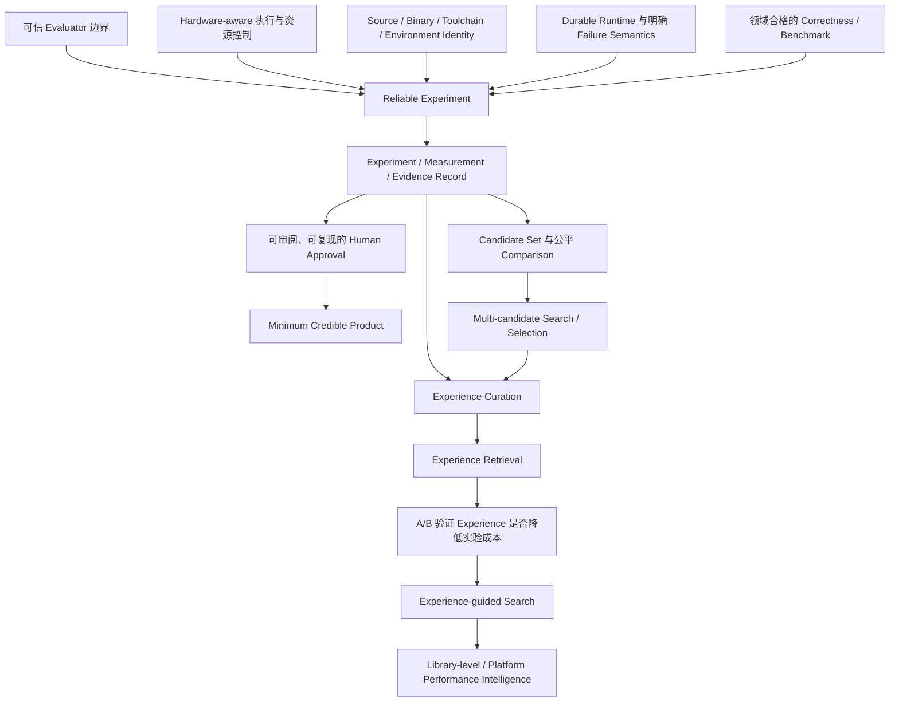

# PhyOpt Gap Analysis

## 1. Analysis Baseline

本分析回答“从当前实现走到 Vision，差在哪里”，不回答“具体如何实现”。分析基线如下：

| Baseline | Source |
| --- | --- |
| Current Fact | `docs/CURRENT-STATE.md` |
| Dynamically verified Current Fact | `docs/CURRENT-STATE-VERIFICATION.md` |
| Vision Requirement / Product Hypothesis | `docs/VISION.md` |
| Branch | `main` |
| Commit | `09d4d9e7b2080b77037837145c9333e34f059f1a` |
| Analysis date | 2026-09-24（Asia/Shanghai） |

若静态审计与动态验证冲突，以动态验证为准；历史 README、architecture、handoff 和旧 PRD 不作为目标状态依据。当前工作区原有 `src/cli-interactive/commands.ts` 修改与三份未跟踪基础文档均保持不变。

本文严格区分四种陈述：

- **Current Fact**：当前源码或动态验证已经证明的事实。
- **Vision Requirement**：PhyOpt 成为“面向飞腾 CPU 的自动性能工程系统”必须满足的产品语义。
- **Gap**：Current Fact 未满足 Vision Requirement 的部分。
- **Future Hypothesis**：可能产生长期价值、但尚未通过产品实验验证的判断。

Gap 的 primary category 只取 `FOUNDATION`、`RELIABILITY`、`ARCHITECTURE`、`PRODUCT`、`EXTENSIBILITY`、`DATA`、`INTELLIGENCE`、`UX`、`LEGACY` 之一。优先级含义为：`P0` 阻止可信产品核心成立；`P1` 核心成立后必须尽快补足；`P2` 有明显价值但不阻塞当前闭环；`P3` 属于长期研究或扩展。

## 2. Executive Summary

当前 PhyOpt 已有一条真实但不完整的优化编排骨架：它能调用 Model / Agent、修改隔离 Git worktree、记录候选源码身份、执行本地或 SSH 命令、做形式上的 validation/revalidation，并在人工批准后合并。动态验证也确认主项目可 clean build、关键模块可加载，双执行平面、默认 MockRunner、宽松工作树写权限、未执行资源与采样约束、单一最新候选和摘要持久化等事实成立。

距离 Vision 最大的差距不是“Agent 还不够聪明”，而是当前系统还不能形成一个**可信、可恢复、可复现的真实硬件实验事实链**。Agent 可以修改测试、benchmark、Makefile 和 evaluator；correctness 主要等于命令退出码；performance 只运行一次外部命令并消费 JSON；CPU、NUMA、线程、采样和置信区间字段不驱动 runner；binary、toolchain、machine state 和原始测量没有形成完整身份；所谓 independent revalidation 仍依赖候选可影响的命令。因此，现有流程能够“执行命令”，但不能稳定承担 Vision 中最终裁判的语义。

第二个根本差距是 Experiment、Measurement、Evidence、Experience 都不是一等产品实体。SQLite 保存的是 workflow 最新摘要，不是完整实验历史。原始 stdout/stderr、逐样本数据、失败尝试、假设、Agent 身份、候选谱系、决策原因和 profiling 均缺失。这直接阻塞可靠报告、多候选比较、搜索、经验复用和未来 Knowledge Flywheel。

第三个根本差距是 public optimize 与 TaskHost 两个执行平面分裂：前者拥有真实优化能力但运行控制主要在内存，后者拥有 lease、状态机、retry/resume/reconcile 等基础设施却只运行 MockRunner。该问题属于 `REWORK` 级责任边界问题；本阶段不决定它们是否合并或如何合并。

因此，PhyOpt 尚未达到 Minimum Credible Product。近期判断产品方向的顺序应是：先证明可信真机实验闭环，再证明 Agent 辅助优化和第二软件领域能够在相同可信边界内工作，最后才验证历史经验是否真的降低实验成本。Knowledge Graph、RL、自动模型路由和大规模搜索现在都早于其数据与裁判基础。

## 3. Existing Assets

下表评价的是资产相对于 Vision 的适用性，不是代码质量，也不直接表示删除或重构方案。

| Current asset | Classification | Why |
| --- | --- | --- |
| CLI / Interactive UI | EVOLVE | 已有可用入口、命令注册和配置体验；但首页活动来自 mock tasks，缺少真实 workflow 列表、Evidence 审阅和实验观察语义。 |
| Configuration | EVOLVE | 严格 YAML、未知字段拒绝、路径解析和摘要是正确基础；但配置未成为完整 execution-context snapshot，部分 schema 绑定 SGEMV/矩阵语义。 |
| Model integration | EVOLVE | endpoint + model ID + API Key、代理、动态发现和 Pi 适配提供了可替换基础；当前仍偏 OpenAI-compatible，能力元数据固定且运行记录不保存模型身份。 |
| Pi Agent loop | EVOLVE | 多轮 tool call/result 回灌和边界预算符合开放式智能职责；对话、假设、token/cost、最终说明和跨进程状态没有进入实验记录。 |
| Workspace tools | REWORK | 全仓库调查和真实文件修改是必要资产；现有写边界允许修改 evaluator、测试和构建脚本，破坏 Candidate/Evaluator 信任边界。 |
| OptimizationWorkflowService | REWORK | 已承载真实 public optimize 主链；执行控制仅在内存，状态摘要不足，且与 TaskHost 生命周期能力分裂。 |
| Public agent workflow | REWORK | 已形成编辑—构建—正确性—性能—反馈—复验循环；但单候选、实验非一等实体，Agent 工具阶段与正式裁判边界不可信。 |
| Git candidate / worktree | EVOLVE | baseline commit、editing/validation 分离、candidate commit/tree/file hash 是当前最强资产之一；仍缺多候选身份、完整 lineage、artifact/binary identity 和失败候选记录。 |
| Validation runner | REWORK | 受控 cwd、参数、超时、本地/远端执行有价值；当前本质是通用命令启动器，未兑现 testpack 的 cases、resources、sampling 和统计语义。 |
| Correctness | REWORK | 已有“build 成功后运行检查”的顺序；仅依赖退出码、忽略 case/pass_required，且 evaluator 可被候选影响，不能称为可信 correctness。 |
| Performance measurement | REWORK | 已有 measurement JSON 解析和门槛汇总；无重复采样、bootstrap、真实 CI、资源控制和原始数据持久化。 |
| Revalidation | REWORK | 每项前刷新 validation worktree 并重建是正确方向；当前“独立”来源不独立，也不重新执行正式性能 gate。 |
| SSH transport | EVOLVE | 能真实 scp 完整 candidate archive 并执行远端命令；同步阻塞、不可可靠取消、无远端状态确认和产物身份核验。 |
| Target configuration | EVOLVE | 主机、用户、端口、密钥、Alias、workspace 和连通性探测可复用；它描述的是 SSH 连接，不是 hardware-aware execution context。 |
| CPU / NUMA / thread resources | NEW | 字段虽存在于 testpack，但动态验证确认 runner 不执行；Vision 所需资源管理能力基本不存在。 |
| Persistence | REWORK | SQLite 和 workflow JSON 表明持久化入口存在；数据中心仍是“最新 workflow 摘要”，不是 Experiment/Evidence history 或可恢复运行日志。 |
| TaskHost | REWORK | lease、幂等 command、状态机、retry/resume/reconcile 是有价值的运行时资产；当前只承载 mock task，且不管理真实 optimize。 |
| State machine | REWORK | 状态转换和恢复规则有基础价值；当前状态语义属于 mock task plane，没有覆盖真实 candidate/experiment/remote execution 生命周期。 |
| MockRunner | KEEP | 作为隔离测试和故障场景模拟资产仍有价值；它必须被明确限制为测试/模拟工具，不能代表产品执行能力。 |
| Remote helper | RETIRE | 当前主链未接线，不能提供真实 remote runner 能力；其历史思路可参考，但现有路径不应被当作活跃产品资产。 |
| SGEMV testpack | REWORK | 它包含首个具体领域的大量 case、baseline 和方法学素材；当前参数缺失、CSV/JSON 不匹配、资源字段不执行，不能作为合格 evaluator。 |
| Knowledge assets | REWORK | SGEMV 方法和历史材料可能有领域价值；它们不是由 Experiment/Evidence 产生的 Experience，运行时检索不存在，旧构建路径还会破坏 clean packaging。 |
| VS Code extension | RETIRE | 当前无法构建并引用已删除的 experiment/patch/config 模块，与 public workflow API 和产品方向均不一致。 |
| Packaging | REWORK | 已有打包脚本和安装验证意图；clean checkout 动态验证因 stale `dist/knowledge` 依赖失败，不能形成可复现分发。 |
| Approval / merge | EVOLVE | 显式人工批准、baseline identity 和工作区洁净检查符合 Vision；批准界面缺少充分 Evidence、决策原因和可复现交付资料。 |
| Experiment model | NEW | Vision 所需但当前基本不存在。 |
| Trusted evaluator boundary | NEW | 当前 command 机制不等于可信 evaluator，Candidate 仍可影响裁判。 |
| Hardware-aware execution context | NEW | 当前 target 主要是 SSH address，缺少飞腾 CPU、机器状态和资源执行事实。 |
| Profiling record | NEW | Vision loop 中有 Profile / Analyze，当前主链没有 profiling 执行与证据记录。 |

## 4. Vision Invariant Assessment

| # | Vision invariant | Status | Current fact and gap |
| ---: | --- | --- | --- |
| 1 | Agent 不能作为 correctness 最终裁判 | PARTIAL | 最终状态来自 validation command，而不是 Agent 自述；但 Agent 能修改测试、脚本、Makefile 和 evaluator，裁判未与候选隔离。 |
| 2 | Agent 不能作为 performance 最终裁判 | PARTIAL | performance gate 使用命令输出而非模型判断；但 benchmark 可被候选影响，采样和统计也未由可信层执行。 |
| 3 | Candidate 与 Evaluator 形成可信边界 | VIOLATED | `WorkspaceToolset` 只保护 `.git`、`.phyopt`、`node_modules`；动态探针确认普通 test/benchmark/validation 文件可写。正式 validation 会使用这些文件。 |
| 4 | 正式结论绑定 execution context | PARTIAL | 有 baseline/candidate source identity、testpack digest 和 target 摘要；缺 binary、toolchain、实际环境、资源落实和 machine state identity。 |
| 5 | 优化成功必须有 Evidence | VIOLATED | workflow 可进入 `WAITING_APPROVAL`，但只持久化命令摘要与 gate 汇总；原始输出、samples 和完整事实链丢失。 |
| 6 | baseline / candidate 同口径比较 | PARTIAL | performance measurement 接受 paired times，testpack 也声明 baseline；runtime 不核验 baseline binary/hash、环境对称性或相同资源条件。 |
| 7 | 失败实验必须保存 | VIOLATED | 只保留最新 candidate 和部分最新摘要；失败轮次的原始输出、候选、假设和判定原因不能作为完整实验重建。 |
| 8 | Model / Agent 可替换 | PARTIAL | endpoint/model ID 和 Pi 动态 provider 提供一定替换性；只覆盖兼容接口，Agent identity、能力、成本和结果比较未记录。 |
| 9 | 新飞腾 CPU 可扩展 | NOT_PRESENT | target profile 只证明 SSH/POSIX 可连接，没有 CPU generation、拓扑、能力、校准和资源 inventory 语义。 |
| 10 | 新软件领域不污染 Core | VIOLATED | `ValidationCase` 固定 m/n/threads/seed，唯一 runtime testpack 绑定 SGEMV/BLAS；领域语义已进入通用契约。 |
| 11 | 结论范围与 Evidence 一致 | VIOLATED | runner 不消费 correctness cases/pass_required，也不确认 performance case 完整性；单条命令成功可能被提升为整个 workflow 成功。 |
| 12 | Human review before delivery | SATISFIED | revalidation 后进入 `WAITING_APPROVAL`，必须显式 approve 才 merge；现有不足是供人审阅的 Evidence 不充分。 |
| 13 | 可信 → 自动化 → 智能化 | VIOLATED | 真实 Agent 修改与自动循环已经存在，但 evaluator isolation、资源控制、测量统计和持久证据尚未建立，智能化先于可信基础。 |

其中最严重的违反不是“没有更多测试”，而是责任边界错误：候选提出者可以改变裁判材料，runtime 又把裁判进程的退出码当作结论。这使更多自动化轮次可能放大不可信结果，而不是提升产品成熟度。

## 5. Gap Inventory

| Gap ID | Gap | Current State | Vision Requirement | Primary Category | Priority | Classification | Evidence | Impact |
| --- | --- | --- | --- | --- | --- | --- | --- | --- |
| G-01 | Trusted evaluator isolation 缺失 | Agent 可修改 tests、benchmark、Makefile、validation script | Candidate 与裁判形成可信边界 | FOUNDATION | P0 | REWORK | Verification §6-D；Current State §8.1（检查项 16） | correctness、performance、revalidation 都无法成为最终证据 |
| G-02 | Correctness 只有命令成功语义 | 只看 exit code，不消费 cases/pass_required | 独立、领域有效、可审计的 correctness 判定 | RELIABILITY | P0 | REWORK | Current State §8.2 | 错误候选可能被视为正确，或无法证明覆盖范围 |
| G-03 | 正式性能测量不成立 | 单次 command；sampling/bootstrap/confidence 不执行 | 真实硬件、重复采样、统计与可比较门槛 | RELIABILITY | P0 | REWORK | Verification §6-E/F；Current State §8.3 | speedup 和 CI 可能只是外部输入，不能支撑接受决策 |
| G-04 | Execution context 与身份链不完整 | 有 source/testpack/target 摘要；无 binary/toolchain/machine/resource actual identity | 每个结论绑定明确 execution context | DATA | P0 | NEW | Current State §8.4 | 无法证明运行了哪个二进制，也无法可靠复现 |
| G-05 | Experiment、Measurement、Evidence 非一等实体 | SQLite 保存 workflow 最新 JSON 摘要 | 完整实验、原始观察、判定与谱系可追踪 | DATA | P0 | NEW | Verification §6-G/H；Current State §4.6 | 阻塞恢复、审计、报告、搜索和 Experience |
| G-06 | 真实飞腾 E2E 尚未证明 | 本阶段未执行真实模型、SSH、ARM、correctness、benchmark | 至少一个可重复的真实飞腾闭环 | PRODUCT | P0 | EVOLVE | Verification §7/§9 | 产品核心论断目前没有动态端到端证据 |
| G-07 | 双执行平面分裂 | public optimize 真实但内存控制；TaskHost durable 但 mock | 确定性运行时管理真实优化生命周期 | ARCHITECTURE | P0 | REWORK | Verification §6-A/B/C | 恢复、lease、资源锁、取消、状态和 UI 语义分裂 |
| G-08 | Remote execution 生命周期不可信 | SSH/scp 真实；同步阻塞、无 kill/status/reconcile | 可确认、可取消、可恢复的真机执行 | RELIABILITY | P0 | REWORK | Current State §8.1（检查项 9）；§8.5 | 中断后不知道远端实际状态，无法可靠归类实验 |
| G-09 | Revalidation 并不真正独立 | 重建 worktree，但命令由候选仓库提供且不重跑 performance gate | 与生成者隔离的同候选独立复验 | RELIABILITY | P0 | REWORK | Current State §5 Revalidation；§8.1（检查项 12） | 偶然收益或被篡改 evaluator 可通过最后关口 |
| G-10 | 资源和机器状态未受控 | CPU/NUMA/thread 只解析展示；无正式资源锁 | 确定 affinity、NUMA、线程、并发和机器状态 | FOUNDATION | P0 | NEW | Verification §6-E；Current State §5 | 测量互相干扰、上下文漂移，结果不可比较 |
| G-11 | Candidate history 与 lineage 不完整 | 只持久化最新 checkpoint；旧 commit 仅偶然留在 Git 链 | 每个候选、假设、父子关系和结果可追踪 | DATA | P1 | EVOLVE | Verification §6-G | 无法解释搜索过程或复用成功/失败方向 |
| G-12 | Candidate Set / Comparison / Selection 缺失 | 单 editing branch 连续覆盖，最多 8 轮 | 独立候选集合、同口径实验与可解释选择 | INTELLIGENCE | P1 | NEW | Current State §5；Vision Stage 3 | 不能进行真正多方向搜索，搜索质量无法评估 |
| G-13 | Target 不是 hardware-aware abstraction | host/user/port/workspace + 连通性探测 | 飞腾 CPU、拓扑、能力、校准和可用资源上下文 | EXTENSIBILITY | P1 | REWORK | Current State §5 Target；§7.2 | 新 CPU 接入会继续依赖脚本和隐含机器知识 |
| G-14 | 软件领域边界被 SGEMV 污染 | case schema 固定矩阵字段；唯一 testpack 不能按当前定义跑通 | Math/Image/Compression 可各自定义可信语义而不污染 Core | EXTENSIBILITY | P1 | REWORK | Current State §7.1；§11.16 | 不能证明产品超越单一 BLAS Agent |
| G-15 | Model / Agent 可替换性只有传输层 | Pi + OpenAI-compatible 较通用，元数据固定且 identity 不入实验 | 替换智能来源不改变核心闭环，并可比较其表现 | EXTENSIBILITY | P1 | EVOLVE | Current State §5 Model；Vision §11 | 无法审计某个候选由谁、以何种能力和成本产生 |
| G-16 | Human review 缺 Evidence UX | status 只显示状态/phase/error，首页读取 mock tasks | 工程师能审阅 candidate、测量、回退、范围与决策依据 | UX | P1 | EVOLVE | Current State §10 | 人工批准存在，但缺少作出负责决定的信息 |
| G-17 | 分发与提交级验证不可复现 | clean packaging 失败；tests 被 ignore；VS Code build 失败 | 产品自身可从 clean checkout 构建、验证和分发 | RELIABILITY | P1 | REWORK | Verification §2/§3 | 产品版本无法携带自己的可靠性证据 |
| G-18 | Secret 与 Agent authority 边界不足 | Key 可明文落盘/显示；Agent 可读广泛文件并间接执行修改脚本 | 实验系统不泄露凭据，Agent 权限与裁判权限隔离 | RELIABILITY | P1 | REWORK | Current State §8.6 | 影响生产环境可接受性，并加剧 evaluator 信任问题 |
| G-19 | Profiling 不在主链 | 无 profiling execution/record | Profile / Analyze 能产生绑定候选与硬件的事实 | PRODUCT | P2 | NEW | Current State capability matrix；Vision loop | Agent 主要依赖源码和命令错误，缺少瓶颈反馈 |
| G-20 | Experience / Knowledge 尚无事实基础 | 只有静态 SGEMV 文档；runtime retrieval 不存在，旧 knowledge packaging 已坏 | 从高质量 Experiment/Evidence 谨慎形成 Experience | DATA | P2 | NEW | Current State §5 Knowledge；Verification §2 | 现在做检索或知识图谱会复用不完整、无上下文材料 |
| G-21 | Legacy 路径制造产品语义噪声 | mock `/tasks`、旧 VS Code、旧 knowledge、历史文档并存 | 当前入口与产品事实一致，历史资产明确降级 | LEGACY | P1 | RETIRE | Current State §11.18-20 | 用户和开发者可能把不可达或模拟能力当作现状 |

`G-06` 与其他 Gap 不同：它既可能暴露实现缺陷，也可能只是尚未获得验证证据。在真实 E2E 执行前，不能把“未执行”直接改写成“已失败”；但没有该证据时，同样不能声称产品核心成立。

## 6. Root Gaps

五个 Root Gap 解释了大多数表面问题：

```mermaid
flowchart TD
    R1[Root 1<br/>可信 Evaluator 边界不存在]
    R2[Root 2<br/>Experiment / Evidence 不是一等实体]
    R3[Root 3<br/>真实优化与 durable runtime 分裂]
    R4[Root 4<br/>Hardware-aware 测量与身份链不足]
    R5[Root 5<br/>软件领域边界被 SGEMV 绑定]

    R1 --> D1[Correctness 只看退出码]
    R1 --> D2[Benchmark 可被候选影响]
    R1 --> D3[Revalidation 不真正独立]

    R2 --> D4[无 raw measurements / stdout / stderr]
    R2 --> D5[无失败实验与完整 candidate lineage]
    R2 --> D6[无可信报告与 Experience]
    R2 --> D7[Multi-candidate 无比较基础]

    R3 --> D8[public workflow 不可重启续跑]
    R3 --> D9[lease / cancel / reconcile / resource lock 断裂]
    R3 --> D10[UI 同时暴露 workflow 与 mock task 语义]

    R4 --> D11[CPU / NUMA / threads 不执行]
    R4 --> D12[无 machine / binary / toolchain identity]
    R4 --> D13[无 sampling / statistics / reproducibility]

    R5 --> D14[testpack 不能跨 Math / Image / Compression]
    R5 --> D15[唯一 SGEMV pack 仍无法按主链跑通]
    R5 --> D16[新 CPU 与新领域继续依赖隐含脚本知识]

    R1 --> D17[没有可信真机结论]
    R4 --> D17
    R2 --> D18[Knowledge Flywheel 无事实燃料]
    R5 --> D18
```

因此，“没有报告”“没有失败记录”“没有候选排名”“没有知识检索”不是四个同等独立的根问题。它们首先来自 Experiment/Evidence 不存在或不可信。如果先做表面能力，会把不完整数据包装得更好看，却不会让结论更可靠。

## 7. Reliable Experiment Gap

Vision Stage 1 要求 Reliable Experiment System。当前 runner 能执行命令，但“命令被执行”与“实验可信”之间仍有系统性距离。

| Dimension | Current fact | Gap assessment |
| --- | --- | --- |
| Evaluator isolation | evaluator/test/benchmark 可位于 Agent 可写 worktree | **完全缺少可信边界** |
| Correctness | build 后运行一个 command，以 exit code 判定 | **部分实现但不可信**；不执行声明 cases/pass_required |
| Benchmark | 可运行一个 performance command | **部分实现但不可信**；候选可影响脚本，输出契约与现有 SGEMV 脚本不匹配 |
| Sampling | testpack 有 warmup/samples | **完全没有 runner 实现** |
| Statistics | 接受外部 `ci_lower`，缺失时使用 ratio | **完全没有独立统计实现**；confidence/bootstrap 字段不驱动行为 |
| Resource isolation | public workflows 可并发，TaskHost lease 不覆盖它们 | **完全没有正式测量资源锁** |
| CPU affinity | 仅有 `cpu_set` 描述 | **完全没有通用执行** |
| NUMA | 仅有 `numa_nodes` 描述 | **完全没有通用执行** |
| Threads | case 和 resources 中有 thread count | **完全没有 runtime 强制或实际值证明** |
| Machine state | 无温度、频率、负载、拓扑或校准事实 | **完全没有** |
| Baseline identity | testpack 声明 path/hash，performance 接受 comparison time | **部分描述但不核验** |
| Candidate identity | commit/tree/file SHA/source hash | **较成熟的源码级资产**；不等于执行产物身份 |
| Binary identity | 未记录 build output hash 或实际加载库 | **完全没有** |
| Toolchain identity | build command 可见，但编译器/版本/依赖未固定 | **部分配置，不是实际身份** |
| Environment identity | command environment 有配置，target 有摘要 | **部分配置，不是完整快照或实际环境** |
| Raw measurement persistence | stdout/stderr 和 samples 只在运行内存 | **完全没有 durable raw evidence** |
| Revalidation | 刷新 validation tree 后重建/重跑 command | **部分实现但不独立**，且不重做 performance gate |
| Remote execution | archive + scp + SSH command | **部分实现但生命周期不可信**；timeout/cancel 不能可靠终止同步 SSH |
| Failure semantics | exit code、timeout、cancel flags 在单次结果中存在 | **部分实现**；远端未知状态、未运行与失败可能在摘要中混淆，历史会丢失 |
| Reproducibility | 有源码/testpack hash 与部分 target 信息 | **部分实现**；缺实际执行身份、原始数据和环境，无法完整重放 |

当前最值得保留的是 Git source identity 和 validation worktree 隔离；最危险的误判是把它们等同于 evaluator isolation 或可复现实验。源码目录干净，并不能证明 benchmark 独立、资源一致或运行二进制正确。

## 8. Runtime / Execution Gap

### Public optimize plane

Current Fact：public optimize 拥有真实 Model / Agent 调用、Git candidate、local process、SSH staging、validation、performance gate、revalidation 和 approval。它是真实优化主链。

缺失：durable scheduling、启动恢复、event journal、正式资源锁、跨进程 cancel、remote reconcile、完整失败历史和工作流列表。运行中的 Promise 与 AbortController 在进程内；重启后持久化 `GENERATING` 记录不会重新执行，动态探针已验证这一点。

### TaskHost plane

Current Fact：TaskHost 拥有状态机、lease、heartbeat、幂等 command、waiting、retry、resume、cancel 和 startup reconcile。其默认 Runner 是 `MockRunner`，HTTP `/v1/tasks` 只接受 mock scenario；它不运行 public optimize。

缺失：真实 candidate、experiment、target resource、SSH execution、measurement、evidence 和 approval 语义。其恢复能力只证明 mock task lifecycle，不证明真实优化可恢复。

### Overlap and impact

两者都表达“后台任务、状态、取消、持久化和恢复”概念，却对不同对象生效。public plane 有真实工作而无 durable runtime，TaskHost 有 durable lifecycle 而无真实工作。CLI 又同时暴露 `/workflow` 和 `/task`，首页 recent activity 读取后者，形成产品语义错位。

该边界整体分类为 **REWORK**：并非两边代码都无价值，而是职责分配与 Vision 中“用确定性 runtime 管理非确定性 intelligence”冲突。本阶段不预设应保留哪一套、不决定合并方式，也不把 TaskHost 的现有状态模型直接视为未来答案。

## 9. Candidate / Search Gap

### Current candidate assets

当前 Candidate 已具备 baseline commit、editing/validation worktree、checkpoint commit、tree hash、变更文件 before/after SHA 和 source archive hash。候选通过明确 Git 身份进入 validation，并在批准前保持与 baseline 分离。这些是未来搜索与比较可复用的基础。

### Missing semantics

当前“Candidate”实际上是同一 editing branch 的最新状态：每轮继续修改并覆盖 workflow 的单组 candidate 字段。Git 历史可能残留旧 commit，但系统没有把它们登记为独立候选，也没有保存每轮 hypothesis、Agent identity、父子关系、失败原因、实验集合或淘汰理由。

进入真正的 Candidate Set / Experiment / Comparison / Selection / Search 之前，至少存在以下语义 Gap：

- Candidate 必须具有独立、稳定身份，而不只是“当前 HEAD”；
- 每个 Candidate 必须关联产生它的假设、来源、父候选和修改范围；
- 一个 Candidate 可以接受多个 Experiment，Experiment 失败不能等同于 Candidate 不存在；
- 不同 Candidate 的 comparison 必须建立在相同 evaluator、baseline 和 execution context 上；
- Selection 必须记录比较依据、约束和决策原因，而不是只保留胜者；
- Search 必须能够看到已尝试方向和预算，避免把连续覆盖误称为探索。

Multi-candidate Search 是 `P1`，不是 Minimum Credible Product 的前置条件。没有 Reliable Experiment 和 Experiment Record 时，增加候选数量只会扩大不可比较数据和目标机成本。

## 10. Experiment / Evidence / Data Gap

五个概念必须分开：

| Concept | Required meaning | Current representation | Gap |
| --- | --- | --- | --- |
| Candidate | 一个待验证的源码/产物提案 | 最新 commit/tree/file hash | 源码身份较强，但无稳定候选集合、hypothesis、完整 lineage 和 binary identity |
| Experiment | 在固定上下文中对候选执行一次有目的的验证或比较 | 没有一等实体；散落在 workflow round 和 command result 中 | 无实验身份、目的、输入、状态、重试、失败历史和复现实例 |
| Measurement | evaluator 产生的原始观察 | 临时 stdout JSON 被解析为 measurement | 原始 samples、stdout/stderr、时间序列和实际资源上下文不持久化 |
| Evidence | 支撑某个有限结论的、经过校验的 measurement 与身份集合 | validation/performance summary、部分 hash | 不足以审计或复现；不能证明 binary、baseline、环境和 evaluator 身份 |
| Experience | 从多次 Evidence 中归纳、标注适用范围并验证可复用的认识 | 静态知识文档和历史资产 | 尚不存在产品级 Experience；当前材料不能直接升级为规则 |

当前 SQLite 实际保存：mock task/job/event/command/lease；public workflow 的单个 JSON；function/config path/config hash/testpack digest；repository/baseline/worktree；最新 candidate source identity；target 摘要；validation/performance/revalidation 汇总状态和错误文本。

它没有保存：

- raw stdout/stderr 和逐样本 measurements；
- 实际 machine、CPU、NUMA、thread、frequency/load 等环境事实；
- binary、toolchain、动态链接与 baseline artifact identity；
- model/provider/Agent version、prompt、messages、token/cost；
- optimization hypothesis 与候选生成理由；
- 每轮 candidate lineage 和失败 attempts；
- profiling 原始数据及其与候选、硬件的关系；
- evaluator identity、完整执行命令事实和决策 reason；
- 人工批准依据、已知回退、适用范围和复现实验。

因此，当前 persistence 的主要价值是查询最新 workflow 状态，而不是构成 Experiment Dataset。Knowledge Flywheel 在这一 Gap 关闭前没有可靠输入。

## 11. Intelligence Plug-in Gap

Current Fact：模型配置已简化为 endpoint、model ID、API Key 和可选 proxy/reasoning effort；Pi 可以动态注册兼容模型；Agent loop 通过通用 tool call/result 工作。这说明 Model 与具体算法代码已有一定解耦。

但“能调用不同 endpoint”不等于 Intelligence 真正可插拔：

- 当前交互发现依赖 OpenAI-compatible `GET /models` 和 API Key；
- 模型 context、token 和 compatibility 元数据部分固定在代码中；
- tool-call probe 只证明一次最小调用，不证明长任务稳定性或工具使用质量；
- workflow 不记录实际 model/provider/Agent identity、版本、参数、token、成本或失败类型；
- Agent messages、hypothesis 和最终说明不持久化，无法比较不同 Intelligence 的有效性；
- 当前 WorkspaceToolset 权限同时包含候选修改和可间接改变裁判的能力，智能插件边界过宽。

因此该领域是 **EVOLVE**，不是当前最大的 P0。PhyOpt 已经有足够的模型入口去验证产品主线；在没有可信实验和 Agent 结果评价数据前，继续扩展模型目录或自动路由无法证明产品价值。

## 12. Hardware Gap

Current target 是连接描述：SSH alias，或 host/username/port/identity file，加上 workspace root。连接检查能够确认架构字符串、用户名和远端目录可写；这对远端执行必要，但不构成 Hardware-aware foundation。

Vision 所需而当前缺失的语义包括：

- 明确飞腾 CPU 产品、代际、revision、核心与 NUMA 拓扑；
- 对目标机可用资源、并发占用和实验隔离状态的认识；
- affinity、NUMA、thread 等声明是否真实落实的证据；
- 与性能相关的 firmware、kernel、governor、频率、温度、系统负载等执行上下文；
- benchmark 前后的稳定性、校准和异常测量识别；
- 远端实际源码、binary、依赖库和动态加载对象身份；
- 中断后的远端任务状态、清理、恢复和机器可再次使用条件。

所以“已有 SSH”只解决了 transport，不等于真实硬件实验系统；“连接的是 AArch64 主机”也不等于“新飞腾 CPU 可插拔”。Hardware gap 是 P0 可信测量与 P1 新 CPU extensibility 的共同根因。

## 13. Software-domain Gap

当前 validation/testpack 既有通用 command 字段，也把 `m`、`n`、`threads`、`seed` 固定为 `ValidationCase` 核心字段。唯一 runtime testpack 绑定 `cblas_sgemv`、BLAS operation/data type、PhyBLAS/OpenBLAS baseline、固定路径和 SGEMV 脚本。更严重的是，它按当前参数不能直接调用自身脚本，performance CSV 也不符合 JSON parser。

因此，当前系统尚未证明它能表达三类明显不同的领域：

- Math：数值容差、矩阵形状、转置、线程缩放和多实现 baseline；
- Image：图像 corpus、像素/感知正确性、格式与质量约束、吞吐或延迟；
- Compression：corpus、bit-exact/round-trip、压缩比约束、吞吐、内存与不同 level。

这些领域共享“任务—候选—实验—证据”的产品语义，但不共享同一组 case 字段或正确性 oracle。Gap 不在于少写两个 YAML，而在于当前 Core 已经携带数学库假设，同时又没有一个真正合格的 SGEMV evaluator 证明领域接入方法。第二个非 BLAS 领域是检验 Software plug-in philosophy 的必要产品证据。

## 14. Legacy Assessment

| Legacy asset/path | Assessment | Rationale |
| --- | --- | --- |
| Git candidate/worktree 与本地 mock tests | Still Useful | 前者提供源码身份和隔离，后者覆盖状态、故障与 UI 行为；均需正确标注证据范围。 |
| TaskHost 的 lease/state/reconcile 思想 | Still Useful | 是 durable runtime 的参考资产，但当前 mock task 产品路径不能直接代表未来真实执行。 |
| SGEMV 方法学、历史结果、benchmark/testplan/source manifests | Reference Only | 可帮助理解首个领域和历史实验；未被当前 runtime 消费，也未统一满足当前 Evidence 语义。 |
| `scripts/phyopt-remote-agent.sh` | Reference Only | 体现过远端任务状态思路，但当前不可达，是否符合未来边界尚未证明。 |
| 旧 architecture/guides/handoffs 中的 ResourceGrant、patch、多候选、experiment、knowledge 描述 | Misleading | 与当前主链和 Vision 都可能冲突；只能作为历史，不能作为当前或目标事实。 |
| `/v1/tasks` 与首页 recent activity 的 mock product exposure | Misleading | UI 看见的是 mock plane，不是用户实际提交的 optimize workflow。 |
| 当前 Knowledge runtime/packaging 路径 | Dead / Broken | `src/**` 无 knowledge runtime，clean packaging 因不存在的 `dist/knowledge` 模块失败。 |
| VS Code extension | Dead / Broken | unresolved imports、旧 API/端口和旧产品概念使其无法作为当前入口。 |
| Remote helper 的当前 runtime wiring | Dead / Broken | 没有调用链；存在脚本不等于存在真实 remote Runner。 |
| 当前 SGEMV testpack 的开箱运行路径 | Broken | 参数和输出契约错配，不能按当前主链完成正式 correctness/performance。 |

`Dead / Broken` 是现状分类，不是本阶段的删除决定。相反，`Still Useful` 也不意味着模块可以原样成为未来核心；它只表示其中有与 Vision 相符的资产。

## 15. Capability Dependency Graph

这张图说明 Knowledge Retrieval 不是早期基础能力：没有 Reliable Experiment 和 Evidence Record 时，系统检索到的只是无法确认适用范围的观察。Multi-candidate 同样依赖公平 comparison；否则候选数量越多，选择偏差和机器成本越大。

## 16. Minimum Credible Product

**Minimum Credible Product（MCP）不是功能最少的 Demo，而是 PhyOpt 第一次可以被合理称为“真实自动性能工程系统”的能力边界。**

它至少需要同时满足：

1. 针对一个明确的软件目标和 workload，在真实飞腾 CPU 上执行完整闭环；
2. problem、baseline、acceptance criteria 和适用范围在实验前明确；
3. Candidate 有稳定 source identity，实际执行 binary、toolchain 和依赖也有明确身份；
4. Candidate 不能修改或替换正式 evaluator、correctness oracle 和 benchmark 口径；
5. correctness 在 performance 之前，由领域合格且可审计的 evaluator 判定；
6. baseline 与 candidate 在同一受控 execution context 下比较；
7. CPU affinity、NUMA、threads、并发占用和关键 machine state 被控制并记录；
8. 正式测量具有重复采样、明确统计口径和异常/失败语义；
9. raw measurements、stdout/stderr、环境、候选、失败尝试和决策依据形成 durable Experiment/Evidence record；
10. 长任务在进程或 SSH 中断后能够确定状态，不会把未知结果误判为成功；
11. 同一候选经过真正独立的 revalidation，并能从记录中复现实验；
12. 人类工程师能看到充分 Evidence，明确批准后才交付或 merge。

一句话定义：**MCP 是能够在真实飞腾 CPU 上，对一个受信任的软件目标，由 Agent 提出候选、由隔离 Evaluator 在可复现上下文中证明正确性和性能，并以完整 Evidence 交给人类批准的闭环。**

MCP 不要求先具备 multi-candidate、Knowledge Retrieval、RL、自动模型路由、VS Code 或多个软件领域；这些能力必须建立在 MCP 的可信事实基础上。

## 17. Three Product Validation Milestones

以下里程碑只定义“需要证明什么”，不是开发任务或排期。

### Milestone A — 证明可信真机闭环成立

在一个具有代表性的基础库目标上，证明同一 candidate 能在真实飞腾 CPU 上通过隔离 correctness、受控且可重复的 baseline/candidate 测量、独立 revalidation 和人工审批；另一名工程师可依据记录复现结论。该里程碑验证 Reliable Experiment System，而不是追求最大 speedup。

### Milestone B — 证明 Agent 辅助与产品边界可迁移

在第二个与 BLAS 明显不同的软件领域中，不改变核心产品语义，完成从问题定义到 accepted optimization 的闭环；同时证明 Agent 辅助相对于可比人工流程能够减少首个有效候选时间、实验数或专家操作，而不降低正确性与复现性。该里程碑验证“不是单一 BLAS Agent”和“Agent 确有工程价值”。

### Milestone C — 证明 Experience 产生可测量复利

在积累足够高质量 Experiment/Evidence 后，通过受控 A/B experiment 比较有无历史经验辅助的优化任务，证明 Experience Retrieval 能稳定减少 Time to first valid improvement、Experiments to target 或成本，且不降低最终质量。若不能证明，就不把检索升级为核心产品能力。

## 18. What Should NOT Be Built Yet

在 MCP 基础尚未成立前，下列投入明显过早：

- 大型 Knowledge Graph、通用 RAG 平台或复杂 Experience Retrieval；当前没有足够可靠的 Experiment/Evidence 作为知识来源。
- RL 平台或基于现有 workflow status 的 reward 学习；当前 reward 不是可信性能事实。
- 自动 Model Router、广泛模型目录和以供应商数量为目标的适配；尚无统一实验数据评价模型效果。
- 大规模 multi-candidate 搜索、复杂 ranking 或搜索算法；候选还没有稳定实验与公平比较基础。
- 系统级、整个 OS 或整机自动调优；当前单一基础库的可信真机闭环尚未证明。
- 任意 CPU/GPU/NPU 和任意 Git repository 的通用化；会掩盖飞腾 CPU 与合格软件领域边界尚未建立的问题。
- 重新建设大型 VS Code/GUI 工作台；在底层状态和 Evidence 不可信时，UI 只会展示不完整结论。
- 无人工审核的自动交付；当前 Evidence 甚至不足以支持高质量人工判断。
- 复杂报告生成、排行榜或对外 speedup 展示；没有 raw evidence 和 execution context 时容易制造错误确定性。
- 把历史 SGEMV 文档直接转成“优化规则”；Observation 尚未经过跨上下文验证。

这些事项并非永久 Non-goal，而是依赖关系尚未满足。提前建设会产生结构和数据负债，并分散对产品核心论断的验证。

## 19. Open Questions

以下问题需要后续产品或工程决策，本分析不预设答案：

1. 第一个用于 MCP 的软件目标、代表性 workload、baseline 和接受标准是什么，由谁拥有其 correctness oracle？
2. 哪些 evaluator 资产必须位于 Candidate 无法修改的信任域，哪些项目内测试只作为早期反馈？
3. 正式 performance claim 必须记录哪些硬件、firmware、kernel、toolchain、依赖和 machine-state 要素？
4. 对首个目标而言，什么采样、统计和复现实验标准足以支持工程接受？
5. 目标机资源如何分配时才算实验相互隔离，哪些机器状态会使测量无效？
6. 远端任务处于 UNKNOWN 时，产品允许自动采取哪些动作，哪些必须交给人类判断？
7. Experiment、Measurement、Evidence 和 Experience 的保留周期、敏感数据边界及审计责任是什么？
8. 第二个软件领域选什么，才能真正检验 domain extensibility，而不是 SGEMV 的轻微变体？
9. 哪些指标和对照流程能够公平证明 Agent 辅助优于现有人工过程？
10. Human approval 由谁执行，需要看到哪些 Evidence，批准代表源码接受还是性能结论接受？
11. 新飞腾 CPU 接入的最低资格条件是什么，何时可以声称该 CPU 已被产品支持？
12. 在积累多少、何种质量的实验后，才具备开展 Experience Retrieval A/B 验证的条件？

这些问题的答案将影响后续 Architecture / Product Spec；在答案明确前，不应通过具体 class、schema 或 API 设计替代产品决策。
