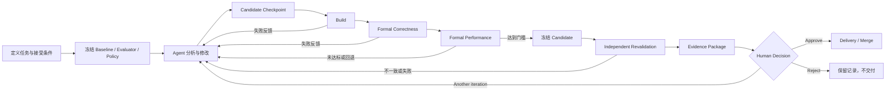

# PhyOpt Minimum Credible Product Specification

本文定义 PhyOpt 的 Minimum Credible Product（MCP）产品边界。它不是最终产品蓝图，也不是技术架构、数据库设计、API 设计或实施计划。本文只回答：PhyOpt 第一次可以被合理称为“真实的飞腾自动性能工程系统”时，必须具备哪些可验证的产品能力。

本文以以下材料为依据：

- 当前事实：`docs/CURRENT-STATE.md`
- 动态验证事实：`docs/CURRENT-STATE-VERIFICATION.md`
- 长期方向与不变量：`docs/VISION.md`
- P0 Gap、Root Gap、能力依赖与 Milestone A：`docs/GAP-ANALYSIS.md`
- 对应代码基线：`main@09d4d9e7b2080b77037837145c9333e34f059f1a`

本文中的“必须”表示 MCP 验收不可缺少的产品要求；“可以”表示允许存在但不构成验收前提的能力；“不得”表示一旦发生就不能形成正式结论。尚无产品或工程证据支持的选择统一列入第 27 节，并标记为 `OPEN`。

## 1. Purpose

### 1.1 一句话定义

**PhyOpt MCP 是一个面向单一明确软件优化目标的可信闭环：Agent 可以在单一 Candidate lineage 中反复提出和修改实现；PhyOpt 在真实飞腾 CPU 上，通过 Candidate 无法影响的 Formal Evaluator，在受控、可重复的 execution context 中证明 Candidate 是否正确、是否真的更快，完整保存 Evidence，经独立 Revalidation 后交由人类工程师审核并决定是否接受。**

### 1.2 本阶段要证明什么

MCP 要证明的不是“模型能够生成看起来更快的代码”，也不是“系统能够远程执行一组命令”，而是以下事实可以同时成立：

1. 开放式 Agent 工作可以持续产生真实源码 Candidate；
2. Candidate 与正式裁判之间存在可信边界；
3. 正确性和性能结论来自真实飞腾 CPU 上的正式实验；
4. baseline 与 candidate 在同一测量口径下可比较；
5. 实验在进程退出、CLI 退出或 SSH 中断后不会丢失已经发生的事实；
6. 每项正式结论都可追溯到 Candidate、Evaluator、Execution Context 和原始 Measurement；
7. 只有通过独立 Revalidation 且经 Human Approval 的结果才能交付。

### 1.3 产品优先级

MCP 的优先级固定为：

```text
可信 > 可恢复 > 可复现 > 自动化 > 智能程度
```

当更强的 Agent 自主性、更快的流程或更丰富的界面与可信实验发生冲突时，可信实验优先。系统宁可给出 `UNKNOWN`、`INVALID` 或“目标未达到”，也不得在证据不足时给出成功结论。

## 2. Product Stage

MCP 对应 `docs/VISION.md` 中的 Stage 1（Reliable Experiment System）与受其约束的 Stage 2 初始能力（Agent-assisted single-candidate optimization），并对应 `docs/GAP-ANALYSIS.md` 的 Milestone A。

| Dimension | MCP boundary |
| --- | --- |
| Hardware | 真实飞腾 CPU、Linux、SSH 远端执行；一次正式实验使用一个受控目标机或明确的受控资源范围。 |
| Software | C、C++、Assembly；一个明确基础库、一个明确函数或 Kernel、一个明确 workload 范围。 |
| Evaluation | 一个可信 correctness oracle、一个可信 benchmark、一套冻结的 formal evaluation policy。 |
| Intelligence | 一个 Agent；允许多轮修改；使用单一 Candidate lineage，不要求候选种群。 |
| Experiment | 真实 build、formal correctness、formal performance、独立 Revalidation；全部形成 durable record。 |
| Delivery | Evidence Package、Human Approval、接受后的 Git 交付或 merge。 |

MCP **不要求支持任意基础库**。它首先必须把一个真实目标做到可信、可恢复、可复现。只支持一个目标不会自动使产品成立；该目标仍必须满足本文全部可信实验要求。

MCP 也不以最大 speedup 为完成标准。即使最终 Candidate 没有达到性能门槛，只要系统能够准确保存失败实验、不给出错误成功结论，并允许工程师理解失败原因，这仍是系统行为正确；但要通过完整 MCP 产品验收，至少需要一个经正式复验和人工接受的真实优化结果。

## 3. Goals

| ID | Goal | 可验收结果 |
| --- | --- | --- |
| G-01 | 建立可信实验边界 | Agent 无法修改或替换 Formal Evaluator、正式 benchmark、correctness oracle、baseline artifact 和 measurement policy。 |
| G-02 | 在真实飞腾 CPU 上裁决 | 正式 correctness 与 performance 均在已确认身份的飞腾目标机和实际受控资源上执行。 |
| G-03 | 形成可比较的性能结论 | baseline 与 candidate 使用相同 workload、Evaluator 和 execution context，经过预热、重复采样和既定统计口径。 |
| G-04 | 建立完整事实链 | 从 Optimization Task、Candidate、Experiment 到 Measurement、Evidence、Revalidation、Approval 均可追溯。 |
| G-05 | 支持 Agent 多轮反馈 | Agent 能消费 build、correctness 与 performance 失败反馈并产生后继 Candidate，但不能把自测结果升级为正式 Evidence。 |
| G-06 | 保证长任务事实不丢失 | CLI、后台进程或 SSH 连接中断后，系统能恢复已知事实并区分可继续、需重跑和状态未知。 |
| G-07 | 让人类作出负责的接受决定 | 工程师能查看 diff、假设、完整正式 Evidence、复验和已知限制，再选择 Approve、Reject 或继续迭代。 |
| G-08 | 形成可交付和可复现结果 | 另一名工程师能够依据 Evidence Package 理解 Candidate 为何被接受，并在记录范围内复现实验。 |

## 4. Non-goals

MCP 明确不包含：

- multi-candidate search、候选种群或并行候选排名；
- evolutionary search、MCTS 或其他复杂搜索算法；
- experience retrieval、Knowledge Graph 或通用 RAG；
- RL、自动 reward 学习或自训练性能模型；
- automatic model router 或以模型供应商数量为目标的适配；
- 多 CPU 厂商支持；
- GPU 或 NPU；
- VS Code extension；
- 复杂 GUI；
- library-level optimization；
- system-level tuning 或整机自动调优；
- 自动 hardware/software co-design；
- 任意 Git repository 的无条件自动优化；
- 无人工审核的生产交付或自动 merge。

MCP 也不要求建立通用 profiling 平台。Agent 可以使用目标项目已有的 profile 工具作为 Development Feedback；除非 profile 数据被纳入某项正式结论，否则它不是 MCP 正式 Evidence 的必要组成部分。

## 5. Users

### 5.1 Primary User

MCP 的主要用户是负责飞腾软件性能的专业工程师，包括 CPU 厂商基础软件工程师、性能工程师、高性能基础库工程师、芯片软件使能团队和性能验收团队。MCP 不以没有性能工程经验的普通开发者为第一阶段用户。

### 5.2 用户前提

使用 MCP 的工程团队必须能够提供或负责确认：

- 明确的优化函数或 Kernel 及其源码基线；
- 代表性 workload 与结论适用范围；
- 可独立执行的 correctness oracle；
- 可独立执行的 benchmark；
- baseline 的工程含义和身份；
- 性能门槛、回归约束和停止条件；
- 可受控的真实飞腾目标机资源；
- 有权作出最终工程接受决定的审批人。

PhyOpt 的责任是把这些输入变成受控、可追踪的实验闭环，而不是替用户猜测正确性标准或业务接受条件。

## 6. Product Roles

| Role | 必须负责 | 不得负责或不得做 |
| --- | --- | --- |
| Human | 定义目标、workload、baseline、correctness 口径、性能阈值、资源预算和适用范围；确认 Formal Evaluator；处理维护性、兼容性和风险取舍；作出 Approve/Reject/继续迭代决定。 | 不得把未经正式评估的 Agent 自测当作产品结论；不得在 Evidence 不完整或 Revalidation 未通过时批准。 |
| Agent | 阅读 Candidate 源码和允许的上下文；分析瓶颈；提出可证伪假设；修改 Candidate；运行允许的开发反馈；根据正式实验反馈产生下一轮 Candidate。 | 不得修改、替换或选择性绕过 Formal Evaluator、correctness oracle、正式 benchmark、baseline artifact、formal measurement policy；不得宣布正式正确性或性能成功。 |
| PhyOpt Runtime | 固定任务定义和信任边界；管理 Candidate checkpoint、Experiment、远端执行、资源条件、Evaluation、Evidence、Revalidation、恢复和审批门禁；如实保存所有正式事实。 | 不得把模型自述、单次 timing、未知远端状态或缺失数据转换成成功；不得在未批准时交付 Candidate。 |
| Trusted Evaluator | 在冻结的 policy 下构建或接收明确 artifact；执行正式 correctness 和 performance；产生可审计的原始 Measurement 与 Evaluation Result。 | 不得被 Candidate 内容改变裁判口径；不得用未记录的隐式步骤产生正式结论。 |
| Target Machine | 提供已识别的真实飞腾 CPU、可核验的软件环境和受控计算资源；承载正式实验。 | 不得在资源冲突、机器状态不满足 policy 或实际上下文未知时被视为有效正式测量环境。 |

### 6.1 信任边界

Agent 的写权限止于 Candidate source trust domain。即使测试、benchmark 或构建文件在同一个原始源码仓库中，凡被指定为正式裁判资产，就必须在正式评估时处于 Candidate 无法修改或替换的信任域。单纯记录文件路径、使用另一个工作目录或在评估前复制 Candidate，都不足以证明边界成立。

### 6.2 Development Feedback 与 Formal Evaluation

| Property | Development Feedback | Formal Evaluation |
| --- | --- | --- |
| Purpose | 帮助 Agent 快速发现构建错误、明显正确性问题或性能方向 | 产生可用于接受决策的正式事实 |
| Assets | 可以使用项目内测试、临时脚本、Agent 可见工具 | 只能使用冻结且有 identity 的 Formal Evaluator 资产 |
| Candidate influence | 允许 Candidate 间接影响其结果，因此结果不具裁决力 | Candidate 不得改变 evaluator、oracle、benchmark、baseline 或 policy |
| Context | 可以较轻量，允许与正式目标机不同 | 必须使用受控、记录且满足 policy 的正式 context |
| Output | Feedback | Measurement、Evaluation Result，满足完整性后形成 Evidence |

Agent 自测无论执行多少次都不能直接升级为正式 Evidence。Development Feedback 可以作为 Candidate 的生成原因或失败线索保存，但必须明确标注其非正式性质。

## 7. End-to-End User Journey



| # | Step | 用户看到或决定什么 | 系统必须做什么 | Agent 做什么 | 失败时的产品行为 |
| ---: | --- | --- | --- | --- | --- |
| 1 | 初始化优化任务 | 新任务身份、目标仓库和待补全定义 | 创建 durable Optimization Task，记录创建人、时间和初始范围 | 不参与 | 输入不完整时保持“不可运行”，不得启动正式实验 |
| 2 | 选择/定义目标 | 基础库、函数或 Kernel、可选入口文件、允许修改的 Candidate 源码范围 | 固定目标身份和声明范围；入口文件只用于优先调查，不替代目标定义 | 后续可调查整个允许的 Candidate 源码域 | 目标无法唯一识别时要求用户补充，不猜测 |
| 3 | 配置飞腾机器 | 机器身份、连接状态、飞腾 CPU 摘要、可用资源范围 | 验证连接并观察实际硬件/系统事实；区分声明值和观察值 | 不参与正式连接裁决 | 连接失败或 CPU 身份不符合时不进入正式执行 |
| 4 | 定义 baseline | baseline 的来源、版本、artifact 和适用含义 | 固定并核验 baseline identity，防止被 Candidate 覆盖 | 可读取允许公开的 baseline 说明，不可修改 artifact | baseline 无法核验时任务不可产生性能 Evidence |
| 5 | 定义 correctness | case set、输入/reference、容差、覆盖和通过规则 | 检查定义完整性并关联 Formal Evaluator identity | 可了解规则以改进 Candidate，不可改变规则 | 缺少可判定 oracle 时任务不可启动正式优化 |
| 6 | 定义 benchmark | workload、指标、单位、基准比较和回归范围 | 固定 benchmark identity 和输入；确认 baseline/candidate 可同口径执行 | 可了解 workload，不可修改正式 benchmark | workload 或输出无法识别时不产生正式性能结论 |
| 7 | 定义资源约束 | CPU set、NUMA nodes、thread count、并发要求和机器状态条件 | 保存 declared context 和有效性 policy | 可据此提出硬件相关优化 | 条件不完整时不得把后续 timing 称为正式测量 |
| 8 | 冻结 Formal Evaluator | Evaluator 内容、版本、所有者、policy 和信任边界摘要 | 生成稳定 evaluator identity，确认 Candidate 无写权限 | 失去对正式裁判资产的修改能力 | 无法证明隔离时阻止正式执行 |
| 9 | 启动优化 | 已冻结任务摘要、预算、停止条件和待使用 Agent | 记录启动决定并进入可恢复运行状态 | 接收目标和允许工具 | 前置条件失败时明确列出阻塞项，不创建伪实验 |
| 10 | Agent 分析 | 当前阶段、正在调查的源码区域、已提出假设 | 记录 Agent identity、关键假设和工具活动边界 | 阅读代码、调用搜索、分析可能瓶颈 | Agent 失败单独记录，可重试或由人终止，不改变既有事实 |
| 11 | Agent 修改 Candidate | 变更中的文件和 Development Feedback 明确标识 | 只允许写 Candidate 域；保护正式资产 | 修改源码并可运行开发构建/快速测试 | 越界修改被拒绝并记录；自测失败作为反馈而非正式结果 |
| 12 | Candidate checkpoint | 稳定 Candidate identity、parent、diff 和 hypothesis | 固化 source identity；之后正式评估只使用该 checkpoint | 提交本轮说明，停止修改该 checkpoint | 无法固定身份时不得进入 Build |
| 13 | Build | 构建状态、耗时、工具链与产物身份 | 在既定 context 中构建，保存命令事实、stdout/stderr、产物及 binary identity | 消费失败反馈 | Build Failure 结束本次 Experiment；不得标记 correctness failed 或 performance failed |
| 14 | Formal correctness | 实际执行 case、覆盖、通过/失败详情 | 用 Formal Evaluator 执行并保存每个 case 的事实和判定 | 只能读取允许反馈 | 未通过时不进入正式 performance；无效/未知状态不得视为通过 |
| 15 | Formal performance | baseline/candidate 原始样本、汇总、波动、回退和门槛 | 在同一有效 context 下按冻结 policy 测量和比较 | 只能读取允许反馈 | 回退、未达标、基础设施失败和无效实验分别记录 |
| 16 | 失败反馈 | 失败类型、可信反馈和可操作上下文 | 将本轮 Candidate、Experiment 和失败事实完整保留 | 根据反馈提出后继 Candidate | 不覆盖旧 Candidate，不丢弃失败记录，不把基础设施失败归因于代码 |
| 17 | 下一轮 | lineage 中的新一轮和剩余预算 | 从选定 parent 产生新 checkpoint，重复正式门禁 | 继续分析和修改 | 超出预算或停止条件时结束为未达成，不制造成功状态 |
| 18 | 达到接受门槛 | 候选达到预定义 correctness、performance 和 regression 条件 | 冻结待复验 Candidate 与声明范围，禁止继续修改 | 结束对该 Candidate 的编辑 | 仅初测通过不能进入 Approved |
| 19 | Independent Revalidation | 新一组 correctness/performance 结果及与初测一致性 | 对冻结 Candidate 创建独立正式实验，重新执行和计算 acceptance | 不再修改该 Candidate，不担任裁判 | 失败、不一致、无效或未知时不得进入 Approval |
| 20 | 查看 Evidence | diff、假设、context、raw/summary measurement、失败尝试和复验 | 形成完整、可追溯的 Evidence Package | 可以提供非裁决性的修改说明 | 关键 Evidence 缺失时明确阻止批准 |
| 21 | Human Approve/Reject | Approve、Reject 或 Request another iteration | 记录人员、时间、理由、接受范围和决策；严格执行门禁 | 仅在请求新一轮时重新参与 | Reject 保留全部记录；继续迭代产生新 Candidate；不得静默覆盖决定 |
| 22 | 交付/Merge | 将交付的 Candidate、commit 和 Evidence Package | 仅对已批准的冻结 Candidate 执行交付，并核验 baseline 未发生未处理漂移 | 不参与最终 merge 裁决 | baseline 漂移、工作区冲突或交付失败时保持未交付，不撤销历史 Approval 事实但要求重新确认适用性 |

## 8. Core Product Concepts

这些对象是不同产品事实，不能继续用单个 workflow 状态或单个命令结果代替。

```text
Optimization Task
  ├─ Baseline
  ├─ Evaluator + Evaluation Policy
  ├─ Declared Execution Context
  └─ Candidate lineage
       └─ Candidate
            └─ Experiment(s)
                 ├─ Observed Execution Context
                 ├─ Measurement(s)
                 └─ Evaluation Result
                      └─ Evidence
                           ├─ Initial formal evaluation
                           └─ Independent Revalidation
                                └─ Human Approval
                                     └─ Artifact / Evidence Package
```

| Concept | 产品语义 | 与其他概念的边界 |
| --- | --- | --- |
| Optimization Task | 一个有明确目标、范围、baseline、Evaluator、资源和接受条件的优化责任单元 | Task 管理全过程，但本身不是 Candidate 或 Experiment |
| Baseline | 正式比较参照，具有固定来源、版本、artifact 和适用范围 | Git 基线源码与性能 baseline artifact 可以相关，但必须分别具有可核验身份 |
| Candidate | Agent 某轮提出、具有稳定 source identity 的待验证实现 | Candidate 不是实验结果；同一 Candidate 可以接受多次 Experiment |
| Evaluator | 定义如何构建、验证正确性、测量性能并解释输出的可信裁判资产与 policy | Evaluator 不属于 Candidate 的可写域 |
| Execution Context | 影响实验解释与可复现性的硬件、资源、软件、artifact 和测量条件 | 同时包含预先声明条件和执行时实际观察事实 |
| Experiment | 在明确目的、Candidate、Baseline、Evaluator 与 context 下进行的一次可追踪执行 | 重试、复验或 context 改变必须形成可区分的实验事实 |
| Measurement | Evaluator 产生的原始观察，例如单次耗时、case 结果、计数和日志 | Measurement 不是判断，也不自动构成 Evidence |
| Evaluation Result | 按冻结 policy 对一组 Measurement 作出的 correctness、performance、validity 或门槛判定 | 判定必须保留其输入 Measurement 和规则身份 |
| Evidence | 支撑一个有限、明确结论的已核验 Measurement、identity、context 和 Evaluation Result 集合 | Evidence 的结论范围不得超过其 workload 和 context |
| Revalidation | 对冻结 Candidate 进行的独立正式再验证，产生新的 Experiment、Measurement 和 Evidence | 不是简单复用旧摘要或再次解析同一输出 |
| Approval | 有责任边界的人类对 Candidate 及其声明范围内结论作出的明确工程决定 | Approval 不等于按钮点击或单纯 Git merge |
| Artifact | 可保存、核验和交付的源代码、二进制、日志、报告或 evaluator 产物 | 每个关键 Artifact 必须有身份并关联产生它的事实 |

## 9. Trusted Evaluator

### 9.1 Purpose

Trusted Evaluator 是 MCP 最核心的产品边界。它负责将 Candidate 从“Agent 提出的实现”转化为“经独立事实支持或否定的实现”。可信不表示 evaluator 永不出错，而表示它的内容、身份、输入、执行条件、输出和责任所有者都可审计，且 Candidate 无法在被评估时改变裁判规则。

### 9.2 Required behavior

Formal Evaluator 必须满足：

1. Candidate 无法修改或替换正式 evaluator 代码与配置；
2. correctness oracle、case set、input/reference、tolerance policy 固定；
3. benchmark、workload、指标定义和输出解释固定；
4. baseline artifact 与其 identity 固定；
5. warmup、sampling、aggregation、异常处理、阈值和 regression policy 在实验前固定；
6. Evaluator 具有稳定 identity 和可追踪版本；
7. Evaluator 的实际输入、执行动作、输出和错误均可追踪；
8. Evaluator 能确认它评估的是指定 Candidate binary 和指定 baseline，而不是路径上偶然存在的其他产物；
9. Formal Evaluation 与 Development Feedback 在状态、展示和数据中始终可区分；
10. Evaluator 或 policy 发生变化后，旧 Evidence 仍保留其原 identity，新结果不得与旧结果无标识地混合。

Evaluator identity 至少要能够唯一指向本次使用的 correctness、benchmark、case/workload、baseline 和 measurement policy 版本。本文不规定 identity 的技术表达方式。

### 9.3 Failure behavior

- 无法证明 Candidate 与 Evaluator 隔离：实验为 `INVALID`，不得产生正式正确性或性能结论。
- Evaluator 资产缺失、损坏或输出不符合约定：归类为 Evaluator Failure，不得归因于 Candidate。
- 实验中发现 evaluator identity 与冻结值不一致：停止正式评估，保留已有原始事实，结果为 `INVALID`。
- 用户需要修改 evaluator 或 policy：必须形成新的 evaluator identity；既有 Candidate 如需按新口径判断，必须重新执行正式实验。

### 9.4 Acceptance condition

验收者能够用一个受控测试证明：Agent 可修改 Candidate 源码，但对 Formal Evaluator、oracle、benchmark、baseline 和 policy 的写入或替换尝试会被拒绝；正式结果明确指向冻结 evaluator identity。

## 10. Correctness

### 10.1 Purpose

Formal Correctness 证明 Candidate 在声明范围内满足目标软件的功能和数值语义。`exit code == 0` 只能是进程状态，不能单独作为完整 correctness 证据。

### 10.2 Required behavior

每次正式 correctness evaluation 必须记录并核验：

- case set identity 及其版本；
- 每个 case 的稳定 identity；
- input identity，包括生成规则、固定数据或 seed 的身份；
- expected result 或 reference implementation/artifact identity；
- 数值容差、精度、错误分类或其他领域判定 policy；
- 计划 case 数、实际执行 case 数和未执行原因；
- 每个 case 的 pass/fail/inconclusive 事实与必要诊断；
- coverage summary，明确结论覆盖和未覆盖的范围；
- failed cases 及其实际/期望差异；
- Evaluator identity、Candidate binary identity、开始/结束时间和 observed context。

只有既定必需 case 全部按 policy 完成，coverage 达到预先定义的接受条件，且不存在未解释失败时，Formal Correctness 才能通过。不同软件领域可以有不同 correctness semantics；MCP 只要求首个领域的语义完整、固定并可审计。

### 10.3 Failure behavior

- Build 未成功：correctness 是“未执行”，不是“correctness failed”。
- 任何必需 case 失败：结果为 Correctness Failure，Candidate 不得进入正式性能结论。
- case 未实际执行、输入/reference 无法核验或容差 policy 缺失：实验为 `INVALID` 或 `UNKNOWN`，不得视为通过。
- evaluator 进程失败：记录 Evaluator Failure；除非已有 case 结果满足完整性要求，否则不得推导 Candidate 错误。

### 10.4 Acceptance condition

工程师能够从记录中回答“计划测了什么、实际测了什么、每个 case 如何判定、失败在哪里、哪些范围未覆盖”，并能把每项结果追溯到 Candidate binary 和 evaluator identity。

## 11. Performance Measurement

### 11.1 Purpose

Formal Performance Measurement 证明一个范围有限的性能主张，而不是展示一次最快 timing。任何正式 speedup 必须来自 baseline 与 candidate 的对称、重复、受控测量。

### 11.2 Required behavior

正式 performance policy 必须在运行前固定并包含：

- baseline 和 candidate 的明确 artifact/binary identity；
- 相同且有 identity 的 workload、输入、数据规模和指标单位；
- 相同的 Formal Evaluator 与关键 execution context；
- warmup 规则；
- baseline 和 candidate 的重复采样规则；
- 样本执行顺序或交错规则，以避免未声明的顺序偏差；
- 每个原始 sample 及其时间、case、对象和有效性；
- aggregation method；
- variance、confidence 或其他不确定性表达方式；
- 异常测量的识别、保留、排除和解释规则；
- overall threshold、key workload threshold 和 regression checking；
- 缺失、超时、资源变化或环境漂移时的判定规则。

系统不得把单次 timing 直接称为正式性能结论，也不得用 baseline 与 candidate 的不对称参数、资源或测量次数产生 speedup。汇总值必须能追溯到全部原始样本；排除样本不得被删除，必须保留并说明原因。

### 11.3 Failure behavior

- Candidate 比 baseline 更慢且触发回归规则：Performance Regression。
- 没有显著回退但未达到接受阈值：Performance Target Not Met。
- 样本不足、方差/不确定性超出 policy、实际 context 不一致或异常无法解释：实验为 `INVALID` 或结论为不充分，不得宣称提升。
- benchmark/evaluator 自身失败：Evaluator Failure 或 Infrastructure Failure，不得自动归因于 Candidate。

### 11.4 Acceptance condition

对每个正式性能结论，工程师能够查看 baseline/candidate 全部 raw samples、汇总方法、不确定性、异常处理、回归检查和阈值结果，并确认二者使用相同 workload 与实际受控 context。

## 12. Execution Context

### 12.1 Purpose

Execution Context 定义“该结论在什么条件下成立”。没有明确 context 的 speedup 不能成为正式 Evidence。

### 12.2 Declared 与 Observed Context

| Type | Meaning | Product requirement |
| --- | --- | --- |
| Declared Context | 任务开始前要求系统使用的目标条件 | 在实验前冻结，用于准入和调度判断 |
| Observed / Actual Context | 实验执行时系统实际观察到的条件 | 与每次正式 Experiment 绑定，是 Evidence 的主要事实依据 |

正式 Evidence 必须同时保留二者。Observed Context 与 Declared Context 不一致时，系统必须按冻结 policy 判定实验是否仍有效；不得只保存声明值并假定其已经落实。

### 12.3 Minimum context

| Domain | 必须包含的产品事实 |
| --- | --- |
| Hardware | machine identity、飞腾 CPU identity、architecture、与实验有关的拓扑和 NUMA 信息 |
| Resources | CPU set、NUMA nodes、thread count、受控资源占用范围、并发使用状态 |
| Software | OS、kernel、compiler/toolchain、关键环境变量、影响结果的依赖及其版本/身份 |
| Artifacts | baseline source/artifact identity、Candidate source identity、Candidate binary identity、benchmark identity及实际加载的关键对象 |
| Measurement | Evaluator identity、workload identity、measurement policy identity、时间范围 |

对频率、governor、温度、系统负载、firmware 等机器状态，首个 MCP 目标需要在第 27 节的 OPEN 决策中确定哪些属于有效性必需项。未决并不允许完全不记录；至少必须记录能够解释和复现实验的已选关键事实。

### 12.4 Failure and acceptance

关键 context 无法观察、实际资源未落实、artifact identity 无法确认或实验期间发生超出 policy 的变化时，实验不得产生正式性能结论。验收时必须能从任一 Evidence 反向找到其 Declared 与 Observed Context，并看到所有差异及处理决定。

## 13. Resource Control

### 13.1 Purpose

资源控制保证正式测量不是与其他任务争抢资源后得到的偶然结果，并证明 CPU affinity、NUMA 与线程约束实际生效，而不是只存在于配置文本中。

### 13.2 Required behavior

Formal Performance Experiment 开始前，PhyOpt 必须确认：

1. 本实验已获得其所需受控资源范围；
2. 两个正式 workflow 不会同时占用相互冲突的受控 CPU/NUMA/机器资源；
3. CPU affinity 实际生效且可观察；
4. NUMA policy 实际生效且可观察；
5. thread count 实际生效且可观察；
6. 并发占用和关键 machine state 满足冻结 policy；
7. baseline 与 candidate 使用同等资源条件；
8. 资源条件在实验期间持续满足，或任何变化均被发现并影响有效性判定。

本文不规定 resource scheduler 的实现，但正式实验必须具有可审计的资源获得、使用和释放事实。

### 13.3 Experiment validity semantics

| Status | Meaning | 是否可形成正式性能结论 |
| --- | --- | --- |
| `VALID` | 执行完成，身份、资源、context 和 policy 均满足要求 | 可以，仍需结合 Evaluation Result |
| `INVALID` | 执行可能完成并产生数据，但违反信任、资源、context 或 measurement policy | 不可以；数据可保留作诊断 |
| `FAILED` | 某个明确步骤执行失败，失败原因已知 | 不可以；失败事实必须保存 |
| `UNKNOWN` | 系统无法确认是否执行、执行到何处或结果是否可信 | 不可以；必须 reconcile 或人工处理 |

`VALID` 不等于“性能更快”，`FAILED` 也不等于“Candidate 错误”。有效性与评价结论是两个不同维度。

### 13.4 Acceptance condition

验收实验必须展示实际 CPU/NUMA/thread 约束、冲突防止和机器状态检查均发生；故意制造资源冲突或约束不生效时，系统拒绝产生正式性能结论。

## 14. Remote Execution Semantics

### 14.1 Lifecycle states

| State | Meaning |
| --- | --- |
| `PENDING` | 远端工作已登记，但尚未确认开始 |
| `RUNNING` | 已确认远端工作正在执行 |
| `SUCCEEDED` | 已确认远端工作按预期完成且结果可获取；这不等于实验有效或门槛通过 |
| `FAILED` | 已确认远端工作以明确失败结束 |
| `CANCELLED` | 已确认远端工作因取消而终止 |
| `UNKNOWN` | 当前无法确认远端是否仍运行、已完成或已终止 |

### 14.2 Required behavior

- SSH 连接断开 **不等于** 远端任务失败，也不等于任务已取消。
- CLI 退出不得改变远端真实状态。
- 用户发出 Cancel 时，首先是取消请求；只有远端终止得到确认后才可标为 `CANCELLED`。
- 后台恢复后必须能够识别所有非终态远端执行，并尝试确认、reconcile 或明确要求人工处理。
- `UNKNOWN` 不得自动转换为 `SUCCEEDED` 或 `FAILED`，也不得触发正式成功、审批或交付。
- 同一实验在状态未确认前不得被无标识地重复执行；如必须重跑，应形成新的可区分执行事实并保留与未知执行的关系。
- 远端产生的源码、binary、日志和测量必须与本地声明身份核验后才能进入 Evidence。

### 14.3 Acceptance condition

通过人为中断 SSH 和重启后台的场景，系统能够保留已知事实、显示 `UNKNOWN` 或确认后的真实状态，并且不会产生错误成功、重复交付或丢失远端执行关联。

## 15. Candidate

### 15.1 Purpose and identity

Candidate 是一份待验证的、不可歧义识别的源码提案。每个 Candidate 必须具有：

- 稳定 Candidate identity 和 source identity；
- parent Candidate 或 baseline；
- 产生它的 optimization hypothesis / reason；
- Agent identity；
- 完整 diff 和变更文件；
- 创建时间和 lineage 位置；
- 与它相关的 build artifact、Experiment 和结果列表。

MCP 只要求单一 Candidate lineage：后继 Candidate 可以基于前一 Candidate 继续修改，但每一轮 checkpoint 都是独立可追踪的事实，不得只保留最新状态。失败 Candidate 及其原因必须保留。

### 15.2 Required boundaries

- Agent 可以修改允许的 Candidate source。
- Candidate checkpoint 进入 Formal Evaluation 后必须冻结；任何源码变化都形成新的 Candidate。
- Candidate 不得包含或覆盖 Formal Evaluator、baseline artifact 或 formal policy。
- 实际执行的 Candidate binary 必须能追溯到冻结 Candidate 和本次 build。
- 一个 Candidate 可以有多个 Experiment；Experiment 失败不删除 Candidate。

### 15.3 Acceptance condition

对任意一轮，工程师都能恢复其源码、diff、parent、hypothesis、Agent 和全部实验结果；不能出现“有性能结果但无法确定对应哪份源码或二进制”的情况。

## 16. Experiment

### 16.1 Definition

Experiment 是在明确目的下，针对固定 Candidate 与 Baseline，使用固定 Evaluator 和 measurement policy，在一个声明并观察的 Execution Context 中进行的一次可追踪执行。Development Feedback 可以被记录为开发实验，但只有 Formal Experiment 能参与正式 Evidence。

### 16.2 Durable Experiment Record

每次 Formal Experiment 在开始前就必须获得稳定 identity，并在运行过程中持续形成 durable record。记录至少包括：

- Task identity；
- Experiment identity、目的和 formal/development 属性；
- Candidate identity 与 parent Candidate；
- hypothesis / reason；
- Agent identity；
- Baseline identity；
- Evaluator identity 与 measurement policy identity；
- Declared 和 Observed Execution Context；
- 实际 commands / actions 及其顺序；
- build result 与 binary/artifact identity；
- correctness result；
- performance result；
- raw measurements；
- stdout/stderr；
- failure reason 与 failure category；
- start/end time；
- 输入和输出 Artifacts；
- validity、Evaluation Result 和后续 decision。

失败、回退、未达标、取消、无效和未知实验都必须保存。重试不得覆盖前一次记录；它应形成新的可区分 attempt 或 Experiment，并保留因果关系。

### 16.3 Acceptance condition

后台或 CLI 在 Experiment 任意阶段退出后，重启系统仍能回答：已经执行了什么、哪些事实已确认、当前远端状态是否已知、哪些步骤可继续、哪些必须重新执行。

## 17. Measurement

### 17.1 Definition

Measurement 是 Evaluator 直接产生的原始观察，例如某个 correctness case 的实际结果、一次 benchmark sample 的耗时、资源观察值或相关计数。Measurement 不包含“值得接受”这一工程决定。

### 17.2 Required behavior

- 原始值、单位、case/workload identity、baseline/candidate 对象、sample 序号、时间和来源必须保存；
- 原始 stdout/stderr 必须保留，并与解析出的 Measurement 关联；
- 解析、换算、聚合和异常标记必须可追溯，不能覆盖原始值；
- 未被采用的异常 sample 仍需保留，并记录排除规则和原因；
- Measurement 必须关联 Candidate binary、Baseline、Evaluator 和 Observed Context；
- 解析失败时保留原始输出，并明确标记 Evaluator Failure 或 `INVALID`，不得凭部分文本推导成功。

### 17.3 Acceptance condition

任何 summary、ratio 或 confidence 表达都能下钻到组成它的原始 Measurement；删除汇总结果后，授权工程师仍能依据保存的原始数据和冻结 policy 重新得到相同判定。

## 18. Evidence

### 18.1 Definition

**Measurement 不等于 Evidence。** Evidence 是能够支持一个范围有限结论的一组已核验 Measurement、identity、Execution Context、Evaluator policy 和 Evaluation Result。

一个合格的性能结论应类似：

> Candidate X 在 Machine Y、workload W、8 threads 及记录的 execution context 下，相对于 Baseline B，按 Evaluator E 与 policy P 测得聚合性能提升 9.2%，满足预定义不确定性和 regression 条件，并且 Formal Correctness 的全部必需 case 通过。

这项结论不能被扩大为“整个库在所有飞腾 CPU 上提升 9.2%”。

### 18.2 Evidence completeness

正式 Evidence 必须能追溯到：

- Task、Candidate source 和 Candidate binary；
- Baseline source/artifact/binary；
- Formal Evaluator 与 policy；
- correctness case、coverage 和结果；
- performance raw samples、汇总、不确定性、异常与 regression；
- Declared 与 Observed Execution Context；
- 资源控制事实；
- Experiment identity、时间、stdout/stderr 和 Artifacts；
- 初次 formal evaluation 与独立 Revalidation；
- claim 的明确适用范围和已知限制。

### 18.3 Incomplete Evidence

出现以下任一情况时，系统必须拒绝给出正式性能成功结论：

- Candidate、baseline、binary 或 evaluator identity 缺失或不一致；
- correctness 未完整通过；
- baseline/candidate workload 或关键 context 不对称；
- 只有单次 timing 或 raw samples 缺失；
- 资源约束未证明生效；
- Experiment 为 `INVALID`、`FAILED` 或 `UNKNOWN`；
- performance policy、阈值或异常处理在测量后才改变；
- Revalidation 未执行、未通过或与初测无法按 policy 解释一致；
- claim 超出实际 case、workload、机器或 context 范围。

### 18.4 Acceptance condition

Evidence 的每个结论都可以沿引用链回到原始 Measurement 和 Artifact；任何关键引用缺失都会使该结论在产品中明确显示为不完整且不可批准。

## 19. Revalidation

### 19.1 Purpose

Independent Revalidation 用于排除偶然测量、环境污染、Candidate 在初测后漂移或对裁判的不当影响。它不是“再运行一次同一脚本并看 exit code”。

### 19.2 Required behavior

Revalidation 必须：

1. 使用已经冻结、不可继续修改的 Candidate source 与 binary identity；
2. 使用 Formal Evaluator 和冻结 policy；
3. 使用满足要求并重新观察的可信 Execution Context；
4. 创建独立的 Experiment identity；
5. 重新执行完整 Formal Correctness；
6. 重新执行 baseline/candidate Formal Performance；
7. 产生一组新的 raw Measurement、Evaluation Result 和 Evidence；
8. 重新计算正式 acceptance，而不是复用初测 summary；
9. 按预定义一致性 policy 比较初测和复验；
10. 在 Revalidation 期间禁止 Agent 修改该 Candidate 或正式资产。

“独立”至少意味着新的正式执行和新的事实记录，并且候选生成者不能控制裁判。是否要求不同时间窗口、不同操作者或额外环境条件属于第 27 节的 `OPEN` 决策。

### 19.3 Failure behavior

- correctness 复验失败：不得批准。
- performance 复验回退、未达标或与初测不一致且无法按 policy 解释：不得批准。
- context、资源或 evaluator 无效：Revalidation 为 `INVALID`，不得批准。
- 远端状态未知：Revalidation 为 `UNKNOWN`，不得批准。
- 需要修改 Candidate：产生新的 Candidate，并从正式评估重新开始。

### 19.4 Acceptance condition

Approved Candidate 必须关联两组彼此可区分的正式 Experiment/Evidence：初次 formal evaluation 与 Revalidation；两者都满足 acceptance，且一致性判断有明确依据。

## 20. Human Approval

### 20.1 Approval view

执行审批的工程师至少必须看到：

- Candidate diff、source/binary identity 和 parent；
- optimization hypothesis 与 Agent identity；
- Formal Correctness 的 cases、coverage、失败/未覆盖信息；
- Formal Performance 的 raw/summary measurement、不确定性、阈值和 regressions；
- Baseline identity；
- Declared 与 Observed Execution Context；
- Evaluator identity；
- 初测与 Independent Revalidation 及其一致性；
- 已知 limitation、claim scope 和风险；
- 失败 attempts 摘要及与最终 Candidate 的关系；
- Evidence 的 completeness、validity 和任何警告。

### 20.2 Decisions

Human 可以：

- **Approve**：接受当前冻结 Candidate，以及 Evidence 所限定范围内的正确性和性能结论；
- **Reject**：不接受 Candidate 或其工程风险，保留全部事实但不交付；
- **Request another iteration**：要求产生新的后继 Candidate；旧 Candidate、Evidence 和决定继续保留。

Approval 必须记录审批人身份、时间、理由、接受范围和已知限制。Approve 不是单纯允许 Git merge；它表示具名工程师对“这份 Candidate + 这项有限性能主张 + 当前已知风险”承担接受责任。

### 20.3 Delivery gate

只有 Evidence 完整、Formal Correctness 通过、Formal Performance 达到 policy、Revalidation 通过且 Human Approve 后，系统才能交付或 merge。系统不得自行批准，不得以 Agent 建议、性能数字或自动阈值通过替代 Human Approval。

## 21. Failure Semantics

失败语义必须准确，因为恢复、统计、后续搜索和经验积累都依赖它。系统不得把下列情况全部压缩为一个 `FAILED`：

| Failure / outcome | Meaning | Required product behavior |
| --- | --- | --- |
| Build Failure | Candidate 无法产生所需 artifact | 保存构建事实和日志，反馈给 Agent；correctness/performance 标记未执行 |
| Correctness Failure | Candidate 在有效 Formal Correctness 中未满足规则 | 保存 failed cases，禁止正式性能接受；可进入下一轮 |
| Performance Regression | 有效测量显示触发预定义回退规则 | 保存全部样本与回退范围，可反馈下一轮，不得批准 |
| Performance Target Not Met | correctness 通过且无禁止性回退，但未达到目标阈值 | 明确标为未达标，不与 regression 或基础设施失败混淆 |
| Infrastructure Failure | 网络、磁盘、进程宿主或其他基础设施未能完成工作 | 保存故障；不把结果归因于 Candidate；按 policy 决定重试 |
| Resource Unavailable | 所需机器/CPU/NUMA 等受控资源无法获得 | 不启动或中止正式测量；等待、取消或重新安排，不产生性能结论 |
| Evaluator Failure | oracle、benchmark、解析或 evaluator 资产自身失败 | 保留输出，标记裁判故障；不得判 Candidate 成功或失败，除非已有完整独立事实支持 |
| Remote State Unknown | 远端执行真实状态无法确认 | 保持 `UNKNOWN`，执行 reconcile 或交由人工，不自动重跑或定性 |
| Cancelled | 已确认执行按用户/系统取消请求终止 | 保存取消者、时间、阶段及远端确认；不产生正式成功 |
| Agent Failure | 模型、工具调用、预算或 Agent loop 失败 | 保存 Agent identity 与失败阶段；不得破坏已有 Candidate/Experiment 事实 |
| Invalid Experiment | 数据存在，但信任边界、identity、context、资源或 policy 被破坏 | 保留诊断数据，明确禁止进入正式 Evidence |

失败本身是产品数据。只有在 failure category、发生阶段、影响范围和已有原始事实得到保存时，后续统计或经验才能正确使用它。

## 22. Durability & Recovery

### 22.1 Product requirement

MCP 不要求无限复杂的分布式调度，但必须保证后台进程退出、CLI 退出和短暂网络中断不会让已经发生的事实丢失或被错误重写。

系统重启后至少必须知道：

- 已存在的 Optimization Task、Candidate 和 Experiments；
- 每个 Experiment 已确认完成的步骤与 Artifacts；
- 当前是否存在远端 `PENDING`、`RUNNING` 或 `UNKNOWN` 工作；
- 哪些结果已经 durable，哪些仅是未确认状态；
- 哪些步骤可以安全继续；
- 哪些步骤因身份或 context 变化必须重新执行；
- 哪些状态必须 reconcile 或由人类处理；
- 哪些 Candidate 已等待 Approval、已 Reject 或已交付。

### 22.2 Required behavior

- 正式执行开始前，Task/Candidate/Experiment identity 和计划必须 durable；
- 每个关键边界完成后，结果、状态、时间和 Artifact identity 必须 durable；
- 恢复不得依赖模型“回忆”此前发生了什么；
- 恢复不得把未确认远端工作直接标为失败或成功；
- 若重新执行，必须保留旧 attempt，并明确新旧关系；
- 已冻结 Candidate、Evaluator 和 policy 在恢复后不得静默变化；
- Cancel、Reject、Approve 和 delivery 均必须作为 durable human/system decision 保存；
- 恢复后用户能够从 CLI 看到当前真实状态和需要的操作。

### 22.3 Acceptance condition

在 build、correctness、performance 和远端执行等关键阶段分别模拟后台退出或连接中断，系统重启后不得丢失已完成事实、产生重复成功或误判远端状态，并能给出继续、重跑、reconcile 或人工处理的明确选择。

## 23. Artifact / Evidence Package

### 23.1 Purpose

每次 Accepted Optimization 必须形成一个可交付、可审阅的 Artifact / Evidence Package。其目标是让另一名工程师不依赖原 Agent 会话，也能理解“为什么这个 Candidate 被接受”，并在记录的适用范围内复现实验。

### 23.2 Required contents

交付包至少包含：

- Optimization Task、目标函数/Kernel、workload 和 claim scope；
- source baseline identity；
- performance baseline artifact/binary identity；
- Candidate source identity、parent、完整 diff 和 candidate binary identity；
- optimization hypothesis、Agent identity 和多轮 lineage 摘要；
- Formal Evaluator identity 与 evaluation/measurement policy；
- Declared 与 Observed Execution Context；
- build 事实、toolchain identity 和关键依赖；
- correctness evidence，包括 case、input/reference、容差、覆盖与失败信息；
- performance evidence，包括 baseline/candidate raw samples、summary、不确定性、异常、阈值与 regression；
- revalidation evidence 及与初测的一致性判断；
- 相关 stdout/stderr 和关键 Artifacts；
- 失败 attempts 摘要；
- human decision，包括审批人、时间、理由和接受范围；
- known scope / limitation；
- 复现所需的已记录前提与步骤说明。

### 23.3 Completeness and safety

交付包中的每个关键对象必须可校验身份；summary 不得替代 raw evidence。API Key、私钥、访问 token 或其他无关 secret 不得进入交付包。若任何支持核心 claim 的 identity、raw measurement、context、correctness 或 Revalidation Evidence 缺失，该包不得标为 Accepted Package。

### 23.4 Acceptance condition

由未参与该优化的第二名工程师审阅交付包，能够回答：改了什么、为什么改、测了什么、在哪台机器和哪些资源上测、与什么 baseline 比、正确性为何成立、性能为何成立、结果适用于哪里、有哪些限制、谁为何批准，并能够依据包中信息重复正式评估。

## 24. UX Requirements

MCP 不需要漂亮 GUI；CLI 足够。但 CLI 必须暴露真实产品对象和可信状态，而不是只显示一个笼统 workflow phase。

| User capability | Required behavior |
| --- | --- |
| Create Task | 引导用户补全目标、baseline、Evaluator、资源和 acceptance；显示哪些前置条件尚未满足 |
| Run | 在启动前显示冻结摘要和信任边界；只在必需输入有效后启动 |
| Observe | 查看当前阶段、Candidate、Experiment、远端状态、资源等待和最近确认事件；明确区分运行、失败、无效与未知 |
| Inspect Candidate | 查看 identity、parent、diff、hypothesis、Agent 和关联实验 |
| Inspect Experiment | 查看目的、formal/development 类型、lifecycle、validity、context、commands/actions、日志和 failure category |
| Inspect Evidence | 查看 claim、correctness、performance、raw/summary measurement、Revalidation、完整性和限制，并可下钻到原始事实 |
| Cancel | 发出取消请求并查看是否已确认；不得把请求立即伪装为远端已取消 |
| Resume / Reconcile | 重启后查看可安全继续、必须重跑、状态未知或需要人工判断的项目，并显式选择允许的动作 |
| Approve | 仅在所有门禁通过时可用；展示审批含义、claim scope 和已知限制，记录具名理由 |
| Reject | 记录拒绝理由并保留 Candidate、Experiment 和 Evidence，不交付 |
| Request another iteration | 从明确 parent 进入下一轮，不覆盖已审阅 Candidate |
| List previous tasks | 列出真实 Optimization Tasks 及其当前状态、目标、Candidate、最近 Experiment 和决定；不得混入 mock task 冒充产品任务 |

UX 还必须满足：

- Development Feedback 与 Formal Evidence 使用清晰、不可混淆的标签；
- `UNKNOWN`、`INVALID`、未执行和失败分别展示；
- 用户无需阅读数据库或服务日志才能知道任务是否可批准；
- 默认输出不显示 secret；
- 长输出可以摘要展示，但原始 Evidence 必须可访问；
- 每个成功结论旁都能看到适用范围和 Evidence 链接。

## 25. MCP Acceptance Criteria

只有以下条件全部满足，PhyOpt 才通过 MCP 产品验收：

| ID | Acceptance criterion | 验收证据 |
| --- | --- | --- |
| AC-01 | 使用至少一台身份明确的真实飞腾 CPU Linux 目标机完成闭环 | Evidence 中存在实际 machine/CPU identity 和 observed context |
| AC-02 | 对一个真实基础库的明确函数或 Kernel 完成优化 | Task、baseline、workload、Candidate diff 和交付结果均属于该真实目标 |
| AC-03 | 使用一个有明确所有者、版本和 identity 的 Trusted Evaluator | Evidence 可定位 evaluator、oracle、benchmark 和 policy |
| AC-04 | 至少一个真实 Agent 参与分析和修改 | 记录 Agent identity、假设、工具活动和 Candidate 来源 |
| AC-05 | Agent 至少完成多轮 Candidate 修改 | lineage 中存在至少两个可区分 checkpoint 及其反馈原因，不只是一轮生成 |
| AC-06 | Candidate 无法修改 Formal Evaluator、oracle、benchmark、baseline 或 policy | 受控越界测试被拒绝；正式评估身份与冻结值一致 |
| AC-07 | Formal Correctness 能证明实际 case 覆盖 | 记录计划/实际 cases、input/reference、tolerance、每项结果和 coverage summary |
| AC-08 | baseline 与 candidate 在真机上完成重复性能测量 | 两者有相同 workload/context 下的 warmup、多个 raw samples 和汇总 |
| AC-09 | CPU affinity、NUMA、thread 与并发资源实际受控 | Observed Context 与资源控制事实证明约束生效且无冲突 |
| AC-10 | 每个正式 Experiment 记录完整 Execution Context | hardware、resources、software、artifacts、measurement context 可追溯 |
| AC-11 | raw measurements 与 stdout/stderr durable | 重启后仍可从 summary 下钻到原始样本和日志 |
| AC-12 | Candidate 与 baseline 的实际 binary identity 被记录并核验 | 正式 Measurement 明确关联所执行的两个 binary/artifact |
| AC-13 | 后台重启或 SSH 中断不会产生错误成功状态 | 故障注入后保留事实，远端未确认时显示 `UNKNOWN` 并可 reconcile |
| AC-14 | 同一冻结 Candidate 完成 Independent Revalidation | 存在新的 correctness/performance Experiment、raw data 和一致性判断 |
| AC-15 | Revalidation 未通过时无法进入 Approved | 门禁测试证明失败、无效或未知复验均阻止批准 |
| AC-16 | 只有 Human Approval 后才可交付或 merge | 审批人、时间、理由和范围存在；绕过审批的交付被拒绝 |
| AC-17 | 失败实验和旧 Candidate 不会被下一轮覆盖 | 可查看各轮 build/correctness/performance/infra 失败及完整 lineage |
| AC-18 | Development Feedback 不能作为 Formal Evidence | 产品展示和审批门禁均拒绝用 Agent 自测替代正式实验 |
| AC-19 | Evidence 不完整时系统拒绝正式性能 claim | 删除或破坏关键 identity/sample/context 的验收场景得到不可批准结果 |
| AC-20 | 第二名工程师能依据 Evidence 理解并复现结论 | 独立复现得到按预定义一致性标准可接受的 correctness 与 performance 结果 |

MCP 验收不要求 multi-candidate、Knowledge、RL、第二软件领域或多硬件厂商。AC-20 验证的是首个目标的可信性，不等于证明产品已经具备跨领域通用性。

## 26. Future Compatibility Requirements

MCP 不实现下列未来能力，但当前产品语义不得封死它们：

| Future capability | MCP 必须保留的语义空间 |
| --- | --- |
| Candidate Set | Candidate 已有独立 identity、parent、lineage 和多 Experiment 关系，未来可并列而无需重定义 Candidate |
| Search / Selection | Experiment 与 Candidate 分离，比较依据和失败结果可保存，未来可在可信 Evidence 上进行选择 |
| Experience | Raw Experiment、Evidence 与 human decision 相互区分，未来可经过归因与验证形成 Experience，而不是把日志直接当知识 |
| Hardware generation | Execution Context 明确表达 hardware identity 与 observed facts，新增飞腾 CPU 不要求改变 Evidence 基本语义 |
| Software-domain extension | correctness、workload 和 benchmark 属于领域 Evaluator，通用 Task/Candidate/Experiment/Evidence 不携带首个基础库专有字段 |
| Multiple Intelligence Providers | Agent identity 与实验裁判分离；替换 Model/Agent 不改变 Formal Evaluator、Evidence 或 Approval 标准 |

这些仅是兼容性要求，不是提前实现接口、插件系统、搜索算法或知识系统的授权。任何未来能力仍需单独 Product Spec 和验证。

## 27. Open Product Decisions

下表中的事项目前没有足够证据支持唯一答案。`MCP_BLOCKING` 表示在首个正式任务开始前必须由有责任的产品/工程角色决策；`POST_MCP` 表示不阻塞本文 MCP，但仍是 `docs/GAP-ANALYSIS.md` 保留的未来产品问题。

| ID | Status | Timing | Open decision | 会影响什么 |
| --- | --- | --- | --- | --- |
| OD-01 | `OPEN` | MCP_BLOCKING | MCP 第一个基础库、函数/Kernel、代表性 workload 与 claim scope 是什么？ | Task 边界、Evaluator 内容、验收代表性和结论范围 |
| OD-02 | `OPEN` | MCP_BLOCKING | 正式 baseline 选择什么实现、版本和 artifact，由谁维护并确认其身份？ | 性能比较公平性、baseline drift、交付结论 |
| OD-03 | `OPEN` | MCP_BLOCKING | 首个目标的性能接受阈值、key workload 和 regression 边界是什么？ | Performance Target Not Met、Regression 和 Human Approval |
| OD-04 | `OPEN` | MCP_BLOCKING | Formal Evaluator 由谁拥有、审核和版本化，哪些资产必须处于 Candidate 无法修改的信任域？ | 信任边界、审计责任、Evaluator identity |
| OD-05 | `OPEN` | MCP_BLOCKING | 哪些项目内测试只属于 Development Feedback，哪些检查有资格进入 Formal Correctness？ | Agent 反馈速度与正式 Evidence 的边界 |
| OD-06 | `OPEN` | MCP_BLOCKING | 首个领域的 correctness cases、input/reference、容差、coverage 和通过标准是什么？ | Correctness Result、未覆盖风险和验收门禁 |
| OD-07 | `OPEN` | MCP_BLOCKING | 首个目标采用什么 warmup、采样、执行顺序、聚合、不确定性和异常处理标准？ | 性能结论可信度、实验成本和复现标准 |
| OD-08 | `OPEN` | MCP_BLOCKING | 正式 claim 必须记录哪些 firmware、kernel、toolchain、依赖、频率/温度/负载等 context 要素？ | Evidence 完整性、复现能力和 context drift 判定 |
| OD-09 | `OPEN` | MCP_BLOCKING | 哪些 machine state 条件使实验有效、需等待、无效或必须中止？ | Machine validity、资源可用性和异常测量处理 |
| OD-10 | `OPEN` | MCP_BLOCKING | 首个目标机的 CPU/NUMA 资源如何划分才算正式实验相互隔离？ | 并发执行、资源冲突、baseline/candidate 可比性 |
| OD-11 | `OPEN` | MCP_BLOCKING | 远端任务为 `UNKNOWN` 时允许哪些自动确认或重试动作，哪些必须由人类决定？ | 恢复安全、重复执行、远端资源和事实一致性 |
| OD-12 | `OPEN` | MCP_BLOCKING | Independent Revalidation 的一致性门槛是什么，是否要求不同时间窗口、操作者或额外环境条件？ | “独立”的产品含义、复验成本和 Approval 门禁 |
| OD-13 | `OPEN` | MCP_BLOCKING | Human Approval 由哪个角色执行；批准同时代表源码接受与性能结论接受，还是需要分开责任？ | 审批权限、责任归属、交付语义和审计 |
| OD-14 | `OPEN` | MCP_BLOCKING | Experiment、Measurement、Evidence、日志和 artifact 的保留周期、敏感数据边界与审计责任是什么？ | Durability、合规、存储成本、Evidence Package 和 secret 处理 |
| OD-15 | `OPEN` | MCP_BLOCKING | 单次优化的 Agent/实验预算、停止条件和“Request another iteration”权限由谁决定？ | 长任务成本、未达标结束语义和人工控制 |
| OD-16 | `OPEN` | POST_MCP | 第二个软件领域选择什么，才能真正验证 domain extensibility 而不是首个目标的轻微变体？ | Milestone B、软件领域边界的有效性 |
| OD-17 | `OPEN` | POST_MCP | 用哪些指标和对照流程证明 Agent 辅助优于可比人工流程？ | Agent 产品价值、Milestone B 和后续投入 |
| OD-18 | `OPEN` | POST_MCP | 新飞腾 CPU 的最低接入资格是什么，何时可以声称该代 CPU 被支持？ | Hardware plug-in 边界与产品声明 |
| OD-19 | `OPEN` | POST_MCP | 积累多少、何种质量的实验后，才允许开展 Experience Retrieval A/B 验证？ | Knowledge Flywheel、Milestone C 和避免过早知识化 |

在这些决策明确前，不得用默认值、现有 SGEMV 资产、历史脚本或具体技术实现隐式替代产品决定。尤其是 OD-01 至 OD-15，必须在首个 MCP 验收任务开始前形成具名、可审计的决定。
