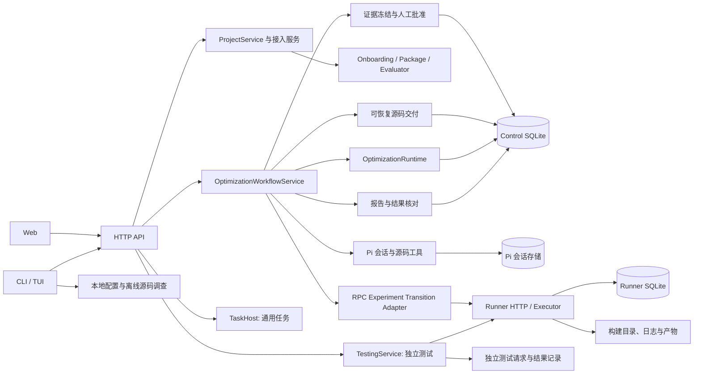

# CorePilot 系统架构与演进边界

本文依据当前可达源码、契约和测试整理；“当前”与“目标”分别标注。它不证明任何新 CPU、模型或库已在真实机器验证。代码索引以本仓库工作树为准，历史证据维持原样。

## 当前系统与实际调用



| 当前模块与主要入口 | 实际职责和边界 |
| --- | --- |
| [CLI 装配](../../src/cli.ts)、[HTTP](../../src/http/server.ts)、[Web](../../web/src/App.tsx) | 服务启动装配 Store、TaskHost、Workflow 和 ProjectService；Web 与在线 CLI 走同一 HTTP 服务。CLI 的配置和离线调查仍有本地入口，并非所有命令都经 HTTP。 |
| [项目与接入](../../src/application/project-service.ts)、[项目路由](../../src/http/project-routes.ts)、[源码调查](../../src/onboarding/onboarding-agent.ts) | 管理项目、机器选择、接入草稿、基线和验证资产；调查是发现，不自动证明构建或测试资格。验证试跑与人类确认各有服务。 |
| [独立测试](../../src/application/testing-service.ts)、[测试路由](../../src/http/testing-routes.ts) | 选择源码或二进制的两端、机器和固定方案，复用 Runner 计划、测量与统计；不修改源码、项目基线或审批记录。文件比较不需要先创建优化任务或源码项目，但仍须有适用测试方案。 |
| [公开任务服务](../../src/workflow/optimization-workflow-service.ts)、[Agent 流程](../../src/workflow/public-agent-workflow.ts) | 前者创建持久工作流和任务、接线会话及 Runner、维护进度和恢复；后者组织调查、候选、正式验证、反馈与复验。它们共同承担编排，目前并非两个独立领域系统。 |
| [Pi 会话](../../src/agent/pi-optimization-session.ts)、[模型适配](../../src/model/pi-provider.ts) | Pi 管理 transcript、工具循环、检查点和 follow-up；CorePilot 提供受限工具与领域反馈。现有通用单次 ModelProvider 不是流式主线的完整替代接口。 |
| [领域运行时](../../src/core/optimization-runtime.ts)、[执行适配](../../src/core/rpc-experiment-transition-adapter.ts) | 运行时创建 Task、Hypothesis、Candidate、Experiment 和反馈；适配器用 RPC 提交/查询/取消实验并同步事实。当前 `core/` 仍存在对 workspace、evaluator 和 client 的具体依赖，目标依赖方向尚未全面落地。 |
| [Runner](../../src/runner/experiment-executor.ts)、[Runner 存储](../../src/runner/sqlite-runner-store.ts) | 接收固定计划、串行获取本 Runner 的独占资源、执行命令并保存原始结果。Runner 不调用模型或决定全局候选。 |
| [报告](../../src/report/optimization-report.ts)、[批准用例](../../src/application/workflow-approval-service.ts)、[交付用例](../../src/application/workflow-delivery-service.ts) | 报告从已保存事实生成视图；批准用例冻结证据并调用领域批准，交付用例引用该批准、持久化请求并经 Git 适配器更新目标。批准和交付是两次不同的人类操作。 |

## 当前状态与事实所有权

| 对象 | 创建、修改与读取 | 注意 |
| --- | --- | --- |
| Workflow | WorkflowService 写 `optimization_workflows` JSON；HTTP、Web、CLI 和报告读取 | 持有进度、候选/实验引用、会话与交付摘要；`WAITING_APPROVAL` 是工作流状态，不是当前证据的独立证明。 |
| OptimizationTask、Hypothesis、Candidate | OptimizationRuntime 和 Store 分别写入领域表；报告、Agent 历史与工作流读取 | Candidate 冻结源码提交和树；工作流也缓存其引用。Task 与 Workflow 的状态分别写入，不能假定跨表转换总是原子。 |
| Experiment、CommandExecution、Measurement | Runner 管理远端执行事实；RPC 适配器以稳定 ID 同步到 Control，Runtime 记录评价；报告及 Agent 读取 | Runner 状态与 Control 副本是两个位置的事实；断线后查询原 ID，未知不能视为失败或立即重跑。新测试与复验产生新实验。 |
| 会话与进展 | Pi 持久会话记录消息/工具事件和检查点；Workflow 存当前摘要；Web 游标读取事件 | 进程内 controllers/sessions 只表示当前接管情况，不是持久结果。启动时按状态查询全部待恢复工作流和复现，不受公开列表 200 条限制；交付恢复单独查询待核对记录。 |
| Evidence、领域 Approval、Delivery | 工作流引用冻结证据；`OptimizationRuntime.approveCandidate` 校验后事务保存 Approval；公开交付引用批准和证据并更新 Git | 新路径要求具名人类决定；冻结、批准和交付分别操作。历史交付不补造 Approval，旧的未完成请求须先核对并撤回后重新审阅。 |

Control SQLite 在 [SqliteTaskStore](../../src/storage/sqlite-task-store.ts) 中保存项目、机器、工作流 JSON、领域对象、命令与测量；部分关联写入有事务，但跨 Workflow、领域事实、会话和文件系统没有统一原子提交。Runner 有独立 SQLite。源码归档、基线、测试包、构建产物和导出报告由文件系统保存；Pi 会话有自己的持久存储。当前命令输出与测量仍可随记录存储和整批读取，不能声称已实现通用分块日志或对象存储。

源码优化与正式优化的入口均先构造领域 Task，再在单个 SQLite 事务中保存 Task、Workflow 和所提供的请求幂等身份，提交后才启动工作。事务内再次核对幂等键：同一请求复用已有 Workflow，不同输入拒绝；历史同键多条记录需人工核对，不自动选取或删除，也不新增可能令历史库无法启动的唯一索引。新执行请求在事务内标记启动中，若提交后、建立会话前中断，重启会明确显示 `INTERRUPTED`，不会留下无法定位的任务。没有检查点时仍需新建任务，旧任务与旧孤儿记录保留。

启动恢复将中断的 Workflow 和状态仍为 `CREATED`/`RUNNING` 的 OptimizationTask 在同一 SQLite 事务中标记为 `INTERRUPTED`；旧版已写入中断工作流、但领域任务仍在运行的记录也会对账。领域任务已经处于终态或等待审批时保留原状态和候选、审批事实；任务缺失或归属不符时记录错误，不阻止其他记录恢复。会话尚未保存时提示创建新任务，不声称能够恢复。复现的 `PREPARING`/`RUNNING` 只改为 `UNKNOWN` 并保留原实验 ID，继续复现时查询原 Runner；启动本身不会提交、取消或修改远端实验。旧版没有会话且领域任务仍为 `CREATED` 的工作流无法区分尚未启动与启动前崩溃，保持原状态。其余运行期 Workflow、Task 和跨 Runner 的状态写入仍非统一原子状态机。

### 优化与独立测试的已落地边界

公开优化请求可显式选择 `verification_mode: source_only`。缺省仍为原有 `verified`，保留历史配置与行为。源码模式通过现有 WorkflowService、OptimizationRuntime、Pi 会话与源码工具生成冻结 Candidate，`Task.evaluator` 为 `null`，不伪造测试身份；终态 `CANDIDATE_READY` 表示代码待验证，报告分别标明构建、正确性和性能未执行。缺评价器或源码模式的候选不能通过正式实验、批准及交付门禁。

源码模式的预检、Pi 源码用例及会话装配分别在 `src/workflow/source-optimization.ts`、`source-agent-workflow.ts`、`source-optimization-execution.ts`。它们隔离“没有评价器”的用例差异，复用原有工作区、候选、预算、取消与检查点；没有建立第二套 Agent 工具循环。

独立测试由 `TestingService` 持有请求、固定的方案及两端身份、准备阶段、幂等键和远端提交记录；`TestingStore` 将这些记录原子替换写入数据目录 `testing/tasks/`，将冻结上传资产保存在 `testing/assets/`。该存储沿用现有文件系统边界，没有新增数据库。它不与优化领域表双写为同一候选。原始执行事实仍由 Runner 保存，详情按原作业 ID 对账，完成结果可持久读取。

`TestingSubject` 区分源码与上传二进制。源码使用项目仓库中的固定 commit，上传归档后在本次目录构建；二进制固定文件清单、入口和摘要，再在目标机器核验。两端各自的库路径与依赖都传入同一个评价计划。方案版本与机器连接身份同时固定，恢复不能静默切换方案或机器。

这条路径使用既有 `DEVELOPMENT_FEEDBACK`，不伪装成已获资格的正式优化实验；结果分别返回执行、正确性和性能，`formal_evidence: false`。测试编排、输入解析、方案读取、两端准备和结果汇总在 `src/application/testing-*` 各自负责实际工作；HTTP 和 CLI 调同一应用用例。AI 测试代码起草继续复用项目接入的已有能力，未新增无上下文的通用生成器。

端到端路径：网页或 `corepilot test start --file ...` → `/v1/testing-tasks` → 固定输入及幂等请求 → 保存测试记录 → 上传源码/库包与方案 → 同一 Runner 排队、构建、测量 → 按原 ID 查询事实 → 共享统计模块生成结果 → 页面查看两端身份、正确性、性能和日志。浏览器关闭不会取消；提交状态未知时查询原作业，不再次提交。

## 基于调用关系的主要问题

| 优先级 | 问题与证据 | 影响及判断 |
| --- | --- | --- |
| P0，已做局部修复 | 之前 [结果摘要](../../src/report/customer-summary.ts) 判断实验/复验，而公开 `approvePublic` 只看工作流状态、复现和 Git 身份。 | 后续复验无效时，报告可能不建议交付，交付入口仍可尝试推进。现由 [候选验证核对](../../src/core/candidate-verification.ts) 同时服务报告和公开交付；它是必要的事实核对，不等于完整领域 Evidence/Approval。 |
| P0，已做局部修复 | 公开交付过去不引用领域 Approval。 | 新请求先冻结候选补丁、正式实验、独立复验、原始样本和 evaluator，再记录具名人工批准；交付重新核对证据与现有事实。当前批准只支持包含性能验收的任务，同一 Candidate 的已有批准不能改写；旧交付保持历史状态。 |
| P0，已做局部修复 | Git 分支更新与 SQLite 提交不能原子完成。 | [交付用例](../../src/application/workflow-delivery-service.ts) 先保存操作和固定身份，以操作 ID 固定 Git 提交；启动时逐条核对全部未完成交付。Git 已更新但数据库写入失败可据身份补记；原 Git 进程终态未知时等待人工确认后才继续。该机制不代替正式 Evidence/Approval，也未覆盖其他任务状态的恢复。 |
| P1 | Workflow JSON、领域 Task 和 Runner 执行状态分开保存；服务中的生命周期回调与 Runtime 分别落盘。 | 重启或部分失败可能留下不一致的投影。状态双写和恢复责任是设计问题，而不只是文件过大。需要可对账的持久操作、事务和迁移。 |
| P1 | WorkflowService 同时装配模型、源码、测试资产、RPC、会话、进度、报告和交付；Agent 流程也编排相邻阶段。 | 改恢复/实验接线需要理解多个模块。应按一个用例和事务边界提取职责，不能仅把文件拆小或增加转发层。 |
| P1 | 领域运行时直接引入 evaluator 和 workspace；执行 backend 接口与 RunnerClient 实现在同一模块。 | 替换实现和隔离测试受具体文件系统、传输细节影响；应随真实用例抽出稳定依赖，而非一次性包装所有类型。 |
| P1 | API 层不少错误收敛为 `PROJECT_OPERATION_FAILED` 等字符串；Runner 有较明确错误码，Agent 有分类反馈。 | 用户、Agent、自动化对同一故障可能得到不同粒度。应逐步保留阶段、归属、代码和关联 ID，避免把基础设施异常判成算法退化。 |
| P2，需测量 | [RunnerClient](../../src/client/runner-client.ts) 明确提到同步 SSH/scp 可能阻塞控制端；报告构造会加载每次实验的命令和测量，Web 周期性刷新。 | 存在事件循环与大量记录的潜在成本，但本轮未做负载测量，不能声称它们已成为实际瓶颈。先测阶段耗时、事件循环延迟、响应大小和数据库查询。 |

## 推荐目标：模块化控制端 + 独立执行端

保持单控制端进程和独立 Runner，先强化边界与持久化，不预设微服务、事件溯源、消息队列或新数据库。高并发、多租户或跨机器调度由实测需求驱动。逻辑依赖如下；这是目标，现有跨层 import 按切片迁移。

```text
Web / CLI / HTTP / TUI
        ↓ 输入、授权、展示
应用用例：项目接入 / 优化任务 / 实验 / 结果与交付
        ↓ 调用领域规则与能力端口
领域：任务、候选、实验、验证、Evidence、Approval、Delivery
        ↑ 实现端口
适配器：Pi/模型、RPC/Runner、SQLite、Git/文件、CPU/工具链、Package/Evaluator
```

允许入口依赖应用契约；应用编排领域规则及执行、存储端口；领域纯规则只依赖契约和标准数据类型。适配器依赖端口与外部协议。禁止领域规则导入 Web、CLI、供应商 SDK 或特定库；禁止界面另算正式判定；禁止 Runner 推理、选择候选或授予人类批准。依赖装配发生在程序入口。当前 [候选验证核对](../../src/core/candidate-verification.ts) 的只依赖 contracts 由 `npm run check:repo` 检查；这不代表整个 `core/` 已达到该约束。

建议继续使用现有目录按职责演进，不要求一次搬迁：

```text
src/contracts/       跨入口协议与领域身份（现有）
src/application/     接入、任务、结果、交付等用例；逐步承接 workflow 装配（部分已有）
src/core/            无外部副作用的领域规则；现有混合职责逐步迁出（部分目标）
src/workflow/        现有持久会话与优化编排；随用例迁移收敛，而非复制
src/agent/, model/   Pi 会话和模型适配；SDK 类型不向领域规则泄漏（部分目标）
src/library-package/, evaluator/  库事实与固定测试契约
src/runner/, client/ Runner 执行、平台探测、RPC 客户端
src/storage/         数据与事务实现；二进制/大日志可由产物接口引用（后者待建）
src/http/, cli*      API、CLI、TUI 入口
web/                 使用同一 API 和服务端判定的界面
```

### 抽象、调用方和成本

| 抽象 | 已解决/拟解决的问题与调用方 | 隔离的变化和成本 |
| --- | --- | --- |
| `assessCandidateVerification`（已落地） | 报告与公开交付需要同一份当前实验核对；输入 Workflow、Task、Candidate、按持久插入顺序排列的实验，返回原因代码与实验 ID。 | 隔离存储和展示；每次读取需要获取当前实验，已有历史缺少身份时会得到“待核对”。不冻结 Evidence、不替代人类审批。 |
| `ExperimentExecutionBackend`（已有，需调整放置） | RPC 适配器调用同一组 submit/get/reconcile/cancel 能力；解决远端状态与控制端解耦。 | 隔离 Runner 传输和状态查询；成本是协议版本、重试与一致性测试。当前接口和 RPC 实现在同一文件，尚非完全独立。 |
| 交付用例（已局部落地） | Web 与 CLI 共用交付请求、核对、继续、撤回和清理；冻结候选、基线、实验身份及 Git 提交，重启后以操作 ID 对账。撤回保留原请求，不能回退已交付提交。 | 隔离 Git 和 SQLite 跨资源失败；需维护操作状态、停止确认与冲突处理。交付请求不是正式人类 Approval。 |
| 持久任务用例与事务边界（目标） | 由 HTTP/CLI 提交、恢复、取消；把状态与相关事实原子保存，并以稳定 ID 对账 Runner。 | 隔离入口和进程重启；成本是迁移、崩溃注入及版本兼容。只在相应持久化用例落地时引入，不另建万能 Manager。 |
| Agent session 适配（目标收敛） | 优化用例需要启动、恢复、补充要求、取消与消费事件；Pi 继续拥有工具循环。 | 隔离 SDK 消息和模型传输；成本是工具参数、流式错误、usage 和恢复的契约测试。不能重写 Pi 循环。 |
| Evidence / 人类决定用例（已局部落地） | Web 与 CLI 准备同一份冻结证据、供人审阅下载并明确批准；交付用例重新核对批准身份。 | 保留原始测量和人类决定，但冻结包当前整体读入内存，且只支持性能验收通过的候选；批准后的新实验需要新的候选身份重新审阅。 |

当前已落地的核心接口示例：

```ts
assessCandidateVerification({ workflow, task, candidate, experiments }): {
  ready: boolean;
  formal_experiment_id: string | null;
  revalidation_experiment_id: string | null;
  issues: Array<{ code: CandidateVerificationIssueCode; message: string }>;
}
```

它比较候选与工作流源码身份、最新正式实验及其后最新复验、执行/有效性/覆盖、测试方案、基线、机器和资源记录；性能任务还要求性能验收通过。未通过时报告保留原始事实并列原因，公开交付返回 409 和同一组结构化原因。它不检查或生成冻结 Evidence，不创建领域 Approval Record，也不授予人类授权。

现有 [执行端口](../../src/core/experiment-execution-backend.ts) 摘录如下；`reconcileExperiment` 查询已提交的原 ID，不能替换成再次提交：

```ts
interface ExperimentExecutionBackend {
  readonly mode: 'rpc';
  submitExperiment(plan: ExperimentExecutionPlan, signal?: AbortSignal): Promise<SubmitExperimentResponse>;
  getExperiment(id: string, signal?: AbortSignal): Promise<ExperimentStatusResponse>;
  reconcileExperiment(id: string, signal?: AbortSignal): Promise<ExperimentStatusResponse>;
  cancelExperiment(id: string, signal?: AbortSignal): Promise<CancelExperimentResponse>;
  // 还提供 preflight、命令记录与测量读取。
}
```

### 端到端及生命周期

1. Web 或在线 CLI 选择 Project/Package、目标、机器和预算，经 HTTP 进入共享服务；服务检查已保存配置和接入资产并创建 Workflow 与 Task。离线调查仍可单独运行。
2. 任务会话恢复或创建源码工作区，Pi 通过工具调查并提交冻结 Candidate；开发调查与正式评价分开。
3. 控制端创建实验身份和固定计划，通过 RPC 提交 Runner；Runner 排队、建立隔离工作目录、构建、执行正确性与性能测量，记录资源与原始样本。控制端按 ID 对账并保存评估和反馈。
4. 通过首轮的候选使用新 Experiment 做独立复验；报告与交付前核对读取同一批持久事实。用户准备冻结证据并审阅源码、范围及结果，具名批准后单独确认 Git 交付；历史记录不补造批准。
5. 取消是请求而非终态：Runner 确认前不宣称已停止；断线或 Runner 重启后状态未知则对账原 ID，资源未确认释放前保持占用。重新验证创建新实验；原实验及历史人类决定保留。

### 存储、诊断和部署

- 业务状态及索引先继续使用 SQLite；关键跨表更新应采用事务和可恢复操作。跨 Git、Runner 和数据库不假装有分布式事务，保存幂等键、操作阶段及补偿/对账依据。
- 事件用于观察和恢复关联，不自动成为权威领域状态；日志可限量展示并关联完整产物，原始样本和二进制按身份、摘要、权限及保留策略存放。大对象流式化是待测量和实施的目标。
- 错误至少包含阶段、归属（候选/评价器/资源/执行/协议/未知）、稳定代码、关联 ID 和可行动建议；用户看到摘要，Agent 取得有界证据，原始输出仍可查。不要把原始异常字符串当唯一协议。
- 本地安装和私有服务复用当前核心、HTTP、存储与 Runner 协议；本地命令可离线调查。未来 SaaS 必须新增隔离的身份、租户授权、数据隔离、密钥和资源配额，当前单凭访问 token 不等于已有多租户能力。
- CPU 能力与工具链由 Runner 探测并与目标执行事实绑定；库语义由 Package/Evaluator 提供；模型通过适配层和 Pi 能力验证。新增 CPU、库或厂商不得以名字分支驱动领域状态机。

## 迁移顺序与完成条件

1. **验证与交付事实一致（本切片）**：报告、HTTP/CLI 交付检查与 Web 同源；最近失败优先、历史保留、源码/机器/测试方案身份不一致被拒绝；单元、公开入口和浏览器 fixture 覆盖。
2. **贯通 Evidence、人工决定和交付（已局部落地）**：公开入口提供冻结证据和具名人类决定；新交付引用批准的 Candidate/Evidence。Git 与 SQLite 的交付操作可对账；旧交付维持历史状态。后续需按真实使用场景扩展纯正确性任务及同一 Candidate 多次独立批准，不回写旧记录。
3. **状态与恢复一致性**：明确 Workflow 是用例状态、Task/Experiment 为领域事实；创建及状态变更采用事务或可恢复的操作记录。交付路径已覆盖崩溃、重复请求及超过 200 条记录的发现；其他任务与 Runner 未知状态仍需各自验证。
4. **收敛编排与适配器**：沿真实用例把 WorkflowService 中的会话装配、执行与交付依赖分离；移除被替代路径；Pi/RPC/存储替换测试不修改领域判断，Web 与 CLI 仍使用相同用例。
5. **测量后治理扩展**：采集真实阶段耗时、日志大小、事件循环延迟和队列等待；针对测得瓶颈做异步传输、查询/索引或大产物分页。逐库、逐 CPU 用目标真机证据扩展，不用 fixture 推断性能收益。

每一步以公开入口行为、重启后事实和可执行测试为完成条件，而不是以目录或接口数量为完成条件。
