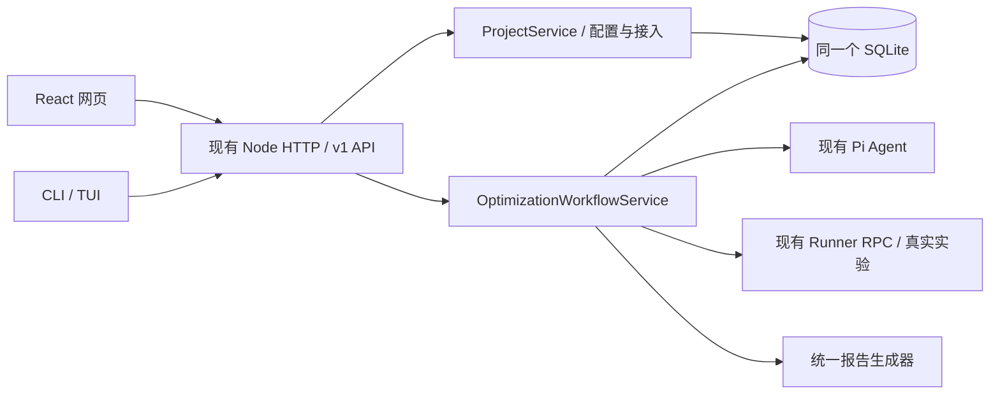

# CorePilot 网页工作台 V1：架构与交付范围

更新：2026-10-22。首版源码已实现，使用与部署见[网页工作台指南](../guides/web-workbench.md)。本文区分实现范围和后续能力，不代表已部署到实际 Linux 服务器或完成新的 ARM 性能实验。

本实现遵循根目录统一的[开发宪章与工程指南](../../AGENTS.md)，在现有 CorePilot 上增加浏览器入口。用户已确认常驻 Linux、浏览器访问、明亮简洁的工作台风格，以及网页和 CLI 必须共用后端。

## 1. 一个 Control，两种客户端

`corepilot web` 调用 `serve --web`，由同一 Node 服务提供 `web/dist` 和 API。没有另建网页任务系统、执行器、统计规则或数据库。网页使用现有 ApiClient 和领域契约，优化仍走 Package → Agent → Candidate → Experiment → Feedback/Report。

`--project <id>` 解决远程 CLI 的路径问题：服务器根据项目 ID 解析源码和配置；客户端无需拥有这些文件。已有 `--config` 模式和 TUI 保持兼容。同一数据库中的两端任务可以互相查看、观察、取消、下载报告和显式人工交付。

## 2. 源码职责

| 位置 | 职责 |
| --- | --- |
| `web/src/App.tsx` | 登录、项目选择、导航、任务提交、状态查询 |
| `web/src/Configuration.tsx` | 模型、机器、testpack/Package、Runner 配置表单 |
| `web/src/Workbench.tsx` | 阶段、候选、差异、实验、样本、报告和人工交付界面 |
| `web/src/components.tsx`、`style.css` | 统一视觉组件、响应式布局和状态样式 |
| `src/application/project-service.ts` | 项目注册、配置读写、运行前检查、连接测试和现有 onboarding 接入 |
| `src/http/` | 原有 HTTP 服务上的会话、项目路由、共享 workflow 路由和静态资源 |
| `src/client/api-client.ts`、`workflow-commands.ts` | CLI 与浏览器共用的工作流 API；CLI/TUI 的报告与观察路径 |
| `src/workflow/optimization-workflow-service.ts` | 继续作为公开优化入口，调用现有 Pi、Runtime、Runner 和报告生成器 |
| `src/storage/sqlite-task-store.ts` | 项目与原有领域记录的同库持久化 |
| `deploy/linux/` | systemd、环境变量、反向代理配置示例 |

前端只负责交互和展示。正确性判定、性能 gate、实验有效性、qualification 和批准含义仍来自后端；没有在浏览器重算验收结论。

## 3. 实现的用户流程

添加服务器源码项目 → 导入/编辑配置 → 运行前检查 → 创建优化任务 → 查看候选与实验 → 下载报告 → 人工审阅和源码交付。

| 页面 | 已实现 |
| --- | --- |
| 登录 | 使用服务器管理员凭据建立 HttpOnly 会话；退出不在浏览器保留 token |
| 项目概览 | 服务器路径、配置、最近任务、运行前检查、只读源码调查 |
| 模型与机器 | endpoint、模型列表与工具调用测试、SSH 连接、构建/验证、Runner 和高级配置 |
| 优化任务 | 真实阶段、候选切换、源码差异、运行配置、日志详情、显式取消 |
| 实验分析 | 首轮/复验记录、正确性覆盖、逐 workload 加速比、原始样本筛选 |
| 优化报告 | Markdown/JSON 下载、完整记录、限制说明和人工交付入口 |

项目配置保存在服务器。导入已有配置直接复用；新项目在数据目录创建配置，源码不会因注册项目而被修改。模型和 Runner 凭据读取时脱敏，保留掩码时保留原值。环境变量引用由服务器解析。

源码调查调用既有 onboarding，写入数据目录的 catalog。Loader 同时读取随发行包提供的 Package/evaluator 与持久化扩展目录；相同 Package identity 不能静默覆盖。Draft 保持 Draft，需要真实人工审阅和 qualification。

当前配置按项目复用，不另建全局 profiles 系统。新库正式 oracle/benchmark 编写、目标 qualification 继续通过既有工程流程完成，网页表单不替代这些工作。

## 4. 页面与结果语义

视觉沿用[已确认的效果图](../design/corepilot-task-workbench-v1.png)：白灰背景、单一蓝色主色、固定侧栏、阶段条、紧凑指标、左侧执行/性能、右侧候选/环境。原效果图是生成的视觉草案；产品不复制其中虚构的数据。

实际浏览器截图由测试生成在 `build/web-workbench-fixture.png`。截图里的模型和测量来自离线测试夹具，不代表飞腾硬件性能结果。字体和图标不依赖外部 CDN。

显示执行状态、实验有效性与正确性/性能评价；进程退出 0 不自动显示为正式验证通过。兼容 testpack 缺少完整 case/复验证据时，明确提示无效或不完整，保留原始样本供排查。

加速比图以 baseline=1 为参照，原始数据表保留记录中的单位。没有真实区间时不绘制置信区间。切换候选会同时切换关联实验，不自动标注“最优”。

报告是已保存事实的快照。人工源码交付调用与 CLI 相同的 workflow approve；冻结 Evidence 的领域批准记录按实际记录另行展示。下载报告不会批准、合并或修改实验事实。

## 5. 会话、状态与断线

- 浏览器 cookie 与 CLI Bearer 使用同一个 `COREPILOT_SERVER_TOKEN`，访问同一 API。会话有效期 24 小时；token 不写入浏览器 localStorage。
- 修改请求校验同源。生产反向代理保留 Host 和 X-Forwarded-Proto；HTTPS 下使用 Secure cookie。
- 以有界轮询读取任务快照，浏览器关闭不取消工作。连接恢复后重新读取真实记录，不生成虚构活动。
- 网页一次任务提交使用稳定 Idempotency-Key；网络重试返回原 workflow ID。不同输入复用该 key 会报错，去重记录随工作流保存在 SQLite。
- 取消请求与后台确认停止分开。没有当前进程 controller 时返回实际原因，不显示“已取消”。
- 查询同时返回当前进程接管的 workflow ID。服务重启后尚未接管的活动记录明确提示需要核对，状态不会自动改成失败，也不会重复提交远端实验。

当前没有完整 Pi Agent checkpoint/崩溃续跑能力；这与浏览器刷新后继续观察不同。新的正式实验与测量仍遵守原有 Runner 持久化、资源约束和身份规则。

## 6. Linux 与发行包

首版采用原生 Linux + systemd，保留现有 Git、SSH、源码路径和工具链。Control 提供静态页面和 API；反向代理提供 HTTPS。Runner 保持目标机独立服务。

数据目录与程序版本分开：SQLite、项目配置、扩展 catalog、候选 worktrees 与默认报告保存在数据目录。导入项目的外部配置、baseline、源码仓库和自定义 output_dir 保留原路径，备份时一并覆盖。已有历史数据库需要明确选择，不自动迁移或合并。

CLI 发行包同时包含 `web/dist`、部署模板、Package/evaluator、生产依赖和使用指南。安装时无需编译网页。Node/Git/SSH 和目标工具链由部署环境提供。

部署指南包含启动、环境文件、服务账户、SSH、反向代理、升级与停服务一致性备份。尚未在用户指定的常驻 Linux 主机上执行安装、升级恢复演练或新增真实 ARM 实验。

## 7. 验证与后续边界

首版验证覆盖类型检查、生产构建、既有离线测试、新增 API/CLI 互通测试、实际浏览器操作、报告下载、人工交付，以及 1920/1440/1366/900/390 宽度布局。打包验证从干净解压目录检查网页资源、浏览器会话和 CLI 对同一项目的读取。

浏览器测试使用本地协议模型与本地子命令验证接线；真实 RPC 信任边界继续由原有 Runner/evaluator 测试覆盖。两者都不能代替新的真实飞腾性能实验。

以下仍是后续能力：全局 profiles、团队账户、Git clone 表单、网页内完整 evaluator 编写/qualification、游标日志与 SSE、跨任务统计查询、更大规模历史分页、自动恢复 Agent 会话。当前任务列表查询最近 200 条，日志通过实验详情按需读取完整报告快照，尚未实现增量日志传输。
