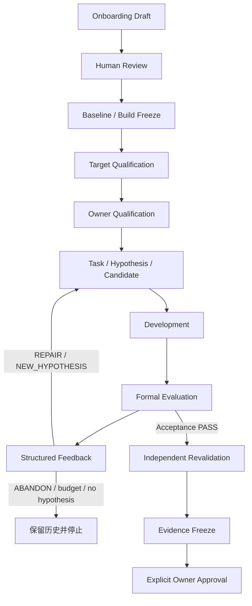

# 当前 Optimization Lifecycle

核对日期：2026-10-15。本文映射当前实现与 [IPPI C002 Approved Result](../../examples/ippi-dilate3x3-success-case/README.md)。阶段名称描述工作顺序，不构成新增 CLI、统一状态枚举或自动状态转换。

## 生命周期与执行者



图中 Human Review、Freeze、Qualification、Evidence Freeze 和 Approval 都包含人工操作。箭头不表示当前有一条 CLI 自动串联全部阶段；Development Gate 的触发条件见后文。

| 阶段 | 现有入口与产物 | 实际状态 / 判定 | 执行者与人工操作 |
| --- | --- | --- | --- |
| Onboarding Draft | `corepilot package init <repo-path>`；Package、Evaluator skeleton、调查 Evidence | Package `qualification.state = DRAFT`；Evaluator `qualification.status = DRAFT`；build `DISCOVERED` | 无 `--config` 为离线 inspector；有配置为 Pi 受控调查；操作者提供源码与可选 target |
| Human Review | 审阅 `onboarding/evidence.json`、build proposal、API、scope、tests/benchmarks 和 UNKNOWN | 调查记录中的 `human_decisions` 初始为 `PENDING`；这不是统一 Workflow 状态 | Owner 确认 build、target、scope、oracle/tolerance、workloads、baseline、acceptance/resources；没有 `package review` CLI |
| Baseline / Build Freeze | 审查后的 build definition、源码 commit、目标机 toolchain 与 artifact identity | commit、flags、SHA、SONAME、machine 与 build context 是事实记录；没有通用 `BASELINE_FROZEN` 状态 | 操作者组织真实构建并冻结结果；Onboarding 不执行该步骤；C002 对应 self-baseline 和 build-binding 记录 |
| Target Qualification | Evaluator 静态 inspection，加真实目标机 qualification 脚本与测量 | Evaluator attestation 可记录 `DRAFT`、`QUALIFICATION_PENDING`、`TARGET_VALIDATED`；静态检查不等于 target validation | 操作者组织 S5000C 构建、oracle/cases、benchmark、sampling、resources 和身份验证；不自动批准 |
| Owner Qualification | Package manifest qualification 与 Evaluator `qualification.json` 各自的审查记录 | Package 可记录 `DRAFT / REVIEWED / QUALIFIED / REJECTED / SUPERSEDED`；Evaluator `QUALIFIED` 绑定精确 digest 和所需 reviewer approval | Owner 决定并由操作者更新相应记录；没有统一 qualification CLI；Package state 尚不是 Loader 强制执行的正式门禁 |
| Task / Hypothesis / Candidate | `corepilot optimize --config ... --function ... --performance`；public preflight、`record_hypothesis`、源码 checkpoint、SQLite domain records | Task `CREATED / RUNNING`；Hypothesis `PROPOSED`；新 Candidate 绑定 Hypothesis，源码以 commit/tree/archive/files 固定 | Control Plane 创建与持久化；Pi 调查、提出 hypothesis 并修改 scope 内源码；操作者先准备运行绑定与预算 |
| Development / Formal | 已配置的 target investigation tools、Development Gate；RunnerClient → RPC → build/correctness/performance | Development 为 `DEVELOPMENT_ONLY`；Formal Experiment 的 `status` 与 `validity` 分开；Acceptance 由 Control Plane 判定 | Agent 可用开发反馈；Formal Evaluator 与 resource enforcement 由系统执行；开发结果不能替代 Formal Evidence |
| Feedback | `CandidateEvaluationFeedback`、HypothesisOutcome、下一轮 reasoning history | Hypothesis outcome 为 `ACCEPTED / REJECTED / INCONCLUSIVE`；不是 Owner Approval | 系统生成结果与失败依据；Agent 用 `REPAIR / ABANDON / NEW_HYPOTHESIS` 决策，受原预算约束 |
| Revalidation | 标准 workflow 调用独立 Experiment；C002 历史续跑由操作脚本组织 | Experiment type `REVALIDATION`；标准流程通过后返回 `WAITING_APPROVAL`；不是自动 APPROVED | Runner 重新 staging/build/测量；Control Plane 重新评估 acceptance；操作者检查与首轮的身份、scope 和结果一致性 |
| Evidence Freeze | 本案 `freeze-c002-evidence.mjs`：归档、inventory、`evidence.json`、freeze receipt | 本案冻结记录为 `FROZEN`；冻结时 `human_approval = NOT_REQUESTED` | 操作者通过本地脚本收集事实并核验文件；生产代码有 frozen-evidence verifier，未接成统一 freeze CLI |
| Approval | 领域 `OptimizationRuntime.approveCandidate`；本案 `approve-c002.mjs` 调用它 | Approval Record `APPROVED`；Candidate `APPROVED`；记录 Evidence `FROZEN → APPROVED` 的审批状态 | Owner 显式授权；操作者调用已有 API，系统核对独立实验、身份、acceptance 与冻结 Evidence；不自动 merge/delivery |

## 实际 CLI 与配置入口

以下为新任务使用的命令形式，不是重放 C002 的命令清单；本轮文档整理没有执行它们：

```text
corepilot package list
corepilot package inspect ippi-ft 0.1.0
corepilot package init /path/to/new-library --target public_symbol
corepilot package init /path/to/new-library --target public_symbol --config phyopt.yaml
corepilot optimize --config phyopt.yaml --function public_symbol --file src/entry.c --performance
corepilot workflow status <workflow-id>
corepilot workflow cancel <workflow-id>
```

路径、symbol 和 Workflow ID 必须使用实际值。Package 配置见 [Library Package](library-packages.md)；`--file` 只是优先读取入口，不能扩大 Package/Hypothesis writable scope。正式 Package preflight 要求 RPC，按 evaluator owner/id/version/digest 核验 Qualified bundle。模型、Runner endpoint/token 和机器路径由运行配置绑定，不放入 Package。

`corepilot package init` 的全部选项以 [CLI 实现](../../src/cli.ts)为准：`--id`、`--version`、`--target`、`--config`、`--api-key`、`--output-root`。不应从概念阶段推导出 `package qualify`、`evaluator qualify`、`evidence freeze`、`workflow export` 等命令。

## Development 与失败反馈的边界

生产 workflow 在配置了 development controller、findings 提出具体 transformation 且存在选定 workloads 时才调用 Development Gate。该 gate 比较调查前后的 cheap benchmark，提前拒绝明显退化；它不是每个任务无条件执行的独立 correctness gate。C002 的 development correctness 由历史操作脚本执行，不应写成当前所有 RPC workflow 都自动先跑开发 correctness。

Formal correctness 失败时，系统保存具体 case、coverage、domain parameters、诊断和 failure origin，再交给下一轮 Agent。`REPAIR` 保留 producing Hypothesis 并生成新的 Candidate；`NEW_HYPOTHESIS` 先持久化 child proposal；`ABANDON` 保留失败记录。没有证据支持新变更、Agent 放弃或预算耗尽时停止。

Experiment 的执行结果、评估结果和数据有效性分开记录：

| 字段 | 现有值 | 含义 |
| --- | --- | --- |
| `execution_status` | `COMPLETED / FAILED / TIMEOUT` | 进程执行事实 |
| `evaluation_status` | `PASS / FAIL / UNKNOWN` | 是否有可信 Candidate 评估结论 |
| `contract_status` | `VALID / VIOLATED` | measurement/evidence contract 是否成立 |
| `violation_reason` | `MISSING_RESOURCE_CONTEXT / MISSING_MEASUREMENT_FIELD / INVALID_EVIDENCE` 或 null | 缺资源、缺字段或证据错误的具体层级 |
| `failure_origin` | `CANDIDATE / EVALUATOR / EXECUTION / CONTRACT` 或 null | 失败归属 |

缺资源 context 或 evaluator/执行故障不等于 Candidate correctness FAIL。无效命令输出保留为诊断，不成为 Formal measurement。详见 [Candidate Feedback](candidate-feedback.md) 和 [Hypothesis Model](optimization-hypotheses.md)。

## Qualification 与 Approval 的区别

Package qualification 表示接入描述的审查记录；Evaluator qualification 表示特定 evaluator 内容和 target evidence 的资格。`LibraryPackageLoader.resolveSelection(..., { requireQualified: true })` 当前把选项传给 evaluator loader，没有同时强制检查 Package 的 `qualification.state`。不能把 Owner 对 Package 的要求写成已经实现的同等执行门禁。

通用 evaluator loader 有针对一个精确 `TARGET_VALIDATED` digest 的 bootstrap 参数；标准 public Package preflight 不传入它。本案使用的是已经 Owner 批准的 `QUALIFIED` evaluator。Package QUALIFIED、manifest valid、target validated 均不能自行授予 Agent 正式批准权限。

领域 Approval API 核对同一 Candidate 的首次 Formal 和不同 ID 的 Revalidation、已 Qualified Evaluator、冻结 baseline、machine identity、有效资源与完整 acceptance，以及冻结 Evidence 的逐文件 identity；记录 reviewer、approved_at 与显式 Owner 授权。它不执行源码合并。

CLI 的 `corepilot workflow approve <workflow-id> --commit-message <说明>` 调用另一条 `approvePublic → approveAndCleanup` 路径：要求 Workflow 为 WAITING_APPROVAL，merge 源码并清理 worktree，变为 DELIVERABLE。它不是创建本案领域 Approval Record 的复现方式，也不能用于把历史 FAILED Workflow 改称已交付。

## 统计口径

当前 gate 使用 baseline/candidate raw samples 的 median ratio 和 workload weight 计算 weighted geomean。有 `ci_lower` 时使用它；没有时以 speedup ratio 替代，并以各 workload 下界或替代值的最小值填充 `overall_ci_lower`。该函数不会根据 `confidence_level` 自行计算 bootstrap 或其他 95% CI。

C002 两次记录的 Acceptance PASS 和 raw measurements 原样保留，但 `confidence_level = 0.95` 只是配置，不能作为已经证明 95% CI 的结论。该限制应随案例、结果表和 Evidence 引用一起解释，不修改既有 policy 或结果。

## C002 的历史状态与证据

本案 C001 由 Pi 生成，C002 repair 记录来自 Codex；Formal 重试、独立复验、Freeze 和 Approval 由本地操作脚本衔接。SQLite 当前 Candidate/Approval/Evidence 的审批状态为 APPROVED，原 Task/Workflow 保持 FAILED，未 merge/delivery。冻结包中保留审批前 Candidate/FROZEN 与 `NOT_REQUESTED` snapshots，新增审批记录表达后续状态。

Revalidation 归档还同时保留 Runner `SUCCEEDED / validity UNKNOWN` 与 Control Plane domain Experiment `SUCCEEDED / validity VALID`，读证据时必须注明层级。完整关联和本轮只读核验见[案例证据索引](../../examples/ippi-dilate3x3-success-case/evidence-index.md)。

## 实现映射

| 能力 | 当前实现 |
| --- | --- |
| CLI 命令与参数 | [cli-command-spec](../../src/cli-command-spec.ts)、[cli](../../src/cli.ts) |
| 只读调查与 Draft | [onboarding-agent](../../src/onboarding/onboarding-agent.ts)、[repository-inspector](../../src/onboarding/repository-inspector.ts)、[draft-writer](../../src/onboarding/draft-writer.ts) |
| Package / Task 映射、Formal preflight | [loader](../../src/library-package/loader.ts)、[task-definition](../../src/library-package/task-definition.ts)、[public-optimization](../../src/workflow/public-optimization.ts) |
| Hypothesis、Candidate、feedback 与复验循环 | [public-agent-workflow](../../src/workflow/public-agent-workflow.ts)、[optimization-runtime](../../src/core/optimization-runtime.ts) |
| Failure classification 与统计 gate | [experiment-failure](../../src/contracts/experiment-failure.ts)、[validation-runner](../../src/workspace/validation-runner.ts) |
| Evaluator attestation 检查 | [formal-evaluator](../../src/evaluator/formal-evaluator.ts) |
| Evidence 核验与领域审批 | [frozen-evidence](../../src/workspace/frozen-evidence.ts)、[approval contract](../../src/contracts/optimization-approval.ts)、[SQLite store](../../src/storage/sqlite-task-store.ts) |
| CLI 审批并合并 | [approvePublic](../../src/workflow/optimization-workflow-service.ts)、[candidate-approval](../../src/workspace/candidate-approval.ts) |

旧 patch/多候选/ResourceGrant/导出流程与外部 baseline 调查见[历史资料说明](../history/legacy-and-external-baselines.md)。本文不把它们列为当前标准流程。
