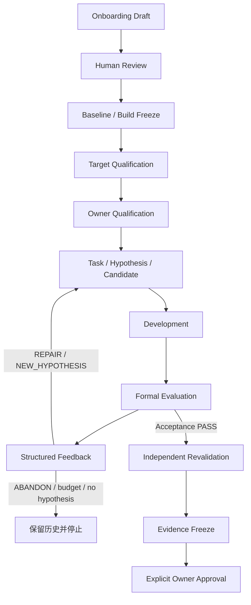

# 当前 Optimization Lifecycle

2026-10-28 更新：项目自建测试方案可通过网页“审阅并启用测试方案”或 `corepilot project validation-review` 留存明确的人类确认，并将通过的受控两库试跑作为目标机资格依据，详见[测试方案指南](test-plans.md)。这一步不将开发测量变成 Formal Evidence，也不批准优化结果或执行合并。公开 CLI 与交互工作台支持输入检查、工作流列表/观察和 Markdown/JSON 优化测试报告；见 [从 CLI 到报告](quickstart-report.md)。

核对日期：2026-10-15。本文映射当前实现与 [IPPI C002 Approved Result](../../examples/ippi-dilate3x3-success-case/README.md)。阶段名称描述工作顺序，不构成新增 CLI、统一状态枚举或自动状态转换。

## 网页中准备一次优化任务

在项目概览选择项目、默认分支、执行机器和目标函数，点击「创建优化任务」后确认本次条件。当前函数没有合适的测试方案时，从任务窗口进入「准备构建与验证」：确认本库构建、选择比较基线，再准备正确性和性能测试、试跑与审阅。也可以从项目概览进入相同的准备入口。测试方案和比较基线保存在项目中，后续任务可复用；返回任务配置后重新核对方案与本次条件。

任务中临时选择的分支与机器不自动修改项目默认值。当前源码识别读取本地检出工作区；生成测试代码和验证试跑使用项目默认环境，分支比较基线构建使用单独选择的分支。若本次任务选择了其他分支或机器，准备页面会提示差异，必要时先调整项目设置并重新核对测试方案。正式任务以所选方案的构建定义为依据，不应将项目通用构建命令当作所有方案最终执行的命令。

已保存测试草稿、试跑结果与方案资格是不同状态。AI 起草的代码仍须审阅和验证；检查通过只说明当前检查项满足条件，不代表正式实验已执行、正确性已通过或性能已提升。`#/validation` 与 `#/settings/validation` 旧链接继续可用于查看原有配置。

仅源码任务和未绑定 Package 的自动验证任务，都须明确选择允许 Agent 修改的仓库相对文件或目录；预检和创建使用同一范围。绑定 Package 的自动验证任务沿用包内固定范围，不接受请求覆盖。目录授权包括目录内的测试、参考实现及构建脚本，务必审阅并排除不应修改的路径。该范围表达用户授权，不能证明 oracle 独立，也不提供进程隔离；仓库内评价资产及同账户构建命令仍需独立审查和隔离。

没有记录范围的历史任务可继续查看原候选与证据。继续由 Agent 编辑前须追加授权，系统检查现有工作区相对原基线的全部改动；原任务验证身份与旧证据不回写。对已冻结候选执行 `workflow retry-validation` 不需要追加源码授权，也不调用模型或要求模型凭据。若原正式实验或复验状态尚未确认，可在页面点击「核对原实验」，或不带 `--allow` 执行 `workflow resume`；系统只恢复与原检查点关联的作业，不调用 Agent 或要求模型凭据。检查点缺失或无法证明关联时保留现场并提示人工核对。

旧开发调查的 `development-job` 独立保存在 Agent 会话，不一定进入正式实验列表，且旧记录未固定 Runner 数据库身份；当前无授权的只核对入口尚不能自动定位或安全对账这类作业。应保留原会话与作业 ID，让维护者核对原 Runner；不要将未确认终态当成失败并重新启动。未来接入固定身份后仍需独立验证。

任务准备默认列出当前项目自建或已绑定、且目标函数匹配的方案。首次绑定外部目录中的其他方案时，可在「选择已有库接入方案」中进入完整目录，核对目标并保存，再返回任务；目前系统不会记录所有曾经绑定过的外部方案。测试条件和代码的未保存修改在当前网页会话内保留；刷新或关闭前浏览器会提示，尚未应用的 JSON、参数名和线程数需先应用才能保存或试跑。

## 生命周期与执行者

项目的比较基线文件保存在 Control 端。RPC 优化任务启动时，系统先按固定 SHA-256 将它同步到 Runner；开发调查、Formal 和 Revalidation 共用本任务核验过的远端副本。Control 文件路径不会作为 Linux 执行路径传给 Agent 工具。两端库依赖也随基线绑定传递。

开发调查与正式实验复用试跑的 CMake 构建隔离规则：相对构建目录指向本次执行的新目录，声明的产物路径随之映射；原编译选项、目标与并行数保持不变。开发测试代码使用已保存的测试资产、种子、单样本调用次数和计时口径。

Agent 可在同一轮中完成删除、重建、重命名和多文件修改，全部完成后通过 `submit_candidate` 提交候选。单次写文件或删除文件不会结束编辑。候选构建失败会携带 Runner 实验 ID、命令记录与错误输出反馈给下一轮修复；它不作为性能退化统计。`revert_file` 从本任务固定的源码基线恢复文件，支持修复已删除文件的失败候选。基础设施、状态未知和取消不被改称为候选性能失败；修复轮次用尽后保留最后的具体失败。



图中 Human Review、Freeze、Qualification、Evidence Freeze 和 Approval 都包含人工操作。箭头不表示当前有一条 CLI 自动串联全部阶段；Development Gate 的触发条件见后文。

| 阶段 | 现有入口与产物 | 实际状态 / 判定 | 执行者与人工操作 |
| --- | --- | --- | --- |
| Onboarding Draft | `corepilot package init <repo-path>`；Package、Evaluator skeleton、调查 Evidence | Package `qualification.state = DRAFT`；Evaluator `qualification.status = DRAFT`；build `DISCOVERED` | 无 `--config` 为离线 inspector；有配置为 Pi 受控调查；操作者提供源码与可选 target |
| Human Review | 审阅 `onboarding/evidence.json`、build proposal、API、scope、tests/benchmarks 和 UNKNOWN | 调查记录中的 `human_decisions` 初始为 `PENDING`；这不是统一 Workflow 状态 | Owner 确认 build、target、scope、oracle/tolerance、workloads、baseline、acceptance/resources；没有 `package review` CLI |
| Baseline / Build Freeze | 审查后的 build definition、源码 commit、目标机 toolchain 与 artifact identity | commit、flags、SHA、SONAME、machine 与 build context 是事实记录；没有通用 `BASELINE_FROZEN` 状态 | 操作者组织真实构建并冻结结果；Onboarding 不执行该步骤；C002 对应 self-baseline 和 build-binding 记录 |
| Target Qualification | Evaluator 静态 inspection，加真实目标机 qualification 脚本与测量 | Evaluator attestation 可记录 `DRAFT`、`QUALIFICATION_PENDING`、`TARGET_VALIDATED`；静态检查不等于 target validation | 操作者组织 S5000C 构建、oracle/cases、benchmark、sampling、resources 和身份验证；不自动批准 |
| Owner Qualification | Package manifest qualification 与 Evaluator `qualification.json` 各自的审查记录 | Package 可记录 `DRAFT / REVIEWED / QUALIFIED / REJECTED / SUPERSEDED`；Evaluator `QUALIFIED` 绑定精确 digest 和所需 reviewer approval | 项目自建方案经受控试跑后，可由网页或 `project validation-review` 显式确认；其他接入仍由 Owner 组织。Package state 尚不是 Loader 强制执行的正式门禁 |
| Task / Hypothesis / Candidate | `corepilot optimize --config ... --function ... --performance`；public preflight、`record_hypothesis`、源码 checkpoint、SQLite domain records | Task `CREATED / RUNNING`；Hypothesis `PROPOSED`；新 Candidate 绑定 Hypothesis，源码以 commit/tree/archive/files 固定 | Control Plane 创建与持久化；Pi 调查、提出 hypothesis 并修改 scope 内源码；操作者先准备运行绑定与预算 |
| Development / Formal | 已配置的 target investigation tools、Development Gate；RunnerClient → RPC → build/correctness/performance | Development 为 `DEVELOPMENT_ONLY`；Formal Experiment 的 `status` 与 `validity` 分开；Acceptance 由 Control Plane 判定 | Agent 可用开发反馈；Formal Evaluator 与 resource enforcement 由系统执行；开发结果不能替代 Formal Evidence |
| Feedback | `CandidateEvaluationFeedback`、HypothesisOutcome、下一轮 reasoning history | Hypothesis outcome 为 `ACCEPTED / REJECTED / INCONCLUSIVE`；不是 Owner Approval | 系统生成结果与失败依据；Agent 用 `REPAIR / ABANDON / NEW_HYPOTHESIS` 决策，受原预算约束 |
| Revalidation | 标准 workflow 调用独立 Experiment；C002 历史续跑由操作脚本组织 | Experiment type `REVALIDATION`；标准流程通过后返回 `WAITING_APPROVAL`；不是自动 APPROVED | Runner 重新 staging/build/测量；Control Plane 重新评估 acceptance；操作者检查与首轮的身份、scope 和结果一致性 |
| Evidence Freeze | 网页“准备审阅证据”或 `corepilot workflow evidence <workflow-id> --prepare` | 固定候选补丁、测试方案、评价器、首轮/复验、命令与原始测量；冻结不授予批准 | 系统核对正式实验、独立复验、资源、原始样本与评价器资格，用户查看或下载 |
| Approval | 网页“记录人工批准”或 `corepilot workflow human-approve` | Approval Record 和 Candidate `APPROVED`；批准绑定具体 Evidence 和两次实验 | 用户填写批准人和明确授权；领域校验后记录决定，不自动 merge/delivery |

## 实际 CLI 与配置入口

2026-10-29 更新：优化主线现使用 Pi `AgentHarness` 的持久 SQLite 会话。提交候选后，系统沿用既有 Runtime 执行构建、正确性、性能和独立复验，反馈继续进入原会话。会话中的消息、工具参数与结果、上下文压缩记录由 Pi 保存，不再每个候选创建一份空白对话，也不再以 32 次模型调用作为优化失败条件。

默认每次探索为 60 分钟、最多评估 8 个候选；可通过创建任务页面的「探索预算」或 CLI `--budget-minutes`、`--max-candidates` 调整。达到预算时为 `BUDGET_EXHAUSTED`，Control 中断时为 `INTERRUPTED`，两者均保留现场。时间预算在新模型请求和工具执行边界检查，正在进行的有超时约束的测试会先结束。关闭浏览器或停止 `watch` 不取消任务。

```text
corepilot optimize --project <project-id> --performance --allow src/kernel.c --budget-minutes 60 --max-candidates 8
corepilot workflow events <workflow-id> --json
corepilot workflow message <workflow-id> --message "先检查大尺寸负载的缓存行为"
corepilot workflow resume <workflow-id> --budget-minutes 30 --max-candidates 4
corepilot workflow resume <workflow-id> --message "根据失败用例修复后继续验证"
corepilot workflow retry-validation <workflow-id>
```

网页任务详情的「Agent 工作过程」与上述 CLI 共用 `/v1/workflows/:id/events`、`messages`、`resume` 接口。过程事件使用游标分页，可查看工具调用详情；补充要求通过 Pi 原生 steering 队列交付。继续任务保持原工作流 ID、源码工作区和测试口径，可更新模型及凭据；构建、测试方案或执行机器变化应创建新任务。旧任务没有持久会话检查点时保留报告，不能假装恢复。

测试包身份冲突、测量契约错误及执行环境故障会进入 `VALIDATION_BLOCKED`（验证受阻），停止向模型重复反馈同一系统故障，不据此认定源码优化失败。修复环境后，网页点击「重新验证当前候选」或运行 `workflow retry-validation`，共同调用 `/v1/workflows/:id/retry-validation`。重试不调用模型、不修改源码、不重建候选，使用原冻结 Candidate 创建新 Experiment；原失败与放弃记录保留。运行中的或远端状态未知的实验须先核对，不能通过重试重复启动。

每个正式实验及独立复验使用各自的 evaluator 副本，位于 Runner 的 `<workspace>/<workflow>/evaluators/experiments/<experiment>/<evaluator>/<version>/<digest>`；不会清理旧实验目录。系统给 setup、正确性、性能命令统一设置 `PYTHONDONTWRITEBYTECODE=1`，避免 Python 导入向不可变测试包写缓存。摘要检查仍覆盖完整测试包；真实内容变化仍拒绝。命令退出 0 但被后置身份或契约校验否决的输出只保留为诊断，不计为正式通过。

`retry-validation` 也可用于对已结束评估的冻结候选重新测量；继续优化会让 Agent 产生新候选，两者分别表达。远端终态未确认时不会启动新的验证。性能 gate v2 将未指定关键负载的下限标记为 `null`（不适用），仍检查全部声明负载与总体停止线；指定的关键负载缺失、负载重复或包含无效样本都会拒绝。原始阈值不改变，历史 gate v1 的结果保留原判定，不按新规则回写。

Control 恢复正式实验时使用已保存的执行计划和原 Experiment ID 对账，不重新准备正在使用的源码目录。重新执行已结束的实验仍需新的 Experiment。开发调查从当前编辑内容生成独立 Git 快照，保护原 HEAD 和 index，通过 Runner RPC 上传源码；同一会话内、同一源码快照复用成功构建，性能调用仍获取新样本。部分基线和 evaluator 资产准备仍使用异步 SSH 兼容传输，全部资产 RPC 化、跨会话构建缓存、候选分支搜索及经验检索仍是后续工作。

当前自动结束策略仍是第一个通过独立复验的候选进入待审阅；持续寻找更优候选尚未接入。会话恢复不是自动批准、Evidence Freeze 或源码合并。当前统计区间限制仍见本指南与报告说明，不将速度点估计称为置信区间。

调查结束但未提交候选时为 `NO_CANDIDATE`，保留明确的结束原因；只有实际评估过候选后，才可能产生 `PERFORMANCE_THRESHOLD_NOT_MET`，避免把调查或执行问题解释成性能优化已经失败。

以下为新任务使用的命令形式，不是重放 C002 的命令清单；本轮文档整理没有执行它们：

```text
corepilot package list
corepilot package inspect ippi-ft 0.1.0
corepilot package init /path/to/new-library --target public_symbol
corepilot package init /path/to/new-library --target public_symbol --config corepilot.yaml
corepilot optimize --config corepilot.yaml --function public_symbol --file src/entry.c --allow src/kernel.c --performance
corepilot workflow status <workflow-id>
corepilot workflow cancel <workflow-id>
```

路径、symbol 和 Workflow ID 必须使用实际值。上述 `--allow` 示例适用于未绑定 Package 的任务；使用 Package 时省略它。Package 配置见 [Library Package](library-packages.md)；`--file` 只是优先读取入口，不能扩大用户或 Package 授权的范围。正式 Package preflight 要求 RPC，按 evaluator owner/id/version/digest 核验 Qualified bundle。模型、Runner endpoint/token 和机器路径由运行配置绑定，不放入 Package。

`corepilot package init` 的全部选项以 [CLI 实现](../../src/cli.ts)为准：`--id`、`--version`、`--target`、`--config`、`--api-key`、`--output-root`。不应从概念阶段推导出 `package qualify`、`evaluator qualify`、`evidence freeze`、`workflow export` 等命令。

## Development 与失败反馈的边界

生产 workflow 在配置了 development controller、findings 提出具体 transformation 且存在选定 workloads 时才调用 Development Gate。该 gate 比较调查前后的 cheap benchmark，提前拒绝明显退化；它不是每个任务无条件执行的独立 correctness gate。C002 的 development correctness 由历史操作脚本执行，不应写成当前所有 RPC workflow 都自动先跑开发 correctness。

Formal correctness 失败时，系统保存具体 case、coverage、domain parameters、诊断和 failure origin，再交给下一轮 Agent。`REPAIR` 保留 producing Hypothesis 并生成新的 Candidate；`NEW_HYPOTHESIS` 先持久化 child proposal；`ABANDON` 保留失败记录。没有证据支持新变更、Agent 放弃或预算耗尽时停止。

Experiment 的执行结果、评估结果和数据有效性分开记录：

| 字段 | 现有值 | 含义 |
| --- | --- | --- |
| `execution_status` | `COMPLETED / FAILED / TIMEOUT` | 进程执行事实 |
| `evaluation_status` | `PASS / FAIL / UNKNOWN` | 是否有可信 Candidate 评估结论 |
| `contract_status` | `VALID / VIOLATED` | measurement/evidence contract 是否成立 |
| `violation_reason` | `MISSING_RESOURCE_CONTEXT / MISSING_MEASUREMENT_FIELD / INVALID_EVIDENCE` 或 null | 缺资源、缺字段或证据错误的具体层级 |
| `failure_origin` | `CANDIDATE / EVALUATOR / EXECUTION / CONTRACT` 或 null | 失败归属 |

缺资源 context 或 evaluator/执行故障不等于 Candidate correctness FAIL。无效命令输出保留为诊断，不成为 Formal measurement。详见 [Candidate Feedback](candidate-feedback.md) 和 [Hypothesis Model](optimization-hypotheses.md)。

## Qualification 与 Approval 的区别

Package qualification 表示接入描述的审查记录；Evaluator qualification 表示特定 evaluator 内容和 target evidence 的资格。`LibraryPackageLoader.resolveSelection(..., { requireQualified: true })` 当前把选项传给 evaluator loader，没有同时强制检查 Package 的 `qualification.state`。不能把 Owner 对 Package 的要求写成已经实现的同等执行门禁。

通用 evaluator loader 有针对一个精确 `TARGET_VALIDATED` digest 的 bootstrap 参数；标准 public Package preflight 不传入它。本案使用的是已经 Owner 批准的 `QUALIFIED` evaluator。Package QUALIFIED、manifest valid、target validated 均不能自行授予 Agent 正式批准权限。

领域 Approval API 核对同一 Candidate 的首次 Formal 和不同 ID 的 Revalidation、已 Qualified Evaluator、冻结 baseline、machine identity、有效资源与完整 acceptance，以及冻结 Evidence 的逐文件 identity；记录 reviewer、approved_at 与显式 Owner 授权。它不执行源码合并。

公开路径依次调用 `corepilot workflow evidence <workflow-id> --prepare`，查看证据后使用 `corepilot workflow human-approve <workflow-id> --reviewer <姓名> --authorization-reference <授权说明> --evidence-digest <摘要>` 记录人工批准，最后以 `corepilot workflow deliver <workflow-id> --commit-message <说明>` 单独交付。旧的 `workflow approve --commit-message` 仍作为交付入口，但同样要求已经取得匹配的领域批准。网页与 CLI 共用这些服务；仅执行正确性、未完成性能验收的任务当前不能生成正式性能优化批准。批准人和授权说明由操作者填写；当前共享工作台没有独立身份认证，不能把该姓名当成已验证的账号身份。

冻结包默认位于工作台数据目录的 `evidence/`，可通过网页下载或 `corepilot workflow evidence <workflow-id> --output <文件>` 获取。文件是 gzip 压缩的 JSON，包含逐文件摘要、候选 Git patch、测试方案、evaluator、两次实验、命令和测量；它不是 tar 包。冻结前分别检查两次实验的正确性用例，并按评价器清单核对每个负载的基线和候选采样数、序号、有效性与评价器身份；缺失或重复的原始记录不能用于批准。系统在批准及交付前重新核对冻结文件、当前事实、评价器资格及源码身份。旧交付不补造批准；批准后若最新实验不再匹配，不能继续按旧批准交付，目前需要新的候选身份重新审阅。

网页「人工审阅与源码交付」与这条 CLI 路径共用后端。交付提交直接以已验证 Candidate 的 Git tree 构造，父提交记录源码基线与 Candidate，避免把用户索引中的其他暂存内容带入提交；目标分支已检出时，以 fast-forward 更新它的工作区，保留不重叠的暂存、未提交和未跟踪文件。与候选路径重叠的本地修改或文件会由 Git 明确拒绝（包括被忽略文件），失败时保留分支与候选供处理后重试。目标分支没有检出时，以预期旧 SHA 更新该分支引用，不创建额外的完整源码 worktree。

交付前持久化请求、目标分支、候选、两次实验与提交说明，并为交付提交创建稳定引用。服务重启后核对所有未完成交付；已经更新的 Git 提交会补记，尚未更新且验证身份仍匹配的原请求可在页面继续。若原 Git 进程终态未知，必须先确认它已停止；目标分支偏离基线时需先人工核对。查询不会自动重新合并。若候选或验证已变化，可核对 Git 后撤回未完成请求，原请求保存在历史中；撤回不会回退现有 Git 提交。

CLI 可用 `corepilot workflow delivery-check <workflow-id>` 核对，`corepilot workflow delivery-resume <workflow-id>` 继续原请求，或使用 `corepilot workflow delivery-withdraw <workflow-id>` 撤回未完成请求。仅在确认原进程停止时才使用 `--confirm-stopped`；需要对同一撤回请求幂等重试时可指定 `--operation-id <id>`。已记录交付但候选工作区清理失败时，先处理提示的未提交内容，再用 `corepilot workflow delivery-cleanup <workflow-id>` 重新清理。清理前检查工作区中已跟踪、未跟踪和被 Git 忽略的内容，存在内容时保留工作区并提示处理。

交付不再枚举整个源码库的全部未跟踪文件，因此临时目录的大量输出不会触发 `git status` 的进程缓冲区溢出。Git 命令执行失败的诊断包含实际工作目录、启动错误/退出状态和 stderr，不再只返回空白的 `failed:`。基线提交与候选 tree 身份仍须匹配；成功更新目标分支且记录交付后才尝试清理本次候选工作区。

网页按当前候选最近一次正式验证及其后独立复验展示当前结果；早期失败或不完整实验保留在历史记录，不使后续通过的结果一直显示为无效。较新的无效或不完整验证仍会显示当前结论缺失。交付请求遇到错误响应时，页面先查询原工作流状态；若后台已经记录 `DELIVERABLE`，显示已确认交付并关闭审阅窗口，不再次提交合并。

## 统计口径

未声明 `statistics` 的历史 gate v2 使用 median ratio 和 workload weight 计算 weighted geomean。有 `ci_lower` 时使用它；没有时以 speedup ratio 替代，`overall_ci_lower` 也不是总体统计量的真实区间。显式启用统计的新方案使用 gate v3 `paired-block-bootstrap-v1`，从配对分块样本计算总体和逐负载区间；证据不足保存候选并停止验证。方法、A/A 校准和复现入口见[性能可信度与复现](performance-assurance.md)。

C002 两次记录的 Acceptance PASS 和 raw measurements 原样保留，但 `confidence_level = 0.95` 只是配置，不能作为已经证明 95% CI 的结论。该限制应随案例、结果表和 Evidence 引用一起解释，不修改既有 policy 或结果。

## C002 的历史状态与证据

本案 C001 由 Pi 生成，C002 repair 记录来自 Codex；Formal 重试、独立复验、Freeze 和 Approval 由本地操作脚本衔接。SQLite 当前 Candidate/Approval/Evidence 的审批状态为 APPROVED，原 Task/Workflow 保持 FAILED，未 merge/delivery。冻结包中保留审批前 Candidate/FROZEN 与 `NOT_REQUESTED` snapshots，新增审批记录表达后续状态。

Revalidation 归档还同时保留 Runner `SUCCEEDED / validity UNKNOWN` 与 Control Plane domain Experiment `SUCCEEDED / validity VALID`，读证据时必须注明层级。完整关联和本轮只读核验见[案例证据索引](../../examples/ippi-dilate3x3-success-case/evidence-index.md)。

## 实现映射

| 能力 | 当前实现 |
| --- | --- |
| CLI 命令与参数 | [cli-command-spec](../../src/cli-command-spec.ts)、[cli](../../src/cli.ts) |
| 只读调查与 Draft | [onboarding-agent](../../src/onboarding/onboarding-agent.ts)、[repository-inspector](../../src/onboarding/repository-inspector.ts)、[draft-writer](../../src/onboarding/draft-writer.ts) |
| Package / Task 映射、Formal preflight | [loader](../../src/library-package/loader.ts)、[task-definition](../../src/library-package/task-definition.ts)、[public-optimization](../../src/workflow/public-optimization.ts) |
| Hypothesis、Candidate、feedback 与复验循环 | [public-agent-workflow](../../src/workflow/public-agent-workflow.ts)、[optimization-runtime](../../src/core/optimization-runtime.ts) |
| Failure classification 与统计 gate | [experiment-failure](../../src/contracts/experiment-failure.ts)、[validation-runner](../../src/workspace/validation-runner.ts) |
| Evaluator attestation 检查 | [formal-evaluator](../../src/evaluator/formal-evaluator.ts) |
| Evidence 核验与领域审批 | [frozen-evidence](../../src/workspace/frozen-evidence.ts)、[approval contract](../../src/contracts/optimization-approval.ts)、[SQLite store](../../src/storage/sqlite-task-store.ts) |
| CLI / 网页交付与恢复 | [交付服务](../../src/application/workflow-delivery-service.ts)、[Git 交付](../../src/workspace/delivery-git.ts) |

旧 patch/多候选/ResourceGrant/导出流程与外部 baseline 调查见[历史资料说明](../history/legacy-and-external-baselines.md)。本文不把它们列为当前标准流程。
