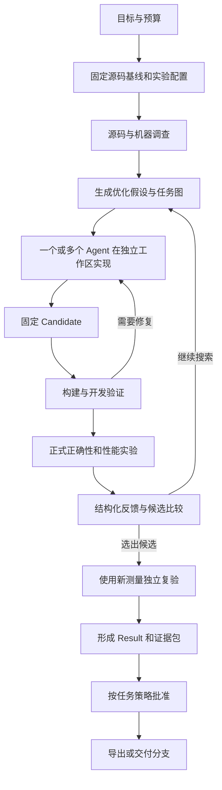
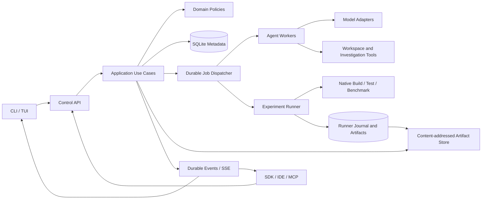

# CorePilot：面向 Agent 时代的性能工程平台

版本：1.0；日期：2026-10-16；状态：全新实现的产品与工程规格。

**当前不执行全量重写。用户已选择在现有项目上持续演进，开发指南见 [AGENTS.md](../../../AGENTS.md)。本文保留作备选设计，局部方案按实际任务选择采用，不自动触发技术栈替换或新仓库建设。**

本文是独立实施依据。开发者无需访问任何旧项目代码。本文中出现的命令、表、接口和架构均为新设计，不代表已经实现。

## 1. 产品定义

CorePilot 让用户把一个 CPU 算法库、一项优化目标和可用计算资源交给 Agent，自动完成源码调查、优化假设、候选实现、编译、正确性检查、性能实验、候选比较和结果交付。

它面向性能工程师、算法库维护者和使用编码 Agent 的研发团队。首要工作负载是 C/C++/汇编实现的 CPU 算法，包括 BLAS、图像处理、信号处理和数值计算。控制端支持 Windows、Linux、macOS；首发实验 Runner 支持 Linux ARM64 与 x86-64，正式验收同时包含 ARM 真机。

用户得到的核心产物是：可使用的源码改动、在指定硬件与工作负载下的正确性和性能结论、能够复查的实验记录，以及后续优化可以继续利用的知识。

### 1.1 产品原则

- 用户围绕“优化任务、候选、实验、结果”工作；调度 Job、数据库 lease 和 SDK 类型留在内部。
- Agent 可以自由调查、提出方案、实现和修复；真实结果由测试与测量产生。
- 多 Agent 是一种执行能力，单 Agent 与多 Agent 共用同一套产品模型。
- 所有主要能力都有非交互 CLI 与 API；TUI、IDE、外部 Agent 使用相同能力。
- 新模型通过适配器接入；模型能力增长用于更深入的调查与更宽的搜索，不要求修改业务核心。
- 用最少的独立组件完成真实闭环；每个新增服务都必须解决已出现的部署或性能需求。

### 1.2 范围

首个完整版本覆盖单用户/单控制端、多项目、多模型、多 Agent、多 Runner，以及完整的接入—优化—实验—交付流程。

后续扩展包括团队权限、共享服务、远端对象存储和更丰富的界面。首版不做通用聊天产品、云计算资源售卖、任意业务流程引擎或多租户计费。GPU 可以未来作为独立执行能力接入，不在首版验收范围内。

“面向 2026”指开放协议、结构化工具、持久化执行、多模型与并行 Agent 的设计取向。本文不把未经核验的未来模型名称、发布日期或能力作为依赖，也不宣称某套框架具有普遍最优性。具体依赖版本在新仓库建立时按官方发布与目标平台兼容性锁定。

## 2. 用户体验与完整业务流程

### 2.1 第一次使用

1. 安装 `corepilot`，在算法库目录执行 `corepilot init`。
2. 配置一个模型 profile 和一个目标机器 profile；已有配置可以复用。
3. 执行 `corepilot library discover . --symbol <api>`，系统调查源码、构建入口、测试和可优化范围，生成 Library Package 草稿。
4. 用户补全缺失的构建、oracle、性能工作负载或基线信息。系统明确指出具体缺项，提供可编辑文件与下一步命令。
5. 执行 `corepilot library qualify <package>`，真实执行构建、测试与机器能力检查，生成接入结果。
6. 执行 `corepilot run start --target <target> --goal <文字目标>`。系统在允许的预算内自动执行。
7. 用户随时查看进度、候选差异、测试失败、性能曲线、Agent 活动与预算使用。
8. 最佳候选通过正式实验及独立复验后形成 Result。用户可导出报告、批准或交付到新分支。

配置一次后，日常使用从第 6 步开始。没有需要用户到源码内部寻找的私有操作脚本。

### 2.2 一次优化 Run



未达性能目标也能形成有用结果：保存最优候选、测量、失败原因和后续建议，任务 outcome 为 `NO_IMPROVEMENT`。网络中断、编译错误和算法退化分别显示，不统一简化成“优化失败”。

## 3. 功能规格

P0 表示第一个完整产品必须具备；P1 表示在核心闭环稳定后补充；P2 表示后续扩展。里程碑中间交付可以只包含部分 P0，但不得标成完整版本。

| 编号 | 优先级 | 功能 | 完成条件 |
| --- | --- | --- | --- |
| F01 | P0 | 项目初始化 | 生成最小配置；识别 Git 根和源码基线；缺 Git 时明确提供初始化操作 |
| F02 | P0 | 模型配置 | 管理 endpoint、模型 ID、能力、凭据引用、代理；连接及工具调用检查可单独执行 |
| F03 | P0 | 机器配置 | 添加本机或 SSH 机器；安装/连接 Runner；展示架构、CPU/NUMA、工具链和可用资源 |
| F04 | P0 | 算法库调查 | 静态发现加可选 Agent 调查；输出源码/API/build/tests/workloads 草稿和待补项 |
| F05 | P0 | Library Package | 检查、编辑、验证、按版本固定接入描述；支持自编基线与外部二进制基线 |
| F06 | P0 | Run 管理 | start/list/show/watch/pause/resume/cancel/fork；CLI 退出后继续运行 |
| F07 | P0 | 假设管理 | 假设说明、影响范围、预期收益、parent、实验支持/反证和放弃理由 |
| F08 | P0 | 候选管理 | 独立工作区、源码快照、父候选关系、diff、比较；冻结后不能原地变更 |
| F09 | P0 | 开发工具 | 读/搜/改源码、构建、测试、反汇编、硬件查询、开发 benchmark、perf 指标 |
| F10 | P0 | 正式实验 | 固定 evaluator 和 baseline，真实 build/correctness/performance，完整 case coverage |
| F11 | P0 | 统计与复验 | 原始样本、采样方案、置信区间、关键用例退化检查、独立复验 |
| F12 | P0 | 结果与证据 | 结果摘要、源码/二进制身份、日志、样本、环境、实验关联；可导出并离线检查 |
| F13 | P0 | 批准与交付 | Result 的批准记录与分支/补丁包交付贯通；不靠工作流状态猜测已交付 |
| F14 | P0 | 多 Agent | 多个候选分支并行实现，模型按任务选择，合并候选重新实验 |
| F15 | P0 | 持久化与恢复 | Agent checkpoint、实验对账、幂等提交、控制端和 Runner 重启后的明确恢复行为 |
| F16 | P0 | 资源与预算 | Agent 并发、模型 token/费用、时间、实验次数、CPU/NUMA 资源预约 |
| F17 | P0 | CLI/TUI | 非交互 JSON、事件流、可读错误；TUI 展示统一 Run 视图 |
| F18 | P0 | 诊断和支持 | doctor、日志检索、运行诊断包、存储用量与缓存清理 |
| F19 | P1 | 知识复用 | 查询已有假设、失败实验和有效优化；记录适用机器/库版本/负载范围 |
| F20 | P1 | SDK/MCP/IDE | TypeScript SDK、MCP 工具入口、VS Code 状态与 diff 面板 |
| F21 | P2 | 团队服务 | 共享控制端、PostgreSQL、对象存储、用户/项目权限和审计 |

### 3.1 接入与配置

Library Package 描述算法领域，机器 profile 描述部署，模型 profile 描述推理来源，Run 描述本次目标。四者不混成一个巨型配置。

Package 至少包含：

- identity：ID、版本、内容摘要、支持的库版本与平台。
- targets：函数/API、允许修改的源码范围、构建定义、输出产物。
- correctness：oracle、数值容差、用例 inventory、参数域和边界条件。
- performance：工作负载、权重、关键 case、测量单位、采样规则与目标。
- baseline：源码构建或二进制 bundle；头文件、依赖库及其加载方式。
- evaluator：独立测试程序、构建和运行命令、输出 schema。

草稿可以包含缺项；正式执行所需项目必须完整。Qualification 是对特定 Package digest、evaluator、工具链与机器能力组合的真实检查记录。内容改变后产生新版本。资格检查不强制额外人工审批层；专业判断不能自动完成的项才显示为待补信息。

执行命令使用 `executable + args + cwd + env + timeout`。复杂构建通过 Package 中的脚本表达，支持 CMake、Make、Meson 或库自带脚本，不在核心中硬编码某个构建工具。

项目配置建议：

```yaml
schema: 1
project: my-kernel-library
library: ./corepilot/library.yaml
model: primary
machine: arm-server
run:
  goal: 提升代表性工作负载速度，保持全部正确性用例通过
  agent_concurrency: 4
  experiment_concurrency: 1
  budget:
    wall_time_minutes: 120
    max_candidates: 12
    max_experiments: 24
  delivery: branch
  approval: manual
```

配置优先级：CLI 显式参数 > 项目配置 > 用户 profile 默认值。解析后保存不含密钥的有效配置快照。预算、库版本和实验 policy 作为本次 Run 的固定输入；更换口径创建新 Run 或显式 fork。

凭据按用户 profile 引用，从环境变量或系统凭据存储读取；Linux 无凭据服务时允许权限受限的本地凭据文件。配置和诊断包不包含密钥。首次设置后，日常执行不反复确认工具调用。

## 4. 领域模型：每个概念只有一个含义

| 对象 | 定义 | 不承担的职责 |
| --- | --- | --- |
| Project | 一个算法源码项目及默认配置 | 不表示单次运行 |
| LibraryVersion | 固定的库接入规格 | 不存机器密钥和模型 endpoint |
| Run | 一次优化目标、基线、预算和执行过程 | 不兼任每个子进程的状态 |
| Hypothesis | 可被实验支持或否定的优化判断 | 不等同于一个代码版本 |
| WorkItem | Agent 的一项任务，含输入、输出和依赖 | 不等同于操作系统进程 |
| AgentSession | 一次模型执行上下文及工具结果 | 不拥有实验结论 |
| Workspace | 一个可修改的工作目录 | 不用目录路径作为候选身份 |
| Candidate | 不可变源码快照，可有多个父候选 | 不存不断变化的编辑中代码 |
| Experiment | 对一个候选的一次开发/正式/复验实验 | 不判定整个 Run 是否成功 |
| ExecutionAttempt | Runner 上的一次实际执行尝试 | 不重定义 Candidate 或 Run |
| Result | 候选、实验、结论和产物的固定组合 | 不等于源码已经合并 |
| Approval | 对某个 Result 的批准决定及来源 | 不启动实验或隐式合并 |
| Delivery | 导出或写入目标分支的一次操作记录 | 不改变已形成的实验事实 |
| Job | 内部可恢复执行单元 | 不成为面向用户的第二套任务系统 |

### 4.1 身份与关系

所有业务对象使用稳定 ID；源码与大产物使用内容摘要。名字用于显示，绝对路径用于定位，二者都不能代替身份。

Run 绑定 baseline commit、LibraryVersion digest、experiment policy 和目标机器要求。一个 Hypothesis 可产生多个 Candidate；Candidate 可有多个父节点，以表示候选组合。每个 Experiment 固定 candidate digest、baseline digest、evaluator digest、采样计划和资源要求。

Result 引用独立的 Formal 与 Revalidation，保留每次测量结论。原任务结束后继续修复，创建带 `parent_run_id` 的新 Run，不回写历史结果。

### 4.2 状态与结果分离

Run 的执行状态为：

```text
QUEUED → RUNNING → COMPLETED
            ├→ PAUSING → PAUSED → RUNNING
            ├→ CANCELLING → CANCELLED
            └→ FAILED
```

`phase` 另记录 investigation / implementation / evaluation / revalidation / reporting。`COMPLETED` 的 outcome 为 `IMPROVED`、`NO_IMPROVEMENT` 或 `BUDGET_EXHAUSTED`。Run 完成后 Result 可以仍待批准，交付状态独立展示。

Candidate 源码不可变；“最佳”“被选中”“批准”等来自比较或 Result 记录，不再维护一串重复的 Candidate 审批状态。

Experiment 分开存储：

- execution：QUEUED、RUNNING、SUCCEEDED、FAILED、CANCELLED、UNKNOWN。
- validity：PENDING、VALID、INVALID。
- assessment：PASS、FAIL、INCONCLUSIVE、NOT_EVALUATED。
- failure_origin：SOURCE、EVALUATOR、ENVIRONMENT、TRANSPORT、MEASUREMENT。

进程正常退出不自动代表 correctness PASS。Runner 连接丢失不代表 candidate FAIL。没有可靠测量时不得产生性能通过结论。

暂停停止新任务派发，让已经开始的工作到达可保存的边界；进行中的正式实验默认跑完。取消请求传播到运行中的工具与 Runner，确认进程结束后才进入 CANCELLED。UNKNOWN 的远端执行先对账，再决定下一步。

## 5. 架构决策

采用 **模块化单体控制端 + 独立实验 Runner + 薄客户端**。控制端内部按业务模块隔离；Agent worker 和数据库 worker 是执行隔离方式，不成为独立产品服务。



### 5.1 技术栈

| 层 | 首版选择 | 选择理由与边界 |
| --- | --- | --- |
| 工程 | pnpm workspace、TypeScript strict、ESM、受支持的 Node.js LTS | 同一语言便于共享契约与并行开发；不锁死本文撰写时的版本号 |
| 控制端 HTTP | Fastify、JSON Schema/TypeBox、OpenAPI | 请求校验、稳定协议、可生成 SDK；领域不引用框架类型 |
| 元数据 | SQLite WAL + 显式 SQL migrations | 本地安装简单，单控制端足够；读写通过专用数据库 worker |
| 持久化执行 | SQLite Job 表、lease、checkpoint、事务内事件写入 | 只实现本产品需要的调度原语，不造通用工作流 DSL |
| Agent | 自有 AgentRuntime/ModelProvider 接口，适配器内部使用 SDK | 不让某个 SDK 的 message/tool 类型成为业务模型 |
| Runner | Node.js/TypeScript，异步进程管理 | 重计算在 C/C++/汇编子进程中，首版不增加第二种服务端语言 |
| 产物 | 本地内容寻址目录、流式传输 | 源码包、日志、二进制和样本文件不塞进数据库大 JSON |
| CLI | Commander 或等价成熟参数解析器；一个命令注册表 | 命令、help、参数和 JSON schema 有统一来源 |
| TUI | React + Ink，独立可替换渲染层 | 复用 API；不持有业务运行状态，不定制整套终端底层 |
| 测试 | Vitest、协议测试、真实子进程集成测试、CLI PTY 测试 | 有实际行为的测试优先，全部进入版本控制 |
| 日志指标 | 结构化日志、OpenTelemetry | trace 贯穿 Run、Agent、Experiment、Runner，默认无需外部平台 |
| 发布 | npm CLI/Runner 包；可选附带 Node 的离线包 | 支持 ARM 实验机离线部署和版本诊断 |

明确不在首版同时引入 PostgreSQL、Redis、Kafka、Kubernetes 和额外工作流服务。也不为“未来可能快”提前用 Rust/Go 重写 Runner。出现实测瓶颈时，稳定协议允许替换执行适配器。

数据库只有 SQLite 一套实现。未来团队部署有实际需求时新增 PostgreSQL 适配器并验证迁移；不要声称换一个连接字符串就能实现迁移。协议保留独立 worker 的可能，不要求首版多控制端抢占同一 SQLite 文件。

### 5.2 依赖方向

`contracts` 定义传输数据；`domain` 定义业务对象和规则；`application` 组织用例并声明依赖端口；`adapters` 实现数据库、Git、模型和 Runner 连接；`apps` 负责装配。

Domain 不 import Fastify、SQLite、模型 SDK、文件系统或终端组件。Adapter 不调用另一个 Adapter 的私有实现。CLI 不访问 SQLite。Runner 不导入 Run 调度服务。一个业务规则只放在一个权威模块中；接收方可以校验输入，但不复制整套规则。

### 5.3 新仓库目录

```text
corepilot-next/
  apps/
    cli/                       # 非交互命令和 TUI 装配
    control/                   # API、启动、生命周期
    runner/                    # Linux 执行服务装配
  packages/
    contracts/                 # API、事件、Runner、Package schemas
    domain/                    # Run/Candidate/Experiment/Result 规则
    application/               # 用例、调度策略、端口
    agent-runtime/             # 会话、工具循环、协作任务
    evaluation/                # coverage、统计、acceptance
    workspace/                 # Git 工作区、冻结、diff
    storage-sqlite/            # DB worker、SQL、migrations
    artifact-store/            # 内容寻址、传输、导出
    model-adapters/            # 模型协议实现
    runner-client/             # Runner 协议客户端
    sdk/                       # Control API 客户端
    tui/                       # 展示和交互
  library-packs/
    example-vector/            # 最小真实 C 库和 evaluator
    blas/                      # 真实接入包
    image-processing/          # 第二类库，检验通用性
  tests/
    contracts/
    integration/
    acceptance/
    terminal/
  docs/
    PROJECT-SPEC.md
    decisions/
    modules/
  tooling/
  pnpm-workspace.yaml
  AGENTS.md
```

这些是逻辑边界，不要求第一天建立全部空包。先建立闭环需要的模块；模块没有明确职责、公开接口和测试需求时，不建立新的抽象层。不设任意代码都能放入的 `common`、`utils` 或“万能 service”。

## 6. 持久化执行与恢复

### 6.1 Job 机制

每个可恢复步骤对应一个 Job，例如 investigate、implement、freeze-candidate、submit-experiment、collect-result、revalidate、deliver。Job 保存类型、输入引用、依赖、状态、attempt、lease、checkpoint、幂等键和下一次执行时间。

控制端在短事务中领取 Job 并递增 lease epoch。执行在事务外进行；保存结果时检查 Job version/epoch，拒绝过期 worker 的状态写回。一个事务同时更新业务事实、Job 状态和事件记录。UI 只在提交后收到事件。

执行语义是至少一次调度，结合幂等副作用，不承诺跨模型、Git、网络和数据库的全局 exactly-once。禁止在未对账时盲目重发可能仍在执行的远端实验。

### 6.2 可恢复边界

| 中断位置 | 恢复行为 |
| --- | --- |
| CLI 或 TUI 退出 | 后台继续；重新 watch 读取持久化事件 |
| Control 重启 | 收回过期本地 lease；对运行中 Agent/Runner 工作进行对账 |
| 模型请求中断 | 已完成工具调用和消息保留；从最近 checkpoint 新建推理调用，允许重复模型费用 |
| 文件写入附近中断 | 工具记录含调用 ID、预期前后文件摘要；核对后完成或重新规划，不盲目重复追加 |
| Candidate 冻结中断 | 依据源码摘要和冻结记录识别已经生成的 Git 对象/产物 |
| 提交 Runner 后响应丢失 | 用 execution ID 查询，存在则继续观察；不存在才允许重试提交 |
| Runner 重启 | 读取 journal，核对本机进程与产物；不能确认归属的 attempt 标记 UNKNOWN/INTERRUPTED |
| 正式测量中断 | 保留原始样本作诊断；新 attempt 重新收集完整批次，不拼接成原批次 |
| 交付时中断 | 核对目标分支与交付 ID 对应的 commit，再完成 Delivery 记录 |

日志、源码、样本用临时文件写入后原子发布；Artifact 摘要验证完成后才允许 Result 引用。孤立的未引用文件可延迟清理。

### 6.3 后台生命周期

默认一个用户级 Control daemon 管理多个 Project。`corepilot` 自动连接，必要时启动；连接信息位于用户数据目录。项目只保存配置和引用，不各自悄悄拉起重复后台。

Control 默认监听回环接口，使用本地 token；Runner 默认通过 SSH 隧道连接。支持明确配置的远端 HTTP/TLS endpoint。后台停止有 graceful shutdown：停止派发、保存 checkpoint、处理活动执行并报告尚未结束的工作。

## 7. 数据库与产物

### 7.1 主要表

所有主表包含 ID、created_at；可变聚合增加 updated_at 和 version。外键显式启用，跨对象写入通过短事务完成。

| 表 | 关键字段与约束 |
| --- | --- |
| projects | root、name、config_ref；同一规范化 root 唯一 |
| library_versions | package_id、version、digest、manifest_ref；ID/version 唯一且内容不可变 |
| qualifications | library_digest、evaluator_digest、machine_context、report_ref、outcome |
| runs | project_id、parent_run_id、baseline_ref、status、phase、outcome、budget、policy_ref、version |
| hypotheses | run_id、parent_id、statement、scope、reasoning_ref |
| work_items / work_dependencies | run_id、kind、assignee、input_ref、output_ref、status；依赖图不能有环 |
| agent_sessions | work_item_id、model_profile_snapshot、checkpoint_ref、usage、status |
| tool_calls | session_id、call_id、input_ref、result_ref、status；session/call 唯一 |
| candidates / candidate_parents | run_id、hypothesis_id、source_digest、commit、manifest_ref；冻结记录不可修改 |
| experiments | run_id、candidate_id、kind、plan_ref、execution、validity、assessment |
| execution_attempts | experiment_id、attempt、runner_id、request_digest、status；experiment/attempt 唯一 |
| measurements | attempt_id、case_id、role、metric、sample_index、value、unit、validity |
| artifacts / artifact_refs | digest、size、media_type、location；引用关联所属业务对象 |
| results | run_id、candidate_id、formal_id、revalidation_id、report_ref、conclusion |
| approvals | result_id、decision、actor、policy_ref、created_at；批准不覆盖历史决定 |
| deliveries | result_id、mode、target、status、commit_or_artifact_ref、idempotency_key |
| jobs / job_dependencies | kind、input_ref、status、next_run_at、lease_owner、lease_epoch、lease_until、attempt、checkpoint_ref；依赖必须已成功才可领取 |
| events | sequence、event_id、aggregate_id、aggregate_version、type、payload、trace_id |
| commands | scope、idempotency_key、request_digest、response_ref；scope/key 唯一 |
| resource_leases | machine_id、resource_set、execution_id、epoch、expires_at |

常用筛选键和关联键必须是结构化列；扩展领域参数、配置快照使用 schema 化 JSON。避免把整个 Run 及所有子对象放在一个不断重写的 JSON 中。

必要索引包括 runs(project_id, created_at, id)、jobs(status, next_run_at)、events(aggregate_id, sequence)、experiments(candidate_id, created_at)、measurements(attempt_id, case_id, role, sample_index)。measurement 唯一键还包括 metric，重复上传不能形成重复样本。

### 7.2 SQLite 策略

启用 WAL、foreign_keys 和合理 busy_timeout。专用 DB worker 持有连接并串行处理写事务；API 和 Agent 线程不执行同步数据库 I/O。批量插入测量与事件，事务内不进行模型请求、SSH、构建或压缩。

迁移编号进入版本控制，启动时检查 schema 版本；升级先创建一致性备份，不支持的版本明确报错。SQLite 文件只在本地磁盘使用，不让多机器共享网络盘中的一个数据库。

数据库记录是业务事实来源，事件用于审计和客户端增量同步；首版不是必须重放所有事件才能启动的纯 Event Sourcing 系统。事件与事实同事务写入，避免为了展示进度再维护第二份工作流状态。

### 7.3 Artifact Store

路径格式为 `objects/sha256/<前两位>/<完整摘要>`。Artifact 保存源码归档、构建产物、完整日志、工具大输出、采样批次和报告。数据库保存引用、摘要、尺寸和结构化查询字段。

Runner 有本地缓存，Control 有权威归档。文件分块流式上传，可重试并按摘要去重。Result 只在必要文件完整到达后固定；未上传完成显示明确阶段。

清理以引用为准：正式 Result 引用的产物默认保留；开发缓存按空间和最近使用策略清理。数据库与产物备份一起生成 manifest；恢复时核对引用是否齐全。

## 8. Agent 与模型架构

### 8.1 稳定接口

`ModelProvider` 负责 streaming、工具调用表示、usage、取消和错误分类；`AgentRuntime` 负责消息历史、工具调度、checkpoint 和预算；`OptimizationPlanner` 负责性能工程任务策略。三者不能合并成一个厂商 SDK wrapper。

模型能力声明至少包含 tool calling、结构化输出、上下文长度、流式响应、usage 和 provider 特有推理参数。按实测能力使用，不用模型名字符串猜测。支持至少一个开放兼容接口和另一种不同 wire format 的适配器验收，证明边界有效。

模型切换只改变任务分配或配置。既有 session 保存实际模型和参数；切换后开启新 session，使用结构化交接摘要与引用，不假设不同 SDK 的原始会话可直接互换。

### 8.2 Agent 工具

工具按类型返回结构化结果和 Artifact 引用：

```text
source.read / source.search / source.edit / source.diff
machine.inspect / binary.inspect / binary.disassemble
build.run / correctness.run / benchmark.development / profile.collect
hypothesis.propose / hypothesis.update
candidate.freeze / candidate.compare
experiment.request / experiment.inspect
work.spawn / work.inspect / work.complete
knowledge.search / result.inspect
```

参数校验、执行和结果编码是统一工具边界。开发命令通过 Runner 或本地执行适配器运行；正式实验请求交给控制端固定计划。工具不直接修改数据库中的 Result 或 Approval 状态。

首次 Run 声明工作范围、预算和交付策略后，正常读写、构建和测试不再逐次询问。人工默认只负责补足领域判断和最终交付批准；允许用户预先选择 auto-on-pass 策略，批准记录注明策略来源。

### 8.3 运行时多 Agent 协作

角色是任务模板，不是固定数量的长期服务：调查、实现、评审、实验分析均可由同一个模型或不同模型承担。默认小任务一个 Agent，复杂任务才展开。

每项任务包含 objective、input_refs、output_schema、dependencies、workspace、budget 和 completion_criteria。Agent 只能通过结构化产物传递完成结果；聊天消息可用于协调，不作为任务完成事实。

每个写代码的 Agent 拥有独立 Git worktree。不同方案在不同 Candidate 分支比较；同一个候选内的并行改动必须在集成工作区合成，产生新 Candidate 并重新验证。不能让多个 Agent 同时覆盖同一个编辑目录。

调度分别控制 model_concurrency、workspace_concurrency、build_concurrency、measurement_concurrency。四个 Agent 可以并行读码和写码，但同一受干扰硬件资源上的正式 benchmark 必须排队。并发度由模型配额、预算和机器资源决定，不因模型更聪明就解除实验互斥。

共享知识存摘要、代码定位和实验引用，按需检索；不把全部对话广播给所有 Agent。先做结构化与全文检索，确有检索质量需求后再增加 embedding。

### 8.4 预算

调度前预留可估算预算，结束后按实际 usage 结算。未知价格显示 token 和“费用未知”，不能填 0 元。达到上限后停止派发，并让活动任务完成或按已声明策略取消。

限制分别覆盖时间、候选数、实验次数、模型 token/费用及并发。预算耗尽保留当前最好候选和下一步建议。强模型可以一次完成较大任务，不被硬编码成固定八轮或固定角色链。

## 9. Runner、实验与资源

### 9.1 Runner 职责

Runner 只负责接收固定执行计划、准备输入、运行进程、约束机器资源、收集事实和上传产物。不调用模型，不选择候选，不根据自然语言决定性能是否通过。

控制端创建 Experiment；Runner 创建 ExecutionAttempt 及执行事实。双方通过 execution ID 对账，Control 负责把测量送入统一 evaluation 模块。

### 9.2 协议

```text
GET  /v1/health
GET  /v1/machine
PUT  /v1/executions/{executionId}
GET  /v1/executions/{executionId}
POST /v1/executions/{executionId}/cancel
GET  /v1/executions/{executionId}/events?after=<sequence>
GET  /v1/executions/{executionId}/artifacts
PUT  /v1/artifacts/{digest}
GET  /v1/artifacts/{digest}
```

提交包含 protocol_version、experiment_id、attempt、plan_digest、source/evaluator/baseline refs、命令步骤、采样配置和资源请求。同 execution ID 同 digest 重试返回已有执行；同 ID 不同 digest 返回冲突。

所有进程异步启动，stdout/stderr 流式写 Artifact，单次事件只传片段引用或有界摘要。取消作用于进程组。命令可配置超时，退出码、signal、duration、超时和取消分别记录。

SSH 用于机器发现、安装和隧道；数据与任务通过统一 Runner 协议传输，避免再建立第二套 SSH 实验实现。

### 9.3 资源调度

机器信息包含架构、CPU 拓扑、NUMA、内核、编译器、可用性能计数器和资源控制能力。正式计划至少固定 CPU 集、线程数、NUMA 策略、工具链与库加载路径。

默认正式测量独占整台实验机器，避免同 NUMA/LLC/内存带宽域竞争。用户可配置已验证的分区并行；仅 CPU 编号不同不足以推导测量互不干扰。开发构建与正式测量也要考虑资源重叠。

资源预约由 Control 统一安排，Runner 校验本机执行约束与占用。lease 过期且执行状态未知时先对账，不立即把同资源发给另一个正式实验。性能计数器不可用时明确记录能力缺失，基础正确性实验不因此全部失败。

## 10. 正确性、性能统计与候选选择

### 10.1 正确性

Evaluator 用例必须有稳定 case ID、输入参数、预期判定方式和容差。记录 planned/executed/passed/failed；少跑、重复或无法解析的 case 不算通过。数值算法支持绝对/相对误差、NaN/Inf 规则以及领域特定比较器。

正式测试以固定 Candidate 构建产物为输入。算法修改和 evaluator 修改分开形成版本；一次优化 Run 中不能修改 oracle 来使当前候选通过。

### 10.2 性能定义

首版标准指标是耗时，单 workload 加速比为 `median(baseline) / median(candidate)`。吞吐类指标先按 schema 声明方向，统一转成“越大越好”的 ratio。

总体加速比为：

`exp(sum(weight_i × log(speedup_i)) / sum(weight_i))`

缺失 case、非正耗时、无穷值或单位不一致产生 INVALID/INCONCLUSIVE，不能用零、忽略或默认通过填补。

### 10.3 采样与置信区间

正式计划提前固定 warmup、测量 block 数、每 block 重复次数、顺序随机种子和统计规则。baseline/candidate 在每个 block 内交错并随机顺序运行；记录每次原始样本和环境。

默认按配对 block bootstrap 重采样。每次重采样重新计算 workload 的 median ratio 和总体 weighted geomean，使用指定置信水平的 percentile 区间。总体区间来自总体统计量的重采样分布，不能用各 workload 下界的最小值冒充。

正式计划中的一个全局 block 覆盖全部 workload 的 baseline/candidate 测量；重采样时以整个 block 为单位，保留同批次的关联。若某个 block 缺失必要数据，则该批次不满足完整性要求。连续时间相关性和环境漂移另行报告；bootstrap 本身不能消除系统性测量偏差。

结果至少输出：统计方法版本、样本数、block 数、bootstrap 次数、seed、point estimate、区间上下界、有效样本和环境异常。可用固定 block 下限（首版默认 30）作为最低样本要求，但不能因此声称所有工作负载都已经统计可靠。

关键 case 的退化判断使用预先声明的多重比较规则，首版采用 Bonferroni 调整的单侧下界；总体加速比单独报告双侧区间及用于门槛的下界。阈值和比较规则在 Run 启动时固定。

开发采样允许少量快速估计，明确标为 DEVELOPMENT。正式批次不按“看到好结果就停止”的方式自适应终止；如未来支持 sequential test，另定义其统计方法。候选搜索可能产生选择偏差，因此最终候选必须用新样本独立复验，并展示首轮与复验结果。

### 10.4 接受与排名

一个可交付的性能提升 Result 必须满足：完整正确性通过、实验有效、总体目标满足、关键 workload 无超限退化、独立复验通过。

候选排名先排除不正确或无效的结果，再按固定目标比较。默认在满足约束的候选中选择正式总体加速比更优者；差异不足时显示不确定性，不强称冠军。用户可以设置代码复杂度、二进制大小或编译时间为附加约束。

Result 明确标注适用机器、库版本、数据范围和性能口径。一次机器测试只支持其已测范围，不自动推广到所有 CPU。

## 11. CLI、TUI、API 与外部 Agent

### 11.1 命令面

```text
corepilot init
corepilot doctor
corepilot model add|list|show|test|remove
corepilot machine add|list|show|probe|install-runner|remove
corepilot library discover|check|qualify|list|show
corepilot run start|list|show|watch|pause|resume|cancel|fork
corepilot candidate list|show|diff|compare
corepilot experiment list|show|retry|logs
corepilot result list|show|export|verify|approve|deliver
corepilot daemon start|status|stop
corepilot storage status|prune
```

示例：

```text
corepilot run start --target gemv-n --goal "提升中小矩阵性能" --agents 4 --json
corepilot run watch <run-id>
corepilot candidate compare <candidate-a> <candidate-b>
corepilot result export <result-id> --output ./result-bundle
corepilot result approve <result-id>
corepilot result deliver <result-id> --branch optimize/gemv-n
```

执行命令统一支持 `--json`；watch 支持 `--format ndjson`。stdout 输出业务结果，stderr 输出诊断。非 TTY 下不弹菜单、不请求交互输入，缺项返回明确错误。退出码固定：0 成功；1 内部/执行错误；2 参数或配置错误；3 业务前置条件不满足；4 目标不存在；5 状态冲突；130 用户中断。

`run start` 返回接受成功，不代表优化成功；`run watch --until-terminal` 在等待后返回最终 outcome：COMPLETED 返回 0（包括 NO_IMPROVEMENT/BUDGET_EXHAUSTED，调用方读取 outcome 判断收益），FAILED 返回 1，CANCELLED 返回 130。以上规则同时写入命令 schema。取消 watch 默认只断开观察，不取消 Run；取消任务使用明确命令。

### 11.2 TUI

首页展示当前项目、模型、机器和最近 Run。主要视图为 Run 时间线、Agent/候选列表、实验对比、结果与日志。展示当前阶段、正在执行的动作、预算与下一步，不把内部状态码直接堆给用户。

TUI 只保存选中项、输入草稿、滚动位置等 UI 状态。运行状态由 SDK 查询和 SSE 更新；断线显示重连并按事件游标补齐。窗口 resize、中文宽度、多行输入、粘贴、Esc、Ctrl+C 都纳入 PTY 验收。

避免在安装过程中直接修改依赖源码。若终端库存在关键缺陷，优先升级或提交上游修复；确需补丁时采用显式版本化 patch，纳入测试和依赖锁定。

### 11.3 Control API

API 以资源和动作表达，与 CLI 一一映射。关键接口：

```text
POST /v1/projects
POST /v1/library-discoveries
POST /v1/libraries/{id}/qualifications
POST /v1/runs
GET  /v1/runs?project_id=...&cursor=...&limit=...
GET  /v1/runs/{id}
POST /v1/runs/{id}/pause|resume|cancel|fork
GET  /v1/runs/{id}/events?after=...
GET  /v1/runs/{id}/candidates
GET  /v1/experiments/{id}
GET  /v1/results/{id}
POST /v1/results/{id}/exports|approvals|deliveries
```

创建类请求携带 Idempotency-Key；相同 key 不同请求摘要返回 409。可变资源命令携带 expected_version，冲突返回当前版本。异步动作返回 202 与业务 ID，不把整个模型执行留在一个 HTTP 请求内。

错误格式统一为 `{error: {code, message, retryable, details}, trace_id}`。列表使用稳定 cursor 分页。事件以持久化 sequence 为游标，SSE 支持重连；历史已清理则返回 reset_required，并引导先获取当前快照。

OpenAPI 与 JSON Schema 从 contracts 生成。SDK、CLI、MCP 不能各维护一份独立的业务参数定义。主版本不兼容变化必须显式升级；Runner 和 Control 在握手时校验协议版本。

### 11.4 MCP 与 IDE

MCP 暴露 start_run、inspect_run、list_candidates、inspect_experiment、export_result 等应用用例，返回业务 ID 和 Artifact 引用。它是接入界面，不负责内部 Agent 协作消息总线。

IDE 展示状态、日志、候选 diff 和结果，所有业务走 SDK。外部超级 Agent 可直接调用 CLI JSON、SDK 或 MCP，以相同协议参与；不要求它访问内部数据库或加载整个服务实现。

## 12. 结果、批准与交付

Result bundle 包含 manifest、候选源码包/补丁、基线和 evaluator 身份、环境、Formal 与 Revalidation、原始样本、统计配置、报告与所需日志。每个文件列摘要，`result verify` 可离线核验完整性与关联关系。

报告包含目标、改动解释、正确性 coverage、逐 workload 和总体结果、区间、资源环境、未达到目标的说明、复现命令。Markdown/JSON 为首版标准，HTML 为可选展示，不把 Word/PDF 排版作为核心依赖。

批准默认 manual，也支持用户在启动时预设 auto-on-pass。批准绑定 Result digest，记录决定者或策略。交付默认创建新分支或导出 bundle；写入当前分支必须由 delivery 参数明确指定。

交付只修改指定源码目标，不更改实验记录。冲突时提供冲突诊断；解决后产生新 Candidate 并视改动重新实验。一个 Result 可以多次导出，分支交付通过幂等键去重。

## 13. 性能与工程质量目标

以下是新实现的验收目标，不是现有产品测量值。参考环境为 8 个逻辑 CPU、16 GiB RAM、本地 SSD、Linux 控制端；Windows/macOS 单独记录 CLI/TUI 结果。模型和远端构建耗时从 API 本地响应预算中排除。

| 指标 | 初始目标与测法 |
| --- | --- |
| `--help`/`--version` | 冷启动 p95 < 300 ms，30 次独立进程测量；不初始化模型/数据库 |
| 常规读 API | p95 < 100 ms；10 万事件、1 万实验元数据、20 并发客户端 |
| 提交 Run | p95 < 300 ms；接受并持久化后返回，远端预检异步进行 |
| 事件可见延迟 | 本机提交到客户端 p95 < 500 ms |
| 控制端事件循环 | 日志高流量及并行 staging 时 p99 delay < 50 ms |
| 空闲控制端内存 | RSS < 200 MiB，不含独立 Agent worker |
| 大日志 | 单次 1 GiB stdout/stderr 能流式保存，不能按总日志大小线性增加内存 |
| 并发 | 4 个 Agent 工作区、2 个 Runner；资源冲突实验正确排队 |
| 热缓存 | 相同源码/evaluator/baseline digest 不重复上传大文件 |
| 恢复 | Control 重启后 10 秒内完成本地 Job 扫描并启动对账；远端不可达显示 UNKNOWN |

缓存 key 包含源码、依赖、编译器、flags、目标架构和 evaluator 所需身份。缓存构建产物可以，不能用缓存性能测量替代新的独立复验。

先测量阶段耗时和队列等待，再优化瓶颈。模型推理、编译、网络、采样分别记录，不能把所有耗时归因于 Node.js 或数据库。

## 14. 面向多个开发 Agent 的工程组织

这一节描述开发新项目时的协作方式，与产品运行时的多 Agent 是两个层面。

### 14.1 契约先行

M0 先落地领域词汇、API/事件/Runner schemas、最小 example-vector 包和验收场景。随后多个 Agent 可根据固定契约并行实现不同模块，无需阅读整个仓库。

每个模块提供 `README.md`、公开 exports、输入输出示例、契约测试和明确 owner。根 `AGENTS.md` 规定依赖方向、运行命令、测试要求和变更规则。协议变更通过一条短 ADR 说明原因与影响，不让实现 Agent 私自扩大公共类型。

### 14.2 并行工作包

| 工作包 | 所有目录 | 依赖与交付 |
| --- | --- | --- |
| A：领域与契约 | contracts、domain | 最先固定；提供 schemas、状态规则、协议示例 |
| B：存储与调度 | storage-sqlite、application 的 jobs 子模块 | 消费 A；提交事务、lease、恢复与集成测试 |
| C：工作区与产物 | workspace、artifact-store | 消费 A；提交 Git 冻结、内容寻址、传输接口 |
| D：Runner 与实验 | apps/runner、runner-client、evaluation | 消费 A/C；提交真实进程、测量、统计与对账 |
| E：Agent runtime | agent-runtime、model-adapters | 消费 A/C，调用固定工具端口 |
| F：产品界面 | apps/cli、tui、sdk | 消费 contracts/API fixtures；提交 CLI/TUI 行为验收 |
| G：集成与真实库 | apps/control、library-packs、acceptance | 分阶段集成各包，负责完整链和真实硬件验收 |

如果同时只有四个 Agent，先 A 定契约，再 B/C/D 并行，之后 E/F/G 按依赖接入。无需让所有工作同时开始。根依赖锁文件与公共 schema 由集成负责人统一维护，降低机械冲突。

每个工作包使用独立 Git worktree，交付清单为代码、测试结果、接口变化和已知缺口。合入前跑受影响模块及契约测试，里程碑跑完整验收。禁止多个 Agent 在共享目录同时改同一个文件。

### 14.3 必须自动检查的边界

- lint/依赖图禁止逆向跨层 import 与循环依赖。
- domain 不出现厂商 SDK、SQL、HTTP 或终端类型。
- 每个应用入口独立 build，不能用一个根 typecheck 代替所有应用验证。
- 公共 API/schema 的变更有兼容性测试和示例同步。
- 新增测试默认进入 Git；默认构建不能把 mock Runner 装配成生产执行器。
- 业务模块不能通过 shell 命令调用自己的 CLI 来绕过应用接口。

## 15. 实施里程碑与验收

### M0：契约与可运行骨架

交付 workspace、contracts、domain、Control health、CLI、example-vector 源码库、CI 与模块说明。验收：全新克隆可安装/构建，CLI 启动并读取 health，依赖方向检查通过。

### M1：单 Agent 最小真实闭环

交付一个模型适配器、独立工作区、真实构建/正确性、Run/Candidate/Experiment 保存和 CLI watch。验收：Agent 在示例 C 库做真实改动，编译测试，生成可查看的 Result；没有模型时可用确定性输入测试同一执行路径。

### M2：正式性能工程

交付 Linux Runner、机器资源固定、正式 evaluator、原始采样、bootstrap、独立复验和结果 bundle。验收：真实 ARM 机器运行一项库优化；第二种算法库接入只增加 Package/evaluator，不改领域核心。

### M3：完整产品与恢复

交付 library qualification、pause/resume/cancel/fork、daemon、checkpoint、对账、Approval/Delivery、doctor。验收：正常全流程只需公开命令；控制端重启、Runner 重启、响应丢失、重复提交都不伪造成功或重复交付。

### M4：多 Agent 和模型可替换

交付任务 DAG、预算、独立候选分支、候选比较与集成、第二种模型协议适配器。验收：4 个 Agent 在独立 worktree 探索；同资源正式实验串行；替换模型不修改 domain/application 业务规则。

### M5：产品体验与发布

交付 TUI、性能基准、安装包、离线 Runner 包、支持文档。P1 的 SDK/MCP/IDE 按独立发布任务推进。验收：Windows/Linux/macOS CLI/TUI 矩阵通过，Linux ARM64/x86-64 Runner 通过，所有 P0 与性能目标有记录。

不提前承诺按天完成的时间表。以可运行切片和验收结果衡量进展，而不是以目录数量、总代码行数或 Agent 数量衡量。

### 15.1 关键验收用例

| 用例 | 预期结果 |
| --- | --- |
| 正常优化 | 从接入到分支交付全程经公开接口，Result 可追到样本和源码 |
| 算法错误 | 显示具体 failed case，反馈给 Agent，旧候选与实验保留 |
| 性能退化 | 正确性通过但 assessment FAIL，不生成“性能提升”结论 |
| 无改善 | Run COMPLETED/NO_IMPROVEMENT，保留最佳候选和实验解释 |
| 样本不足或缺字段 | INCONCLUSIVE/INVALID，不用 point estimate 冒充区间 |
| 固定统计 fixture | 已知样本的点估计、区间及多重比较结果可重复，与独立参考实现对照 |
| 并行候选 | 工作区互不覆盖，组合候选有父关系且重新测试 |
| 资源冲突 | 正式测量排队，日志解释等待资源，开发任务不干扰测量 |
| 模型工具重复 | 同 call ID 不重复执行已确认副作用，checkpoint 能解释结果 |
| Runner 响应丢失 | 同 execution ID 对账，不能重复启动同一次实验 |
| 取消与恢复 | 本地与远端状态一致或明确 UNKNOWN，不把请求取消当完成 |
| 交付中断 | 分支和 Delivery 记录可对账，重试不重复提交 |
| CLI 非 TTY | 纯 JSON/NDJSON，无菜单或 ANSI 污染，退出码一致 |
| 大日志 | 内存有界、文件完整、客户端可按需读取 |
| 第二个库/模型 | 只增加接入包/适配器，不修改核心模型 |

## 16. 新项目启动说明

新项目只需要本文、开发工具链，以及用于验收的公开或获授权算法库。先以 example-vector 的真实 C 实现建立闭环，再加入真实性能库。

建议首个开发任务说明：

> 按 `docs/PROJECT-SPEC.md` 实现 CorePilot。先完成 M0 和 M1 的可运行切片。不要访问旧项目代码，不创建兼容层。固定公开契约后按工作包并行开发；每项任务只能修改分配模块。所有状态变化通过应用用例完成，所有正式实验通过 Runner 协议执行。每个里程碑交付可运行命令和真实测试记录；未实现能力标注为未完成，不能用 mock 输出宣称真实性能效果。

后续设计调整记录短 ADR，注明改变的需求、接口与验收条件。允许用更好的技术替换适配器，核心词汇、事实归属和可验证闭环应保持清晰。
