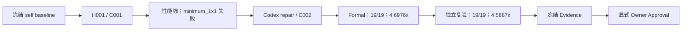

# IPPI-FT Dilate3x3：C002 成功案例

CorePilot 的第一个 Approved Optimization Result：在真实 S5000C 上，优化 IPPI-FT 的 `ippiDilate3x3_64f_C1R`，相对于冻结的 IPPI-FT self baseline，经独立复验获得 **4.5867×** 聚合加速。

| 适用条件 / 结果 | 首次 Formal | 独立 Revalidation |
| --- | --- | --- |
| Target | `ippiDilate3x3_64f_C1R`，float64、C1、3×3 neighborhood maximum | 相同 |
| Machine / resources | S5000C；CPU 0；NUMA node 0；threads 1 | 相同 |
| Input scope | finite float64；有效一圈 source halo；src/dst 不重叠；API-valid、double 元素对齐的 byte stride | 相同 |
| Correctness | **19/19 PASS** | **19/19 PASS** |
| Performance | 6 workloads；**4.6976×** weighted aggregate speedup | 6 workloads；**4.5867×** weighted aggregate speedup |
| Acceptance | **PASS** | **PASS** |

当前 **Candidate = APPROVED、Evidence = APPROVED、Approval Record = APPROVED**。这些状态由新增审批记录表达；历史 Task/Workflow 仍为 **FAILED**，尚未 merge/delivery。

实际参与方式：C001 由 Pi runtime 生成；C002 repair 记录来自 Codex；后续 Formal 重试、独立复验、证据冻结和审批由操作者通过操作脚本衔接。本案例展示已审批结果及其失败恢复证据，不宣称 Workflow 全自动完成并交付。

[证据索引与只读核验方法](evidence-index.md)提供结论、Experiment、Candidate、Approval 与冻结文件 SHA-256 的关联；[生命周期指南](../../docs/guides/optimization-workflow.md)说明通用实现和人工操作的边界。所有性能结论只适用于本页限定的函数、输入、机器、资源条件和冻结版本。

## 1. 优化目标

目标为 `ippiDilate3x3_64f_C1R`：float64、C1，对 ROI 中每个输出像素选择其 3×3 source neighborhood 的最大值。

输入限定为 finite float64；调用方提供一圈有效 source halo；src/dst 不重叠；byte stride 满足 API 要求并按 double 元素对齐。NaN、Inf、overlap 和非 double 对齐 step 均在 claim scope 之外。Correctness 使用独立 scalar oracle，按 finite float64 数值精确相等比较，signed zero 的符号不作约束。

唯一 Candidate 可写源码为 `src/morphological-operations/Dilate3x3.cpp`。Oracle、cases、benchmark、workloads、policy 和 build infrastructure 不属于可写范围。

## 2. Baseline 信息

- Library：IPPI-FT。
- Source baseline：`main@23a39f8de2272c150e168a824b7839de3844661c`。
- Performance baseline：该源码在 S5000C 上构建的原始 `libftppi.so`。
- Baseline SHA-256：`87805e10942159d8cf28b2cc48efe0cc690c1297631ee8f302d16f2e23c57b6a`。
- Build：GCC 10.3.1、CMake Release、C++17、`FTPPI_USE_OPENMP=ON`；Candidate 使用相同冻结 build policy。
- Runtime resources：CPU 0、NUMA node 0、threads 1。
- Machine identity：`58e793cd7ed19e396bf49afb9ab01999b64a64e526f1bd1e9891f00bef2b9ce1`。

这是 IPPI-FT self baseline 的单函数比较，不涉及外部库。

## 3. 初始实现分析

冻结的 Candidate history 中，C001 的 development findings 记录了原实现逐像素扫描 3×3 邻域、标量比较与重复加载。源码调查、disassembly 和 perf development feedback 将主要瓶颈判断为指令与归约开销，而非缓存未命中。该判断属于调查依据；正式提升仍由独立 correctness 和 live symmetric benchmark 验证。

来源：Evidence 中的 `history/candidates.json`、`history/previous-records/final-evidence.json` 和 `history/previous-records/final-runner-facts.json`。

## 4. Hypothesis H001

持久化假设为 `hypothesis:H001`：通过水平三点最大值和三个滚动行缓冲复用中间结果，减少逐输出像素的重复邻域工作，并修复 C001 的水平 halo indexing。

H001 的 motivation 引用了 C001 约 4.84× / 4.59× 的 development 提升以及 `minimum_1x1` 失败。Expected effect 为恢复 exact finite float64 correctness，同时保留行复用收益；risk 包括右侧 halo 访问与小 workload 的 buffer allocation 成本。

H001 在修复阶段正式持久化并引用 C001 失败证据；C001 的旧记录没有被补造 `hypothesis_id`。C002 关联 H001，parent 为 C001。

## 5. C001 失败原因

C001：`candidate:cc0ccef3-8a53-474b-a9ef-1234de5fff89`，commit `a3efe5d482b0a1bfedc500007ec7ac5dad59f712`。

传入水平窗口 helper 的 `row` 已指向 ROI 左侧 halo。旧代码使用 `left = row[0]`、`mid = row[0]`、`right = row[x + 1]`，使首个窗口重复左侧值并遗漏右邻居。`minimum_1x1` 输出因此出现 1 个 mismatch。

历史 experiment `experiment:6330e4a1-1f86-4ad8-acf8-610757e92640` 同时遭遇 measurement contract violation，状态为 INVALID。其原始 FAIL 输出保留为 `COMMAND_OUTPUT_DIAGNOSTIC`，不是可信 Formal performance Evidence；后续 18 个 cases 没有被视为 PASS。

来源：`history/c001-failure.json`、`source/c001-Dilate3x3.cpp`。

## 6. C002 修复过程

C002：`candidate:d9c8eb6b-9131-4419-96a5-2fc154ddd0af`，commit `5831e6bc221122daf94c15799594caa99d0c52fc`。

修复仅将初始化改为 `mid = row[1]`，将右邻居改为 `row[x + 2]`。对应的 2 行增加 / 2 行删除恢复了正确的水平三点窗口，保留滚动行复用。源码、父 Candidate、H001、expected effect 和 risk 均保留在记录中。

Development correctness 为 19/19 PASS；两项 development benchmark 显示约 4.84× / 4.55×。这些 development 数值不代替 Formal Evidence。

修复记录的 Agent identity 为 `codex-cli / gpt-6 / REPAIR`；C001 的生成记录为 Pi runtime 下的 `deepseek-chat`。因此本案例不将这段历史描述成完全无人介入的自主修复。

来源：`source/c001-to-c002.patch`、`history/hypotheses.json`、`history/candidates.json` 和 `history/previous-records/continuation-h001-c002-development.json`。

## 7. Formal validation

Evaluator：`ippi-dilate3x3-64f-c1r@0.1.0`，digest `de9d376571a51a0e0a36dac9fee85e99cce57dc0340e90ad4476b34f143a868d`。

C002 曾在 `experiment:9706221a-026c-4dc0-98af-859ec55896e1` 中因 measurement 缺少 `threads` 被判 INVALID。修复通用 Measurement Contract 后，对同一 C002 重试，未改 oracle、cases、baseline 或 policy。

成功首次 Formal：`experiment:e0ebd0cb-e9d1-4552-98ce-61836a35871c`。Correctness 19/19 PASS，6 workloads，各 workload/role 使用 1 warmup、5 independent raw samples、median。两种角色使用相同 workload、数据和资源条件；只计时函数调用。

冻结 policy 字段为：correctness 全部 PASS；`weighted_geomean_min = 1.03`；`overall_ci_lower_min = 1.00`；`key_case_ci_lower_min = 0.97`；`confidence_level = 0.95`。Evidence 保留实际计算得到的 Acceptance PASS。

统计解释必须与实现一致：当前性能 gate 在没有 `ci_lower` 时使用 median speedup ratio；`overall_ci_lower` 取各 workload 下界或替代 ratio 的最小值。这两次结果不能据配置中的 `confidence_level = 0.95` 宣称已经证明 95% CI。详见[生命周期中的统计口径](../../docs/guides/optimization-workflow.md#统计口径)。本轮只校正文档解释，不改 policy、实验或冻结 Evidence。

## 8. Revalidation

独立 experiment：`experiment:1d51a04f-4f29-49d3-8981-b0bc283eb9da`。

复验重新 staging、重新构建并执行全部 19 cases 和 6 workloads，采集 60 条新的 raw performance samples；没有复用首次测量。Source commit、Candidate binary SHA、Evaluator digest、benchmark binary SHA、baseline SHA、机器、build policy、sampling 和 resources 均匹配。

Correctness 19/19 PASS，Control Plane 判定 VALID，Acceptance PASS。归档中的 Runner 原始 Revalidation 状态为 `SUCCEEDED / validity UNKNOWN`，Control Plane domain experiment 为 `SUCCEEDED / validity VALID`；两层原始记录均保留，没有把 Runner 的 UNKNOWN 改写成 VALID。

## 9. 最终 speedup

| Workload | First Formal | Revalidation |
| --- | ---: | ---: |
| `square_64_contiguous` | 8.4115× | 5.2509× |
| `image_640x480_contiguous` | 3.7868× | 4.4058× |
| `image_1280x720_padded` | 4.0323× | 4.3450× |
| `image_1920x1080_contiguous` | 4.1515× | 4.7149× |
| `wide_2048x512_padded` | 4.0900× | 4.4366× |
| `tall_512x2048_contiguous` | 5.5756× | 4.3078× |
| Weighted aggregate | **4.6976×** | **4.5867×** |

两次 correctness 和 Acceptance 一致，均无被 policy 标记为 regression 的 workload。聚合 speedup 变化 −2.3605%。绝对耗时存在明显跨轮变化；本案例不据此声称绝对 latency 完全稳定，也不扩大为整个 IPPI-FT 库的性能结论。

来源：`results/first-formal.json`、`results/revalidation.json`、`results/comparison.json`。

## 10. Evidence 与 Human Approval

Evidence ID：`evidence:b83fc466921262907fa4b039099efc29a6402c3e6c412e6be4165a459400e6f4`。

Archive SHA-256：`81e844934d7641779df676462da0d18f804f40feb29969affb99047f3e244c2f`。

冻结包共 62 个 payload 文件，包含 task、hypothesis/candidate lineage、C001 failure、C002 repair、两次 commands / measurements、acceptance、源码 snapshots / patches、Evaluator / Package snapshots 和实际 binary。逐文件 inventory 与压缩包 SHA 均经过独立提取核验。

本次显式 Owner 指令形成独立 Approval Record：Candidate 为 APPROVED，Evidence 的审批状态为 APPROVED。Reviewer 使用 `owner-directive-2026-10-14` 标识本次会话中的 Owner 指令，不冒认其他实名身份。`approved_at` 和完整身份绑定以正式记录为准。

Approval ID：`approval:07e6f6f5-2c0b-4e8d-9187-dae9500fc9d0`；`approved_at`：`2026-10-14T06:30:28.492Z`。

审批记录追加在现有 SQLite 并导出只读 JSON。原冻结包、原 FROZEN snapshots、旧失败 workflow/task 记录和全部实验测量保留；其冻结时的 `NOT_REQUESTED` 是历史状态。当前 APPROVED 状态由新增审批记录表达，未改写旧 SHA，未执行 merge 或 delivery。

原始记录保存在本工作区的 `.phyopt/agent-ippi-dilate-20261010/`，不随案例文档提交。[证据索引](evidence-index.md)列出 freeze receipt、冻结归档及其 62 个 payload、Human Approval 和 Evidence Finalization 的实际路径与 SHA，以及本轮完成的只读核验。普通 Git clone 不会因此获得原始包，也没有已配置的公开下载地址。

复制或展示案例时应保留 Evidence identity 和 SHA；缺少原始包时，本 README 和索引只提供说明，不能代替核验。`corepilot workflow approve` 是另一条会 merge 并清理 worktree 的 CLI 路径，不是本案例的审批复现命令。
